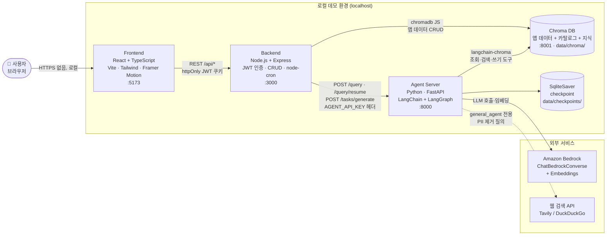
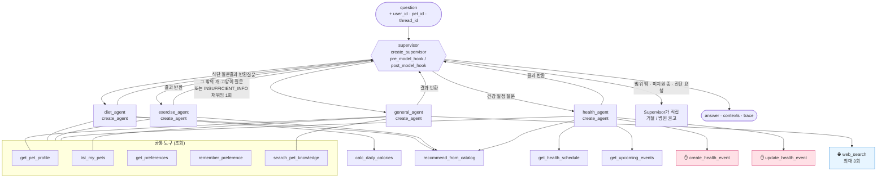
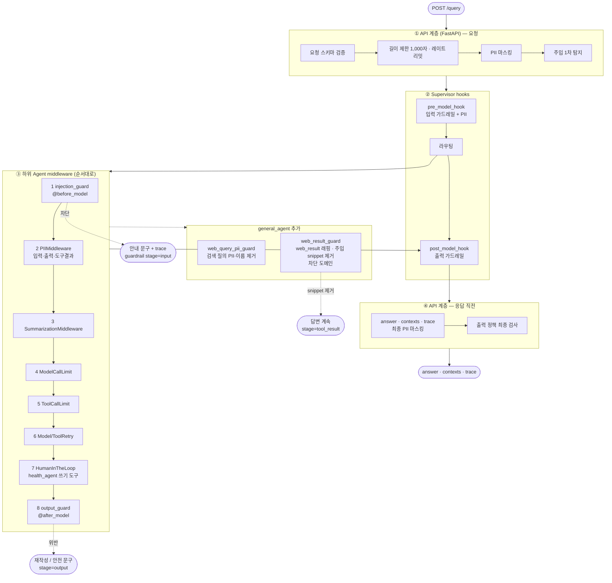
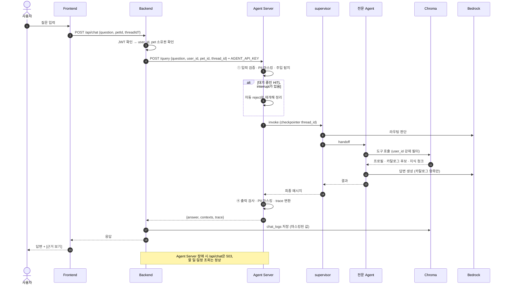
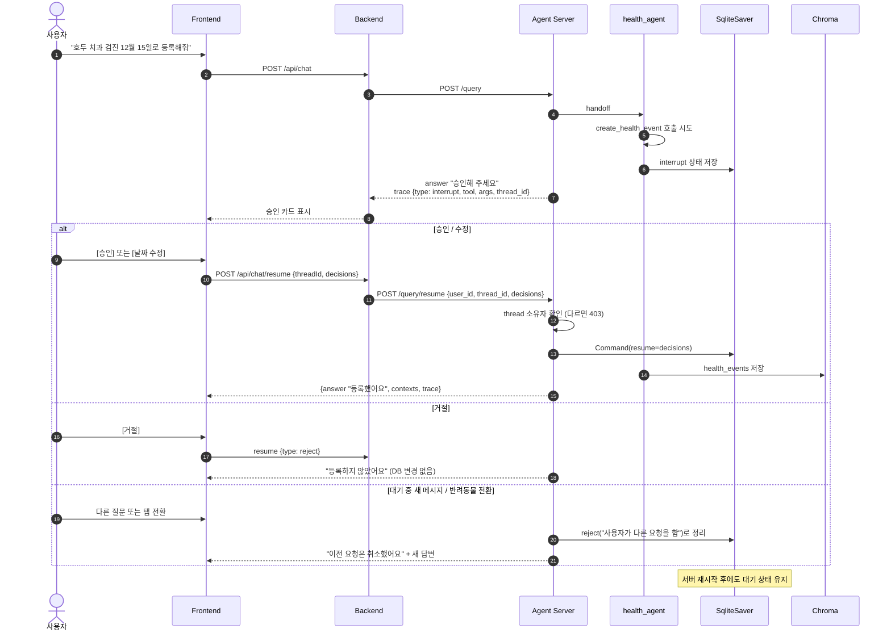
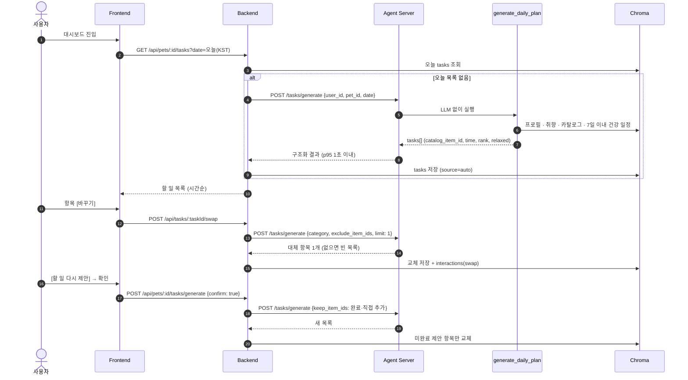
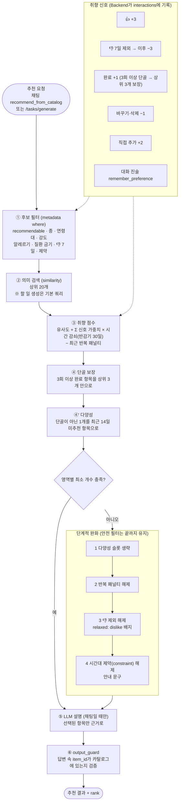
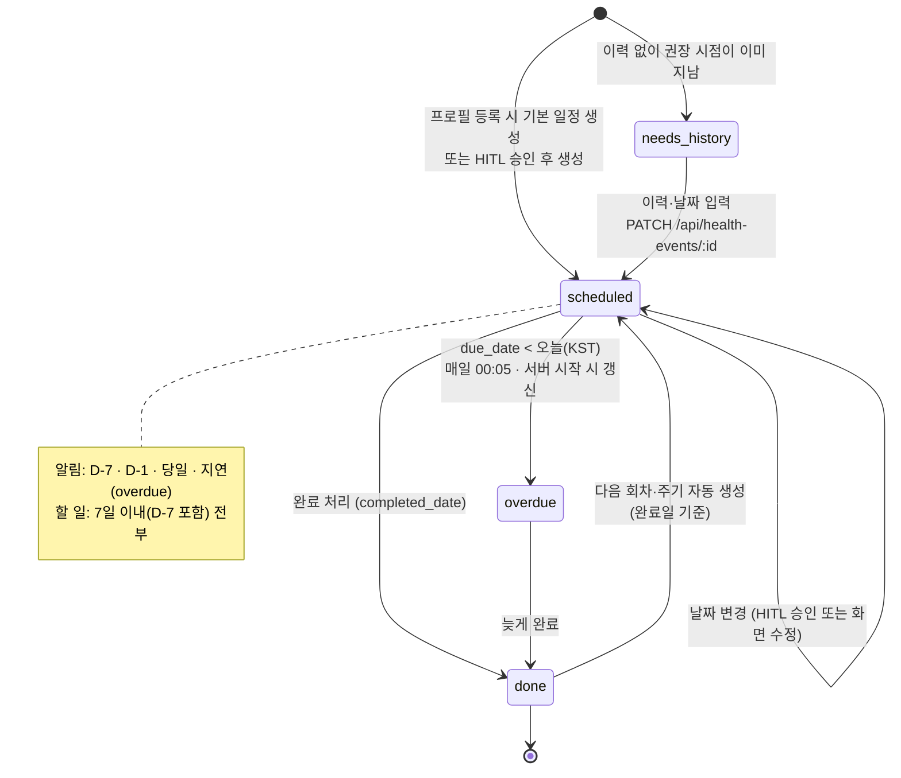
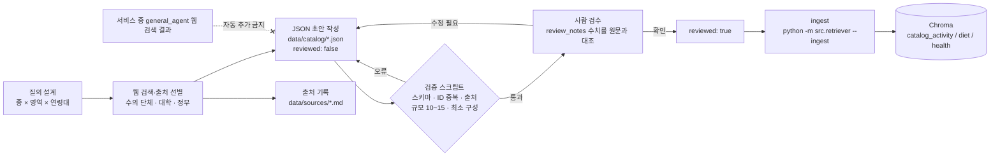
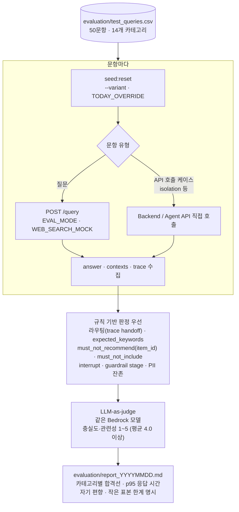

# DailyPet 기술 아키텍처 다이어그램

> [ARCHITECTURE.md](ARCHITECTURE.md)의 내용을 Mermaid로 그린 문서다. 내용이 다르면 ARCHITECTURE.md가 기준이다.
> 작성일: 2026-11-04

## 목차
1. [시스템 구성](#1-시스템-구성)
2. [Agent 그래프](#2-agent-그래프)
3. [가드레일·미들웨어 다층 방어](#3-가드레일미들웨어-다층-방어)
4. [채팅 요청 흐름 (POST /query)](#4-채팅-요청-흐름-post-query)
5. [HITL 승인 흐름](#5-hitl-승인-흐름)
6. [오늘의 할 일 자동 생성·교체](#6-오늘의-할-일-자동-생성교체)
7. [추천·개인화 파이프라인](#7-추천개인화-파이프라인)
8. [데이터 모델 (Chroma 컬렉션)](#8-데이터-모델-chroma-컬렉션)
9. [건강 일정 상태 변화](#9-건강-일정-상태-변화)
10. [카탈로그 구축 파이프라인](#10-카탈로그-구축-파이프라인)
11. [평가 흐름](#11-평가-흐름)

---

## 1. 시스템 구성

**규칙 요약**
- Frontend는 Backend만 호출한다. Backend는 LLM을 직접 호출하지 않는다.
- 추천 로직(카탈로그 필터 → 취향 점수)은 Agent Server(`src/tools.py`) 한 곳에만 있다.
- 웹 검색은 `general_agent`만 쓴다.

---

## 2. Agent 그래프

- ✋ 표시 도구는 `HumanInTheLoopMiddleware` 승인 대상이다.
- `general_agent`에는 쓰기 도구가 없다.

---

## 3. 가드레일·미들웨어 다층 방어

---

## 4. 채팅 요청 흐름 (POST /query)

---

## 5. HITL 승인 흐름

---

## 6. 오늘의 할 일 자동 생성·교체

---

## 7. 추천·개인화 파이프라인

---

## 8. 데이터 모델 (Chroma 컬렉션)

엔터티·필드·관계는 [ERD.md](ERD.md)에서 관리한다 (두 곳에 그리면 어긋나므로 이 문서에는 다시 그리지 않는다). 제약 조건은 [schema.md](../database/schema.md)를 참조한다.

- 앱 데이터: `users`, `pets`, `tasks`, `health_events`, `weight_logs`, `interactions`, `preferences`, `chat_logs`
- 카탈로그: `catalog_activity` / `catalog_diet` / `catalog_health` · RAG 지식: `pet_knowledge` · 체크포인트: SQLite `data/checkpoints/`
- 연쇄 삭제 순서: tasks → health_events → weight_logs → interactions → preferences → chat_logs + checkpoint → pets (→ users)

---

## 9. 건강 일정 상태 변화

---

## 10. 카탈로그 구축 파이프라인

---

## 11. 평가 흐름

