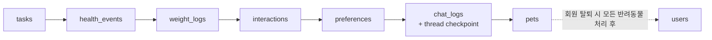

# ERD.md — DailyPet 데이터 모델

이 문서는 [ARCHITECTURE.md](ARCHITECTURE.md) 5장(데이터 모델)과 [USER_SCENARIO.md](USER_SCENARIO.md) 2장(시드 데이터)을 바탕으로 정리한 ERD다.

> **주의** — 저장소는 관계형 DB가 아니라 **Chroma 컬렉션**이다. 아래의 PK/FK는 논리적인 관계이고, DB가 강제하지 않는다.
> 유일성(이메일), 참조 무결성, 연쇄 삭제는 **백엔드 코드**가 보장한다 (ARCHITECTURE.md 5장 "연쇄 삭제").
> 앱 데이터는 `documents`에 JSON 문자열, `metadatas`에 필터용 필드를 둔다. 아래 속성은 metadata 기준이다.

---

## 1. 전체 ERD

```mermaid
erDiagram
    USERS ||--o{ PETS : "소유"
    USERS ||--o{ PREFERENCES : "사용자 공통 취향 (pet_id = null)"
    USERS ||--o{ CHAT_LOGS : "대화 소유 (thread 소유권)"

    PETS ||--o{ TASKS : "오늘의 할 일"
    PETS ||--o{ HEALTH_EVENTS : "건강 일정"
    PETS ||--o{ WEIGHT_LOGS : "체중 기록"
    PETS ||--o{ INTERACTIONS : "취향 신호"
    PETS ||--o{ PREFERENCES : "반려동물별 취향"
    PETS ||--o{ CHAT_LOGS : "대화 대상"

    CATALOG_ACTIVITY |o--o{ TASKS : "추천 근거 (activity)"
    CATALOG_DIET |o--o{ TASKS : "추천 근거 (diet)"
    CATALOG_HEALTH ||--o{ HEALTH_EVENTS : "일정 기준 항목"
    HEALTH_EVENTS |o--o{ TASKS : "건강 할 일 (D-day)"

    CATALOG_ACTIVITY |o--o{ INTERACTIONS : "신호 대상"
    CATALOG_DIET |o--o{ INTERACTIONS : "신호 대상"
    CATALOG_ACTIVITY |o--o{ PREFERENCES : "target (카탈로그 ID일 때)"
    CATALOG_DIET |o--o{ PREFERENCES : "target (카탈로그 ID일 때)"

    CHAT_LOGS }o--|| CHECKPOINTS : "thread_id (SQLite)"

    USERS {
        string id PK "usr_ + sha256(소문자 이메일) 앞 12자리"
        string email UK "소문자, 유일 (id로 구조적 보장)"
        string password_hash "원문 저장 금지"
        string nickname
        string created_at
    }

    PETS {
        string id PK "pet_xxx"
        string user_id FK "USERS.id"
        string name
        string species "dog | cat"
        string breed
        string sex "성별"
        boolean neutered
        string size "small | medium | large"
        string birth_date "YYYY-MM-DD"
        float weight_kg "개 0.5~100 / 고양이 0.3~15"
        string activity_level
        string allergies "예: chicken"
        string conditions "질환 태그, 예: joint_disease"
        string memo "자유 메모"
        json default_times "급여·산책 기본 시간대"
    }

    TASKS {
        string id PK "task_xxx"
        string user_id FK "USERS.id"
        string pet_id FK "PETS.id"
        string date "YYYY-MM-DD (KST)"
        string time "HH:MM, 선택"
        string category "diet | activity | health | custom"
        string source "auto | chat | custom"
        string catalog_item_id FK "CATALOG_*.item_id, custom이면 null"
        string health_event_id FK "HEALTH_EVENTS.id, health일 때"
        string title
        boolean done
    }

    HEALTH_EVENTS {
        string id PK "evt_xxx"
        string user_id FK "USERS.id"
        string pet_id FK "PETS.id"
        string catalog_item_id FK "CATALOG_HEALTH.item_id"
        string type "vaccine | checkup | deworming | heartworm | external_parasite | dental | other"
        int dose_no "접종 회차, 선택"
        string due_date "YYYY-MM-DD"
        int due_ts "비교용 epoch"
        string status "scheduled | done | overdue | needs_history"
        string completed_date "다음 주기 계산 기준"
    }

    WEIGHT_LOGS {
        string id PK "wt_xxx"
        string user_id FK "USERS.id"
        string pet_id FK "PETS.id"
        string date "YYYY-MM-DD"
        float weight_kg
    }

    INTERACTIONS {
        string id PK "int_xxx"
        string user_id FK "USERS.id"
        string pet_id FK "PETS.id"
        string catalog_item_id FK "CATALOG_*.item_id"
        string signal "like | dislike | complete | swap | remove | custom"
        string created_at
    }

    PREFERENCES {
        string id PK "pref_xxx"
        string user_id FK "USERS.id"
        string pet_id FK "PETS.id, 사용자 공통이면 null"
        string kind "like | dislike | constraint"
        string target "카탈로그 item_id 또는 자유 텍스트"
        string note
        float score
        string excluded_until "dislike 제외 기한"
        string updated_at
    }

    CHAT_LOGS {
        string id PK "log_xxx"
        string user_id FK "USERS.id"
        string pet_id FK "PETS.id"
        string thread_id "thr_{user_id}_{pet_id}_{uuid}"
        string created_at
        json document "PII 마스킹된 question / answer / trace"
    }

    CHECKPOINTS {
        string thread_id PK "LangGraph SqliteSaver (data/checkpoints/)"
    }

    CATALOG_ACTIVITY {
        string item_id PK "act_{species}_..."
        string name
        string category "activity"
        string species "dog | cat (리스트)"
        string age_groups "junior | adult | senior (리스트)"
        string intensity "low | medium | high"
        json duration_min "min, max"
        string frequency
        string contraindications "질환 태그 (리스트)"
        string tags "indoor, senior_ok ... (리스트)"
        boolean recommendable
        json sources "title, publisher, url, accessed"
        boolean reviewed "true만 적재"
    }

    CATALOG_DIET {
        string item_id PK "diet_{species}_..."
        string name
        string category "diet"
        string subtype "feeding_guide | treat | topping | hydration | weight_management | harmful_food"
        string species
        string age_groups
        string serving_guide
        string kcal_note
        string allergens "(리스트)"
        string contraindications
        string tags
        boolean recommendable "harmful_food는 false"
        json sources
        boolean reviewed
    }

    CATALOG_HEALTH {
        string item_id PK "hc_{species}_..."
        string name
        string category "health"
        string type "vaccine | checkup | deworming | heartworm | external_parasite | dental | other"
        string species
        string age_groups
        boolean core
        boolean legal_required_kr
        json dose_schedule "dose_no, at_age_weeks / after_prev_weeks"
        int booster_interval_days
        int interval_days
        int start_age_weeks
        boolean recommendable
        json sources
        boolean reviewed
    }

    PET_KNOWLEDGE {
        string id PK "자동 생성"
        string source
        string species
        string category
        string document "RAG 지식 청크 (임베딩)"
    }
```

---

## 2. 컬렉션 분류

| 구분 | 컬렉션 | 임베딩 | 접근 주체 | 시드 리셋 대상 |
|------|--------|--------|-----------|----------------|
| 계정 | `users` | 더미 | Backend만 | ✅ |
| 앱 데이터 | `pets`, `tasks`, `health_events`, `weight_logs`, `interactions`, `preferences`, `chat_logs` | 더미 (`get(where=...)` 조회) | Backend, Agent 도구 (`user_id` 범위 강제) | ✅ |
| 카탈로그 | `catalog_activity`, `catalog_diet`, `catalog_health` | 사용 | Agent (추천·검색) | ❌ |
| 지식 | `pet_knowledge` | 사용 | Agent (RAG) | ❌ |
| 체크포인트 | SQLite `data/checkpoints/` (Chroma 아님) | — | Agent (LangGraph) | ✅ |

- `PET_KNOWLEDGE`는 다른 엔터티와 키로 연결되지 않는 독립 컬렉션이라 1장 관계선에서 뺐다.
- 카탈로그와 앱 데이터 사이의 관계(`catalog_item_id`)는 컬렉션을 넘나드는 **논리 참조**다. 출력 가드레일이 추천 결과의 ID가 실제 카탈로그에 있는지 검증한다.

## 3. 관계·제약 규칙

| 규칙 | 내용 | 근거 |
|------|------|------|
| 소유권 | 모든 앱 데이터는 `user_id`를 갖고, 조회 시 `where`에 `user_id`를 강제한다. `pet_id`는 같은 사용자 소유인지 확인한다. | ARCHITECTURE 3.7 |
| 이메일 유일성 | `users.id` = `usr_` + sha256(소문자 이메일) 앞 12자리 → 중복 저장 불가 | ARCHITECTURE 5 |
| 취향 범위 | `preferences.pet_id`가 null이면 사용자 공통 취향 (예: "놀이·산책은 19:00 이후") | ARCHITECTURE 5, USER_SCENARIO 2.1 |
| 할 일 출처 | `tasks.category`가 diet/activity면 `catalog_item_id`, health면 `health_event_id`, custom이면 둘 다 없음 | ARCHITECTURE 4.1.2 |
| 건강 일정 상태 | 매일 KST 00:05 스캔: `due_date < today && scheduled` → `overdue`. 이력 없이 지난 일정은 `needs_history` | ARCHITECTURE 5, 6 |
| 다음 주기 | 카탈로그 `dose_schedule` / `booster_interval_days` / `interval_days` + 실제 `completed_date`로 계산 | ARCHITECTURE 5 |
| thread 소유권 | `chat_logs.thread_id` ↔ 소유자 `user_id`. resume·기록 조회 시 소유자 불일치면 403 | ARCHITECTURE 3.7 |
| 카탈로그 적재 | `reviewed: true`인 항목만 적재. `recommendable: false`는 추천 후보에서 항상 제외 | CLAUDE.md 4.5.1 |

## 4. 연쇄 삭제 순서

Chroma에는 트랜잭션이 없으므로 백엔드가 아래 순서로 지운다. 중간에 실패하면 백엔드 시작 시 참조가 끊긴 데이터를 정리한다.

