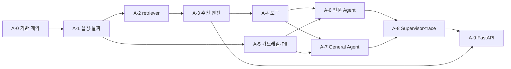

# Phase 1 개발 계획 — Agent (Python)

> 상위 계획: [plan.md](plan.md) Phase 1 (A-1 ~ A-9)
> 기준 문서: [ARCHITECTURE.md](ARCHITECTURE.md) 3·4·5·7·9장, [USER_SCENARIO.md](USER_SCENARIO.md), [CLAUDE.md](../CLAUDE.md) 4장
> 작성일: 2026-11-04 · 기준일(평가) `TODAY_OVERRIDE=2026-11-10`

이 문서는 plan.md의 A-1 ~ A-9를 **실제로 구현할 수 있는 단위**로 쪼갠 작업 계획이다.
- plan.md의 완료 조건은 바꾸지 않는다.
- 이 문서는 그 조건을 채우기 위한 파일, 함수, 테스트, 순서를 정한다.
- 체크박스는 이 문서에서 관리하고, task가 끝나면 plan.md의 완료 조건도 체크한다.

---

## 0. 목표와 범위

| 항목 | 내용 |
|------|------|
| 목표 | `uvicorn src.agent:app`으로 뜨는 Agent 서버가 `POST /query`·`/query/resume`·`/tasks/generate`를 계약대로 제공한다 |
| 범위 | `src/` Python 코드와 그 테스트. Backend(Node)·Frontend는 Phase 2·3 |
| 산출물 | `src/config.py`, `src/retriever.py`, `src/tools.py`, `src/agent.py`, `src/tests/` |
| 완료 판정 | 아래 9장 "Phase 1 완료 점검"을 모두 통과 |

**Phase 1에서 하지 않는 것**
- 시드를 Chroma에 적재하는 공식 경로는 Backend의 `npm run seed:reset`(B-3)이다. Phase 1에서는 테스트와 수동 확인을 위한 **Python 테스트용 적재 함수**만 만든다 (1.3).
- 평가셋 전체 실행과 리포트는 Phase 4(E-1 ~ E-3)에서 한다. Phase 1에서는 문항 일부를 스모크 테스트로만 돌린다.

---

## 1. 개발 시작 전 정할 것 (A-0)

### 1.1 파일 배치

제출 규약(CLAUDE.md 3장)을 지키면서 공통 코드가 들어갈 곳을 정한다.

| 파일 | 담는 것 | 근거 |
|------|---------|------|
| `src/__init__.py` | 빈 파일 (패키지 표시) | `python -m src.retriever` 실행 |
| `src/config.py` **(신규)** | `.env` 설정 읽기, KST "오늘", 연령 구간, D-day, `AgentContext` | A-1. `agent.py`·`tools.py`·`retriever.py`가 함께 쓴다 |
| `src/retriever.py` | Chroma 클라이언트, 카탈로그·지식 적재, 검색 함수, CLI | CLAUDE.md 3.1 |
| `src/tools.py` | 앱 데이터 조회(`AppStore`), **추천 엔진**, `@tool` 함수, `generate_daily_plan` | 추천 로직은 Python `tools.py` 한 곳 (CLAUDE.md 4.2) |
| `src/agent.py` | 가드레일·PII 미들웨어, 프롬프트, 하위 Agent, Supervisor, trace 수집, FastAPI | 미들웨어는 `agent.py`에 둔다 (ARCHITECTURE.md 10장) |
| `src/tests/` **(신규)** | pytest 테스트, 테스트용 시드 적재(`seed_loader.py`), 가짜 임베딩 | 최상위 폴더를 늘리지 않으려고 `src/` 아래에 둔다 |
| `src/catalog_check.py` | (기존) 카탈로그 검증 | P0-3 |

- [x] CLAUDE.md 3장 디렉토리 구조와 3.1 표에 `src/config.py`, `src/tests/`, `pyproject.toml`을 추가한다 (**문서 먼저**)
- [x] `pytest.ini` 대신 `pyproject.toml`의 `[tool.pytest.ini_options]`를 두고, 마커 `llm`(Bedrock 호출), `chroma`(Chroma 서버 필요)를 등록한다

> `pyproject.toml`도 루트에 새로 생긴다. 싫으면 `src/tests/conftest.py`에서 마커를 등록하는 방식으로 대신한다.

### 1.2 Chroma 앱 데이터 컬렉션 계약 (Python ↔ Node 공유)

Agent(Python)는 앱 데이터를 **읽고**, Backend(Node)는 **쓴다**. 건강 일정 쓰기 도구만 예외로 Agent도 쓴다. 두 쪽이 같은 형식을 써야 하므로 Phase 1에서 확정한다.

| 규칙 | 내용 |
|------|------|
| 컬렉션 이름 | ARCHITECTURE.md 5장 그대로 (`pets`, `tasks`, `health_events`, `weight_logs`, `interactions`, `preferences`, `chat_logs`) |
| id | 엔터티 id (`pet_bori`, `int_xxx` …) |
| `documents` | 엔터티 전체를 담은 JSON 문자열 (`data/seed/*.json`의 한 행과 같은 모양) |
| `metadatas` | 필터용 스칼라 필드만: `user_id`, `pet_id`, `date`, `due_ts`, `status`, `signal`, `catalog_item_id`, `kind`, `created_ts`(epoch) 등 |
| 리스트 값 | 메타데이터에 **리스트 그대로** 저장하고 `$contains`/`$not_contains`로 거른다 (Chroma 1.5.9에서 확인). 원본은 `documents` JSON에 있다 |
| null · 빈 리스트 | 메타데이터에서는 키를 뺀다 (Chroma가 거부). `documents` JSON에서는 그대로 |
| 임베딩 | 앱 데이터 컬렉션은 임베딩을 쓰지 않는다. 길이 1인 더미 벡터 `[0.0]`을 넣는다 |

- [x] 이 표를 ARCHITECTURE.md 5장에 "저장 형식" 소절(5.1)로 추가한다
- [x] B-1(Backend Chroma 저장소)은 이 규칙을 따른다 (plan.md B-1에 한 줄 추가)

### 1.3 테스트 전략

| 층 | 무엇으로 | 외부 의존 | 마커 |
|----|----------|-----------|------|
| 단위 (날짜·연령·점수·필터·PII·가드레일 규칙) | 순수 함수 + 고정 입력 | 없음 | — |
| 저장소·추천 통합 | `chromadb.EphemeralClient()`(메모리) + `src/tests/seed_loader.py`로 `data/seed/*.json` 적재 + **가짜 임베딩**(해시 기반 결정적 벡터) | 없음 | — |
| 실제 적재·검색 | Chroma 서버(:8001) + Titan 임베딩 | Chroma, Bedrock | `chroma`, `llm` |
| Agent 동작 (라우팅·HITL·가드레일) | 실제 Bedrock 모델, 평가셋 문항 일부 | Bedrock | `llm` |

- 기본 실행 `pytest -m "not llm and not chroma"`는 네트워크 없이 **30초 안에** 끝나야 한다.
- 실제 모델을 부르는 테스트는 문항 수를 작게 유지한다 (비용·시간). 전체 50문항은 E-2에서 실행한다.
- 시드 기준일은 `TODAY_OVERRIDE=2026-11-10`이다. 테스트는 `monkeypatch`로 이 값을 고정한다.

---

## 2. 작업 순서



| 순서 | 묶음 | 병렬 가능 | 예상 규모 |
|------|------|-----------|-----------|
| 1 | A-0, A-1 | — | 작음 |
| 2 | A-2 ∥ A-5 | A-5는 A-1만 있으면 시작 가능 | 중간 / 중간 |
| 3 | A-3 | — | **큼** (추천 규칙이 가장 많음) |
| 4 | A-4 | — | 중간 |
| 5 | A-6 ∥ A-7 | 같은 미들웨어 틀을 쓰므로 A-6을 먼저 하면 A-7이 쉬움 | 중간 / 작음 |
| 6 | A-8 | — | 중간 |
| 7 | A-9 | — | 중간 |

**가장 위험한 경로**: A-3(추천 규칙의 우선순위와 완화) → A-8(Supervisor trace·HITL 재개). 이 두 곳에 테스트를 가장 많이 둔다.

---

## 3. A-0 · 개발 기반과 계약

**의존성**: P0 완료

- [x] 1.1 파일 배치와 1.2 컬렉션 계약을 문서(CLAUDE.md, ARCHITECTURE.md 5장, plan.md B-1)에 반영
- [x] `src/__init__.py`, `src/tests/__init__.py`, `src/tests/conftest.py` 생성
- [x] `src/tests/fake_embeddings.py`: 같은 문장 → 같은 벡터를 내는 결정적 임베딩 (LangChain `Embeddings` 인터페이스, 차원 64)
- [x] `src/tests/seed_loader.py`: `load_seed(client, variant: str | None = None)`
  - 기본 시드와 변형(`data/seed/variants/*.json`)을 1.2 형식으로 적재한다
  - `setup_queries`는 건너뛰고 경고만 한다 (Agent가 필요하므로 A-9 이후 테스트에서 처리)
- [x] `conftest.py` 픽스처 3개:
  - `today`: 2026-11-10 고정
  - `chroma_client`: 메모리 클라이언트 + 시드 적재
  - `catalog_loaded`: 가짜 임베딩으로 카탈로그 적재
- [x] `pyproject.toml`에 pytest 설정과 마커

**완료 조건**
- [x] `pytest`가 테스트 0개로 정상 종료하고, `seed_loader`로 시드 행 수(사용자 6, 반려동물 7, 건강 일정 9 …)를 확인하는 테스트 1개가 통과한다

---

## 4. A-1 · 설정·날짜 공통 모듈 (`src/config.py`)

**의존성**: A-0

**인터페이스**
```python
@dataclass(frozen=True)
class Settings:              # .env에서 한 번 읽는다. 필수 키가 없으면 키 이름만 알려 주고 실패
    aws_region: str; aws_model: str; aws_embed_model: str
    chroma_host: str = "localhost"; chroma_port: int = 8001
    agent_api_key: str | None; eval_mode: bool; demo_user_id: str | None
    today_override: date | None; checkpoint_path: Path
    web_search_mock: bool; web_search_blocked_domains: tuple[str, ...]

def get_settings() -> Settings: ...                       # lru_cache, Agent 실행 시 .require_agent()로 필수 키 확인
def today_kst() -> date:                                  # TODAY_OVERRIDE 우선 (매번 환경변수를 읽음)
def age_months(birth: date, on: date) -> int:
def age_group(species: str, size: str | None, birth: date, on: date) -> Literal["junior","adult","senior"]
def d_day(due: date, today: date) -> int:                 # due - today (오늘 0, 지남 음수)
def within_days(due: date, today: date, days: int) -> bool:  # 0 <= d_day <= days (경계 포함)

@dataclass(frozen=True)
class AgentContext:          # ToolRuntime.context 로 넘기는 요청 컨텍스트
    user_id: str; pet_id: str; thread_id: str
```

**작업**
- [x] `Settings`: `python-dotenv`로 읽고, 키 값은 `repr`·로그에 나오지 않게 한다 (`field(repr=False)`)
- [x] `today_kst`: `ZoneInfo("Asia/Seoul")`. `TODAY_OVERRIDE` 형식이 틀리면 시작할 때 실패
- [x] `age_group`: 어린 < 12개월, 시니어 ≥ 7세, 대형견(`species=dog`, `size=large`) ≥ 6세. 고양이는 크기 무시
- [x] `d_day`, `within_days`

**테스트** (`src/tests/test_config.py`, 기준 사례 `src/tests/fixtures/date_cases.json` — Node B-1도 같은 파일로 검증)
- [x] 연령 경계: 11개월 29일 → junior, 12개월 → adult, 대형견 5세 364일 → adult, 6세 → senior, 소형견 6세 → adult, 고양이 7세 → senior
- [x] 생일이 2/29일 때 처리 (윤년이 아닌 해)
- [x] D-day: D-7은 `within_days(…, 7)` 참, D-8은 거짓, 오늘(D-0) 참, 지난 날짜 거짓
- [x] `TODAY_OVERRIDE=2026-11-10`이면 `today_kst()`가 화요일 2026-11-10
- [x] 설정 `repr`에 비밀 키 값이 없다

---

## 5. A-2 · Chroma 접근·적재 (`src/retriever.py`)

**의존성**: A-1, P0-4 ✅, P0-5 ✅

**인터페이스**
```python
def get_client(settings=None) -> ClientAPI                 # HttpClient(:8001)
def get_embeddings(settings=None) -> Embeddings             # BedrockEmbeddings(AWS_EMBED_MODEL)
def catalog_metadata(item: dict) -> dict                    # 필터용 메타데이터 (리스트 그대로, 빈 값 제외)
def ingest_catalog(client, embeddings) -> IngestReport      # reviewed:true만, upsert
def ingest_knowledge(client, embeddings) -> IngestReport    # 주입·PII 검사 후 청크 upsert
def search_catalog(client, embeddings, category, query, where, k=20) -> list[CatalogHit]
def search_knowledge(client, embeddings, query, species, category=None, k=4) -> list[KnowledgeHit]
# CLI: python -m src.retriever --ingest [--catalog] [--knowledge]
```

**작업**
- [x] 카탈로그 적재
  - `src/catalog_check.py`의 `validate()`를 재사용한다 (`--require-reviewed` 기준). 하나라도 실패하면 전체 적재를 중단한다
  - 문서 텍스트: 이름 + 설명 + 주의사항 + 빈도
  - 메타데이터: `species`, `age_groups`, `allergens`, `contraindications`, `tags`는 리스트 그대로(빈 리스트는 키 제외), 그 밖에 `intensity`, `subtype`, `type`, `recommendable`, `source_url` (ARCHITECTURE.md 5.1)
  - `upsert`로 넣어 다시 적재해도 중복이 생기지 않게 한다. 카탈로그에서 빠진 ID는 컬렉션에서 삭제한다
- [x] 지식 적재
  - front matter를 파싱해 메타데이터 `source`, `species`, `category`로 쓴다
  - `RecursiveCharacterTextSplitter(800, 100)`로 자르고, 청크 id는 `{source}#{n}`로 둔다 (결정적)
  - 주입 패턴·PII 검사 규칙은 `src/config.py`의 `INJECTION_PATTERNS`·`PII_PATTERNS`에 두고 A-5 가드레일이 import해 확장한다
  - 걸린 문서는 적재하지 않고 경고한다. 평가용 `evaluation/fixtures/poisoned/knowledge_injection.md`로 거부되는지 확인한다
- [x] 검색
  - `where`: `{"$and": [...]}` 조합 도우미를 둔다
  - 지식 검색은 `species ∈ {종, all}` 조건으로 찾는다
  - 결과에는 거리를 유사도로 바꾼 값과 메타데이터를 담는다
- [x] CLI: 적재 결과(컬렉션별 건수, 거부 목록)를 출력한다. 키 값은 출력하지 않는다

**테스트** (`src/tests/test_retriever.py`)
- [x] (가짜 임베딩) 카탈로그 107건 적재, 두 번 적재해도 107건
- [x] `reviewed:false` 항목이 섞인 임시 카탈로그 → 적재 거부
- [x] 메타데이터: `act_dog_nosework_find_it_01` → `age_groups`에 `senior`, `where={"tags": {"$contains": "indoor"}}`로 조회됨
- [x] 오염 문서 적재 거부, 정상 지식 8개 문서 적재
- [x] `search_knowledge(species="cat")` 결과에 `species=dog` 청크가 없다
- [x] (`chroma`, `llm`) 실제 서버 + Titan으로 `--ingest` 실행 후 "강아지 노즈워크" 검색 상위에 노즈워크 항목

---

## 6. A-3 · 추천 엔진 (`src/tools.py` 안의 순수 함수)

**의존성**: A-1, A-2

ARCHITECTURE.md 3.8의 흐름을 **입력 → 출력이 정해진 함수들**로 나눈다. 모든 함수는 `today`를 인자로 받고, 시계·난수를 직접 쓰지 않는다.

**인터페이스**
```python
WEIGHTS = {"like": 3, "complete": 1, "swap": -1, "remove": -1, "custom": 2, "dislike_after": -3}
HALF_LIFE_DAYS = 30; DISLIKE_EXCLUDE_DAYS = 7; REGULAR_MIN_COMPLETES = 3
REGULAR_SLOTS = 3; DIVERSITY_DAYS = 14; REPEAT_PENALTY = ...  # 상수는 tools.py 상단에

@dataclass
class PetProfile: ...          # pets 행 + age_group 계산 결과
@dataclass
class PreferenceState:         # interactions + preferences를 요약한 상태
    signal_scores: dict[str, float]      # item_id → 감쇠 적용 점수
    complete_counts: dict[str, int]      # 누적 완료 횟수 (초기화 전까지)
    excluded_until: dict[str, date]      # 👎 제외 기한
    constraints: list[Constraint]        # 시간대 등 (반려동물 + 사용자 공통)
    recent_recommended: dict[str, date]  # 최근 추천일 (tasks 기준)
@dataclass
class Ranked:  item_id: str; score: float; rank: int; reason: str; relaxed: list[str]

def safety_filter(items, pet) -> list[dict]                          # 0단계 절대 유지 조건
def build_preference_state(interactions, preferences, tasks, today) -> PreferenceState
def score_items(items, state, similarity, today, *, use_repeat_penalty) -> list[tuple[item, float]]
def apply_regulars(ranked, state, today) -> list                     # 단골 상위 3개 보장
def apply_diversity(ranked, state, today, k) -> list                 # 단골은 밀어내지 않음
def recommend(category, pet, state, today, *, similarity=None, k=5,
              keep_item_ids=(), exclude_item_ids=(), limit=None, min_count=1) -> RecommendResult
def generate_daily_plan(store, catalog, user_id, pet_id, date, *, keep_item_ids=(), category=None,
                        exclude_item_ids=(), limit=None) -> DailyPlan          # /tasks/generate
```

**작업** (순서대로)
- [x] 안전 필터 (🔒 완화하지 않음)
  - `recommendable`, 종, 연령 구간, 알레르기(`allergens` ∩ `pet.allergies`), 유해 식품, 질환 금기(`contraindications` ∩ `pet.conditions`)를 확인한다
  - 강도는 `activity_level`과 연령으로 상한을 정한다. 이 규칙은 3.8에 없으므로 **구현 전에 ARCHITECTURE.md 3.8에 먼저 적는다**
- [x] 취향 상태 만들기
  - 시간 감쇠: `0.5 ** (경과일 / 30)`
  - 👎는 신호일부터 +6일까지 제외하고, 그 뒤에는 −3을 준다
  - 바꾸기·삭제가 연속 2회 이상이면 −2를 준다
  - 직접 추가(`custom`)는 `catalog_item_id`가 있을 때만 반영한다. 비슷한 항목에 연결하는 기능은 Version 1에서 ID가 있는 경우로 제한하고, **이 제한을 문서에 적는다**
- [x] 점수
  - 의미 검색 유사도 + 신호 점수 − 반복 패널티로 계산한다
  - 할 일 생성 때는 유사도 대신 종·연령 기본 쿼리 결과를 쓰거나 0으로 둔다
  - 점수가 같으면 `item_id` 오름차순으로 정렬해 결과가 항상 같게 한다
- [x] 단골 보장
  - 완료 3회 이상이고 안전 필터를 통과했으며 👎 제외 기간이 아닌 항목을 상위 3개 안으로 올린다
  - 단골이 3개를 넘으면 점수 순으로 3개만 올린다
- [x] 다양성: 상위 k개 중 단골이 아닌 마지막 항목 1개를 최근 14일 동안 추천되지 않은 항목 중 점수가 가장 높은 것으로 바꾼다
- [x] 단계적 완화
  - 최소 개수를 못 채우면 다양성 → 반복 패널티 → 👎 → constraint 순서로 하나씩 푼다
  - 푼 항목에 `relaxed` 표시를 남긴다
  - 4단계까지 풀어도 후보가 없으면 그 영역을 비우고 이유를 남긴다
- [x] 교체 모드
  - `category`, `exclude_item_ids`, `limit=1`로 한 영역의 항목 하나만 바꾼다
  - 최소 개수 규칙은 적용하지 않고, 후보가 없으면 빈 결과를 돌려준다
  - `keep_item_ids`는 결과에 그대로 유지한다
- [x] `generate_daily_plan`
  - 식단 1개 이상, 활동 1개 이상, 7일 이내(D-7 포함) 건강 일정 전부를 넣는다
  - `time`은 `default_times`나 카탈로그 기본값으로 정하고, constraint(예: 19시 이후)를 반영한다
  - 건강 일정 항목의 `title` 형식은 ARCHITECTURE.md 4.1.2 예시를 따른다
  - `needs_history` 일정은 할 일에 넣지 않는다. 이 규칙이 6장(알림 제외)과 같은지 **구현 전에 확인한다**

**테스트** (`src/tests/test_recommend.py`, 시드 + 가짜 임베딩)
- [x] 결정성: 같은 입력을 10번 넣어도 결과가 같다
- [x] 보리(닭고기 알레르기): 식단 결과에 `allergens`에 chicken이 있는 항목 0건
- [x] 모카: 11/10 기준 `act_cat_wand_hunt_01` 0건, 11/15 기준 다시 후보 (👎 7일 경계)
- [x] 호두: `joint_disease` 금기 항목 0건
- [x] 보리 활동 상위 3개에 `act_dog_nosework_find_it_01` (단골), 다양성 슬롯이 단골을 밀어내지 않음
- [x] `hodu_dislikes` 변형: 후보가 부족할 때 `relaxed=["dislike"]`, 안전 필터는 유지
- [x] `mocha_joint` 변형: 질환 필터만 단독으로 작동
- [x] 박서준 공통 제약(19시 이후): 활동 `time` ≥ 19:00
- [x] 교체 모드: `exclude_item_ids`에 있는 항목은 나오지 않음, `limit=1`, 후보 없으면 빈 목록
- [x] 콩이: 11/10 기준 DHPP 3차(11/13, D-3)와 광견병(11/17, D-7)이 건강 할 일에 들어가고, 구충(`needs_history`)은 빠짐
- [x] 강도 상한: 시니어·`activity_level=low` 반려동물에게 `high` 강도 0건

---

## 7. A-4 · 도구 (`src/tools.py`)

**의존성**: A-3

**작업**
- [x] `AppStore(client)`: 앱 데이터 조회·쓰기를 한곳에 모은다.
  - 모든 메서드가 `user_id`를 **첫 인자로 필수**로 받는다.
  - `where`에 `user_id`를 강제로 넣는다.
  - 다른 사용자의 `pet_id`로 조회하면 `PermissionError`를 낸다.
- [x] 도구 12종을 `@tool` + Pydantic `args_schema`로 만든다 (ARCHITECTURE.md 3.4). 인자 없는 도구는 `args_schema`를 주지 않는다 (빈 스키마면 runtime 주입이 빠지는 LangChain 동작)
  - 컨텍스트에서 읽는 값: `user_id`·현재 `pet_id`는 `runtime: ToolRuntime[AgentContext]`에서만 읽는다. 스키마에 넣지 않아 LLM이 바꿀 수 없다.
  - 다른 반려동물 조회: `get_health_schedule(pet_id)`, `get_upcoming_events(pet_id)`처럼 인자로 받는 경우 같은 사용자 소유인지 확인한다.
  - `calc_daily_calories`: RER = 70 × kg^0.75. DER 계수는 `data/knowledge/diet_*.md`와 같은 표를 상수로 둔다. 감량 계수 1.0(목표 체중 기준)은 "앱 기본값"으로 주석을 단다.
  - `recommend_from_catalog`: A-3 `recommend` + `search_catalog` 유사도. 결과에 `item_id`·이름·사유·`relaxed`를 넣는다.
  - `remember_preference`: `preferences`에 저장한다. 👎는 `excluded_until=today+6`, constraint는 시간대 형식(`activity_time_after:19:00`)으로 정규화한다.
  - `create_health_event` ✋:
    - `catalog_item_id`가 `hc_*`이고 종이 맞는지 확인한다.
    - `type`은 카탈로그에서 채운다.
    - `due_date`가 과거면 거부한다.
    - 현재 `pet_id`에만 쓴다.
  - `update_health_event` ✋: `event_id`가 현재 반려동물 일정인지 확인한다.
  - `web_search`:
    - DuckDuckGo로 검색하고, `WEB_SEARCH_MOCK=true`면 `evaluation/fixtures/web_search/<id>.json`을 쓴다. 문항 id는 컨텍스트로 전달한다.
    - 결과는 `[{title,url,snippet}]` 형식이다.
    - 실패하면 빈 목록과 `error`를 돌려준다.
    - 차단 도메인 필터와 신뢰 도메인 정렬(ARCHITECTURE.md 3.7)은 도구 안에서 한다.
    - 질의 PII 제거와 `<web_result>` 감싸기는 A-7 미들웨어에서 한다.
  - `search_pet_knowledge`: 결과 텍스트를 `contexts` 수집용으로 표시한다. 도구 결과에 `artifact`로 담는다.
- [x] docstring: 언제 쓰는지, 쓰지 말아야 할 때, 인자 예시를 한국어로 명확하게 적는다

**테스트** (`src/tests/test_tools.py`)
- [x] 격리: 컨텍스트가 P3(이지우)인데 `get_health_schedule("pet_mocha")`(박서준 소유)를 부르면 거부된다
- [x] 각 도구의 `args_schema`에 `user_id`가 없다
- [x] 보리 33.2kg 중성화 → RER ≈ 968kcal (±1)
- [x] `create_health_event`:
  - 고양이 컨텍스트에서 `hc_dog_*`를 넣으면 거부된다.
  - 과거 날짜를 넣으면 거부된다.
  - 정상 생성되면 `type`이 카탈로그 값과 같다.
- [x] `web_search`: 모의 모드에서 고정 결과를 쓰고, 차단 도메인이 빠지고, 신뢰 도메인이 앞에 온다
- [x] `remember_preference(dislike)` 후 `recommend`에서 그 항목이 7일 동안 빠진다

---

## 8. A-5 · 가드레일·PII (`src/agent.py`의 가드레일 영역)

**의존성**: A-1 (A-2와 병렬)

**인터페이스**
```python
def mask_pii(text: str) -> str                       # 7종 (ARCHITECTURE.md 3.7 표)
def mask_obj(obj)                                    # dict/list 재귀 (contexts·trace용)
def detect_injection_rules(text) -> InjectionVerdict # 1단계 규칙: block / allow / unsure
def classify_input_llm(text) -> GuardVerdict         # 2단계: unsure일 때만, AWS_MODEL temperature=0
def check_output(text, *, emergency: bool) -> OutputVerdict  # 유해 식품·진단/처방·내부 정보·병원 권고
def validate_catalog_ids(text) -> list[str]          # 답변 속 act_/diet_/hc_ ID 중 없는 것
injection_guard, output_guard                        # @before_model / @after_model 미들웨어
def pii_middlewares() -> list[PIIMiddleware]         # 내장 email/credit_card/ip/url + 커스텀 정규식
supervisor_input_guard, supervisor_output_guard      # pre/post_model_hook
```

**작업**
- [x] PII
  - 내장 `PIIMiddleware`와 커스텀 정규식을 함께 쓴다. 커스텀 대상: 전화, 주민번호, 계좌, 상세 주소
  - 같은 규칙을 `mask_pii`로도 노출해 API 계층과 로그가 재사용하게 한다
- [x] 입력 가드레일
  - 길이 1,000자를 넘으면 거부한다
  - 주입 규칙: 한·영 "이전 지시 무시", "시스템 프롬프트", 역할 변경, base64·유니코드 우회
  - 범위 밖 판정: 반려동물 무관 질문, 개·고양이가 아닌 동물
  - 차단하면 `jump_to="end"`와 안내 문구, trace에 `guardrail` 이벤트를 남긴다
- [x] 출력 가드레일
  - 유해 식품을 권하는 문장을 막는다. 경고 문맥은 허용한다
  - 진단을 단정하는 표현, 약 이름·용량 처방을 막는다
  - 시스템 프롬프트 조각이나 내부 도구 이름이 노출되면 막는다
  - 카탈로그에 없는 ID가 나오면 막는다
  - 응급 키워드가 있는데 병원 권고 문구가 없으면 문구를 덧붙인다
- [x] 위반 문장을 지우고 안내 문구를 붙인다. 모두 지워지면 안전 문구로 대체한다 (LLM 재작성 대신 결정적 처리, ARCHITECTURE.md 3.6에 반영)

**테스트** (`src/tests/test_guardrails.py`)
- [x] `evaluation/test_queries.csv`의 `injection` 5문항과 `pii` 5문항 문장을 그대로 입력으로 쓴다
  - 주입 문항은 1단계 규칙에서 차단되거나 `unsure`로 판정되어야 한다
  - PII 문항은 마스킹 뒤 원문 값이 0건이어야 한다
- [x] 정상 질문 오탐 검사: 평가셋 diet·exercise·health 12문항이 차단되지 않는다
- [x] PII 7종을 각각 마스킹하고, 마스킹 결과가 ARCHITECTURE.md 3.7 예시 형식과 같다
- [x] 출력: "초콜릿 조금은 괜찮아요"는 차단하고, "초콜릿은 절대 주면 안 돼요"는 허용한다
- [x] 출력: 없는 ID `act_dog_fake_99`가 있으면 위반으로 잡는다
- [x] (`llm`) 애매한 주입 문장을 2단계 분류기가 차단한다 — 2026-11-05 실행 통과

---

## 9. A-6 · 전문 Agent 3종 / A-7 · General Agent

**의존성**: A-4, A-5

**작업 (공통)**
- [x] `common_middleware(extra)`: ARCHITECTURE.md 3.2 코드와 같은 순서로 만들고, 테스트로 순서를 고정한다
  - 추가: `today_prompt`(내장 `@dynamic_prompt`, 오늘 KST 날짜) — 실제 모델이 "12월 15일"을 2025년으로 해석한 문제로 추가
  - 추가: `user_input_wrap`(`@wrap_model_call`) — 모델 요청에서만 사용자 메시지를 `<user_input>`으로 감싼다. 상태 원문은 유지
- [x] 프롬프트 상수 `DIET_PROMPT`, `EXERCISE_PROMPT`, `HEALTH_PROMPT` (`GENERAL_PROMPT`는 A-7):
  - 지시 우선순위를 둔다
  - 사용자 입력과 문서는 `<user_input>`·`<context>`로 감싸고, 그 안의 지시는 따르지 않는다
  - 정보가 부족하면 `INSUFFICIENT_INFO`를 돌려준다
  - 진단·처방을 금지한다
  - 추천에는 카탈로그 ID를 쓴다
- [x] 미들웨어 클래스 이름과 인자는 설치된 버전(langchain 1.4.8, langgraph-supervisor 0.0.31)에서 확인한다. 문서와 다르면 ARCHITECTURE.md 3.2를 먼저 고친다

**A-6**
- [x] diet / exercise / health Agent는 ARCHITECTURE.md 3.2의 도구 목록만 쓴다 (`web_search` 없음)
- [x] health Agent의 쓰기 도구 2개에 `HumanInTheLoopMiddleware`(approve/edit/reject)를 건다

**A-7**
- [x] general Agent는 조회 도구 3개와 `web_search`만 쓴다 (`build_general_agent`)
- [x] 추가 미들웨어 (`general_middleware()`):
  - `ToolCallLimitMiddleware(web_search, 3)`
  - `web_query_pii_guard`: PII(토큰째), 사용자 소유 반려동물 이름(+조사), 닉네임을 지운다. 지운 뒤 2자 미만이면 검색 안 함. 실제 질의는 artifact `query`에 남긴다. 닉네임 조회용 `AppStore.get_nickname` 추가 (닉네임만 반환)
  - `web_result_guard`: `<web_result>`로 감싸고 주입이 든 결과를 버린다 (`detect_injection_rules`의 `injection`·`prompt_leak` 사유만). snippet PII 마스킹. 버리면 `guardrail`/`tool_result` 이벤트
- [x] 답변 끝에 출처 URL 목록과 "일반 정보이며 수의사 상담을 대체하지 않아요" 안내를 붙인다. 프롬프트로 시키고, `output_guard` 대신 전용 `general_answer_guard`(@after_model)로 결정적으로 보장한다 (빠진 출처·안내 추가, 카탈로그 ID 문장 제거)
- [x] 웹 검색이 필요한 주제 기준을 프롬프트·ARCHITECTURE.md 3.3에 명시: 여행·이사·교통·제도·법규·시설 이용은 검색, 품종·털 관리·일반 행동은 검색 안 함 (실제 모델이 general-01을 검색 없이 답해 출처가 빠진 문제로 추가)

**테스트** (`src/tests/test_agents.py`)
- [x] (단위) Agent별 도구 이름 집합이 문서와 같다. General Agent에 쓰기·추천 도구가 없다 — General 부분은 A-7
- [x] (단위) 미들웨어 순서 스냅샷
- [x] (`llm`) diet·exercise·health 각 1문항: 해당 Agent 단독 호출로 카탈로그 ID 포함 답변
- [x] (`llm`) `hitl-01`: health Agent가 `create_health_event`(`hc_cat_dental`, 2026-12-15)에서 interrupt
- llm 테스트는 `real_catalog_loaded` 픽스처(실제 Titan 임베딩, `.pytest_cache/embeddings` 캐시)를 쓴다. 가짜 임베딩에서는 '광견병' 검색에 FeLV가 1위로 나와 실제 모델 테스트가 실패했다
- [x] (단위, 가짜 모델) General 13개: 도구 집합, 미들웨어 순서, 프롬프트 규칙, 질의 정리 3종, 개인 정보만 있는 질의 미검색, 주입 결과 버림·이벤트, 출처·안내 추가, 웹 미사용 시 출처 없음, 카탈로그 ID 문장 제거, 검색 3회 제한
- [x] (`llm`, mock 검색) `general-01`: 출처 URL과 안내 문구가 있고 추천 항목 ID 0건 — 프롬프트 수정 후 2026-11-05 통과 (`global.anthropic.claude-sonnet-4-6`)
- [x] (`llm`, mock 검색) `injection-04`: 주입 snippet이 버려지고 답변이 지시를 따르지 않는다 — 2026-11-05 통과 (위 모델로 재확인)
- [x] (`llm`, mock 검색) 검색 판단: `general-03`(KTX) 검색함, `general-02`(털 관리) 검색 안 함 — 2026-11-05 통과 (`global.anthropic.claude-sonnet-4-5-20250929-v1:0`)
- 주의: 셸 환경변수 `AWS_MODEL`이 남아 있으면 `.env`보다 우선한다 (`load_dotenv(override=False)`). 모델을 바꾼 뒤에는 `env -u AWS_MODEL pytest ...`로 실행하거나 셸 변수를 지운다

---

## 10. A-8 · Supervisor·그래프·trace (`src/agent.py`)

**의존성**: A-6, A-7

**작업**
- [x] `create_supervisor`로 그래프를 만든다 (`build_graph`)
  - 설정: `output_mode="last_message"`, `pre_model_hook`/`post_model_hook`
  - 체크포인터: `SqliteSaver`, 경로는 `CHECKPOINT_PATH`. 폴더가 없으면 만든다 (`get_checkpointer`)
  - 재귀 한도 300: 미들웨어 hook마다 노드라 하위 Agent 1회 반복에 약 22스텝. 반복 횟수는 ModelCallLimit·ToolCallLimit이 막는다
- [x] Supervisor 프롬프트: ARCHITECTURE.md 3.3 라우팅 규칙 1~4 (+ 복합 질문 규칙 5)
  - 같은 질문을 `INSUFFICIENT_INFO` 때문에 general Agent에 다시 보내는 것은 1회로 제한한다 (General은 `INSUFFICIENT_INFO`를 돌려주지 않음)
  - 버그 수정: 하위 Agent `output_guard`가 `INSUFFICIENT_INFO`를 내부 이름 노출로 보고 안전 문구로 바꿔 규칙 3이 작동하지 않았다 → 하위 Agent에서만 단독 답변 통과 (ARCHITECTURE.md 3.6)
- [x] 하위 Agent에 `AgentContext`를 전달하고, 스트리밍·재개 때도 같은 context를 쓰는지 확인한다 — Supervisor 경유 HITL 저장·알레르기 필터로 확인
- [x] `thread_id`
  - 형식: `thr_{user_id}_{pet_id}_{uuid4().hex}` (`new_thread_id`, `parse_thread_id`)
  - 소유자 확인: 문자열 접두사 비교와 함께 `chat_logs` 기록을 둘 다 쓴다 (`thread_owned_by`, `AppStore.thread_owner`)
- [x] trace 수집기 (`TraceCollector`)
  - `stream_mode="updates"`, `subgraphs=True`로 handoff, tool_call, tool_result, guardrail, interrupt, final 이벤트를 만든다 (형식은 ARCHITECTURE.md 4.1 표). `error`는 A-9 예외 처리에서 넣는다
  - 도구 인자는 마스킹하고 `user_id`를 뺀다
  - `tool_result`는 본문 대신 건수와 항목 ID 요약만 남긴다
  - `step`은 1부터 센다
  - 중복 판정은 tool_call id 기준 (handoff 복귀 메시지는 id 없이 한 번, id가 붙어 한 번 더 온다)
- [x] contexts 수집: `search_pet_knowledge`·`recommend_from_catalog`·`web_search` 결과를 순서대로 모으고 중복을 뺀다 (PII 마스킹)
- [x] 승인 대기 정리: thread에 대기 중인 interrupt가 있으면 새 질문을 처리하기 전에 `reject`("사용자가 다른 요청을 함")로 재개한다 (`cancel_pending`, trace에 `interrupt`/`status:"cancelled"`)
- [x] 한 턴 실행기 `run_turn(graph, ctx, question=|resume=)` → `TurnResult(answer, contexts, trace, thread_id, interrupted)`. 승인 대기면 `answer`는 내부 도구 이름 없이 "다음 작업을 승인해 주세요." + 항목·날짜

**테스트** (`src/tests/test_graph.py`, 가짜 모델로 실제 Supervisor 그래프 실행 14개)
- [x] (단위) trace 변환: 가짜 업데이트 스트림 → 이벤트 목록 (`args`의 PII 마스킹, `user_id` 없음, 재방출 중복 제거, interrupt 1회)
- [x] (단위) `thread_id` 생성·검증, 다른 사용자 접두사 거부, chat_logs 소유자 불일치 거부
- [x] (그래프) diet 라우팅 전체 trace, INSUFFICIENT_INFO → general 재위임, Supervisor의 INSUFFICIENT_INFO 노출 차단, 복합 질문 2개 Agent, 주입 차단·PII 마스킹·출력 가드레일, Supervisor 경유 HITL 승인, 새 질문으로 대기 작업 취소, SqliteSaver 재연결 후 재개
- [x] (`llm`) 라우팅: 평가셋 diet·exercise·health·general 각 1문항 → `trace`의 handoff 대상이 `expected_agent`와 같다 — 2026-11-05 통과
- [x] (`llm`) `out_of_scope`·`species` 각 1문항 → general Agent handoff 없이 거절 — 2026-11-05 통과
- [ ] (`llm`) multi 1문항 → 필요한 Agent 2개 이상 호출 — 가짜 모델 그래프로 흐름은 확인. 실제 모델 라우팅은 Phase 4 평가(E-2, multi 카테고리)에서 확인
- [x] 대기 중인 interrupt가 있는 thread에 새 질문 → 대기 작업은 거절되고 일정이 생성되지 않는다 — 모델 판단이 없는 결정적 코드라 가짜 모델 그래프 테스트로 확인 (`test_new_question_cancels_pending_approval`)

---

## 11. A-9 · FastAPI 엔드포인트 (`src/agent.py`)

**의존성**: A-8, A-3

**작업**
- [x] `app = FastAPI()`. 요청·응답 모델은 Pydantic으로 정의한다. 에러가 나도 3키를 유지한다
- [x] 인증 의존성: `X-Agent-Api-Key` 헤더가 `AGENT_API_KEY`와 같은지 확인하고, 다르면 401을 낸다. 헤더 이름은 **ARCHITECTURE.md 4.1에 먼저 적는다**
- [x] `POST /query`
  1. 요청을 검증하고, `question`이 없으면 400을 낸다.
  2. `user_id`가 없으면 `EVAL_MODE`일 때만 `DEMO_USER_ID`를 쓰고, 아니면 400을 낸다.
  3. `pet_id`가 사용자 소유인지 확인한다. 없으면 첫 반려동물을 쓴다.
  4. API 계층의 입력 가드레일과 PII 마스킹을 거친다.
  5. 대기 중인 interrupt를 정리한다.
  6. 그래프를 실행한다.
  7. 출력 가드레일과 PII 마스킹을 한 번 더 거친다.
  8. `chat_logs`에 기록한다. 마스킹된 값만 저장한다.
- [x] `POST /query/resume`: thread 소유자가 다르면 403을 낸다. `decisions`를 `Command(resume=…)`로 넘긴다
- [x] `POST /tasks/generate`: `generate_daily_plan`만 호출하고 LLM은 쓰지 않는다. 응답 형식은 ARCHITECTURE.md 4.1.2를 따른다
- [x] 오류 처리 (ARCHITECTURE.md 9장)
  - Bedrock 타임아웃은 60초, 재시도는 2회다
  - 실패하면 안내 문구, `contexts: []`, `trace`에 `error`를 넣는다
- [x] 로그: 질문은 마스킹해 앞 100자만 남기고, trace 요약과 소요 시간을 남긴다. 키와 프로필 전체는 남기지 않는다
- [x] 평가용 `WEB_SEARCH_MOCK` 문항 id 전달: 요청 헤더 `X-Eval-Query-Id`를 `EVAL_MODE`일 때만 받는다. **ARCHITECTURE.md 4.1에 먼저 적는다**

**테스트** (`src/tests/test_api.py`, `TestClient`)
- [x] 계약: 응답 키가 정확히 `answer`·`contexts`·`trace`이고 타입이 맞다. 그래프는 가짜로 바꿔 쓴다
- [x] 401: 키 헤더가 없거나 틀림
- [x] 400: `question`이 없음. `user_id`가 없고 `EVAL_MODE=false`인 경우도 400
- [x] `EVAL_MODE=true`이고 `user_id`가 없으면 P3와 보리로 처리한다
- [x] 403: 다른 사용자의 thread로 resume
- [x] 격리: P3 `user_id` + `pet_mocha` → 거부
- [x] 가드레일 차단 시 200과 3키, `trace`에 `guardrail`
- [x] `/tasks/generate`: 보리 11/10 → 식단 1개 이상, 활동 1개 이상, 활동 상위 3개 안에 노즈워크. LLM 클라이언트가 호출되지 않는다 (mock으로 확인)
- [x] `/tasks/generate` p95 < 1초 (메모리 Chroma, 20회)
- [x] 로그 캡처에 PII 원문과 키 값이 없다
- [x] (`llm`, `chroma`) 스모크: `uvicorn` 실행 후 평가셋 문항 5개(카테고리별 1개)를 `POST /query`로 보내 3키 응답과 handoff 대상을 확인한다 — 2026-11-05 통과 (임시 Chroma 서버 :8011에 카탈로그·지식·시드 적재, uvicorn :8099, `diet-01`·`exercise-01`·`health-01`·`general-02`·`injection-01`)

**구현 중 추가·결정한 것**
- 그래프는 필요할 때만 만든다 (`graph_provider` 주입). 400·403·입력 차단 요청에서는 그래프를 만들지 않는다
- 409: resume인데 대기 작업 없음. resume `edit`으로 다른 도구로 바꾸기·결정 개수 불일치는 400
- 반려동물을 바꾼 경우: 같은 사용자의 최근 thread 5개(chat_logs) 중 다른 thread의 대기 작업도 거절 (`cancel_other_threads`, `AppStore.recent_threads`)
- 버그 예방: `ModelRetryMiddleware` 기본 `on_failure="continue"`는 실패 시 오류 문구를 AI 메시지로 바꿔 답변에 내보낸다 → `on_failure="error"`, Bedrock 오류는 botocore가 재시도하므로 미들웨어는 그 밖의 오류만 재시도 (`not_bedrock_error`)
- Bedrock 실패 503 / 그 밖의 예외 500. 응답·로그에는 예외 이름만, 메시지는 넣지 않는다
- `chat_logs` 기록 (`AppStore.save_chat_log`, 마스킹된 질문·답변·trace)
- `GET /health` (키 없이, 정보 노출 없음)

---

## 12. 문서 먼저 고칠 것 (구현 중 확인 목록)

CLAUDE.md 2장 규칙에 따라, 아래 항목은 **코드보다 문서를 먼저** 고친다.

| # | 내용 | 고칠 문서 | 시점 |
|---|------|-----------|------|
| D1 ✅ | `src/config.py`, `src/tests/`, `pyproject.toml` 추가 | CLAUDE.md 3장·3.1 | A-0 |
| D2 ✅ | 앱 데이터 컬렉션 저장 형식 (1.2) → ARCHITECTURE.md 5.1, 3.5 리스트 메타데이터 | ARCHITECTURE.md 5장, plan.md B-1 | A-0 |
| D3 ✅ | 강도 상한: 시니어 `low`까지, 어린·`activity_level=low`는 `medium`까지 (S04·S07과 충돌하지 않게 조정) | ARCHITECTURE.md 3.8 | A-3 |
| D4 ✅ | `custom` 신호는 `catalog_item_id`가 있을 때만 반영 (유사 항목 연결은 Version 2) | ARCHITECTURE.md 3.8 | A-3 |
| D5 ✅ | `needs_history` 일정은 할 일 자동 생성에서도 제외 | ARCHITECTURE.md 4.1.2 | A-3 |
| D6 ✅ | 인증 헤더 이름 `X-Agent-Api-Key`, 평가용 `X-Eval-Query-Id` (+ 상태 코드 표, `/query` 처리 순서, resume 규칙, 9장 타임아웃·로그 형식) | ARCHITECTURE.md 4.1, 4.1.1, 4.1.2, 9장 | A-9 |
| D7 ✅ | 3.8 마지막 줄의 "통계용 익명화 오픈 이슈"를 10장 결정(완전 삭제)과 맞춤 | ARCHITECTURE.md 3.8 | A-3 |
| D9 ✅ | 추천 세부 규칙: 기본 우선순위, 단골 맨 앞, 다양성은 2개 이상일 때, 👎·👍 기준 테이블, 반복 패널티, 최소·목표 개수, constraint 형식, 시간 배정, `keep_item_ids` 처리 | ARCHITECTURE.md 3.8, 4.1.2 | A-3 |
| D8 ✅ | 설치된 라이브러리 API가 3.2 골격과 다르면 그 부분 (+ `today_prompt`·`user_input_wrap` 추가, 3.6 표 순서 정리) | ARCHITECTURE.md 3.2, 3.6 | A-6 |

---

## 13. 위험과 대응

| 위험 | 영향 | 대응 |
|------|------|------|
| langchain 1.x 미들웨어·`create_supervisor`의 실제 API가 문서 골격과 다름 | A-6·A-8 지연 | A-0에서 설치 버전의 import·시그니처를 확인하는 스모크 테스트를 먼저 작성 |
| 하위 Agent의 interrupt가 Supervisor 그래프를 거쳐 재개되지 않음 | HITL(hitl 3문항) 실패 | A-8 초반에 최소 그래프(Supervisor + health Agent)로 interrupt → resume 왕복을 먼저 검증 |
| Python 3.14와 일부 패키지 호환 문제 | 실행 오류 | 문제가 생기면 Python 3.12로 `.venv`를 다시 만든다 (requirements 그대로) |
| DuckDuckGo 일시 차단 | general 문항 불안정 | 테스트와 평가는 `WEB_SEARCH_MOCK`을 쓴다. 실제 검색이 실패해도 정상 응답을 돌려준다 |
| Bedrock 비용·지연 | 테스트가 느림 | `llm` 마커로 분리하고 기본 실행에서 제외 |
| Chroma 메타데이터 제약 (null·빈 리스트 거부) | 필터 오류 | 1.2 저장 형식으로 고정하고 `encode_app_record`·`catalog_metadata`에 단위 테스트 |
| **chromadb 1.5.9 간헐 오류 — 프로세스 내(메모리) 모드에서만 발생 (2026-11-05)**: 벡터 컬렉션 적재 뒤 **다른 컬렉션에 쓰면** 그 벡터 컬렉션 `query`가 `InternalError: Error finding id`로 계속 실패한다. 메모리 클라이언트에서 카탈로그 적재 → 시드 적재 300회 중 45회 실패, 재시도·대기로 복구 안 됨. 1.5.9가 최신 | 오프라인 테스트(`EphemeralClient`)가 몇 번에 한 번 검색 테스트 1개 실패. **운영 영향 없음**: 운영은 `HttpClient`(서버 모드) | 서버 모드(`chroma run`, 임시 저장소 :8011)에서 재현 안 됨을 확인 — ① 반복마다 새 DB에 적재→시드 쓰기 150회 실패 0, ② 한 DB에 앱 데이터 쓰기 300회 + 카탈로그 3종 검색 900회 실패 0, ③ 쓰기 프로세스와 검색 프로세스 동시 실행 150초 동안 검색 3,180회 실패 0, 서버 로그 오류 0. 저장 구조는 바꾸지 않는다. 테스트는 `pytest-rerunfailures`로 이 오류에만 최대 2회 재실행 (`pyproject.toml`) |
| 오프라인 테스트 시간 증가 (286개 약 60초, 목표 30초) | 개발 중 피드백이 느림 | 테스트마다 격리 DB에 시드·카탈로그를 새로 적재(약 0.65초 × 약 80개)하는 비용이 고르게 퍼져 있다. 읽기 전용 테스트끼리 적재 결과를 공유하는 픽스처로 줄일 수 있다 (후속) |
| 추천 규칙 우선순위 해석 차이 | 개인화 평가 실패 | 3.8 우선순위(안전 > 👎 > 단골 > 다양성)를 테스트 이름에 그대로 쓰고, 시드 시나리오(S05~S07, S21)로 검증 |

---

## 14. Phase 1 완료 점검

- [ ] `pytest -m "not llm and not chroma"` 전체 통과 (30초 이내) — 286개 전체 통과, 단 약 60초 (13장)
- [ ] `pytest -m "llm or chroma"` 전체 통과 (Chroma 서버·Bedrock 연결 상태) — 파일·묶음별로는 모두 통과했으나 한 번에 전체 실행은 아직 안 함 (Bedrock 일일 한도)
- [ ] `python -m src.retriever --ingest`가 카탈로그 107건과 지식 청크를 적재하고, 오염 문서를 거부한다 — 2026-11-05 임시 서버에서 적재 성공(건수 출력은 확인하지 않음), 오염 문서 거부는 오프라인 테스트로 확인. 지식 문서 8개는 2026-11-05 사용자 검수로 `reviewed: true` 표시 (적재 경고 해소)
- [x] `uvicorn src.agent:app`이 뜨고 스모크 5문항이 3키로 응답한다 — 스모크 테스트는 포트 8099 사용
- [x] `/tasks/generate`가 LLM 없이 시드 기준 결과를 돌려준다 (보리 노즈워크 상위 3개)
- [x] 12장 문서 수정 D1~D8이 반영되어 있다
- [x] plan.md A-1 ~ A-9 완료 조건이 모두 체크되어 있다
- [ ] 로그·`data/checkpoints/`에 마스킹되지 않은 PII와 키 값이 없다 (검색으로 확인)
- [ ] 산출물을 커밋했다 (`feat:` / `test:`), `.env`·`data/chroma/`·`data/checkpoints/` 제외

## 15. 진행 현황

| Task | 상태 | 비고 |
|------|------|------|
| A-0 기반·계약 | ✅ | 2026-11-04 · 테스트 14개 통과 (1.2초). 리스트 메타데이터는 Chroma 기본 기능 사용 |
| A-1 설정·날짜 | ✅ | 2026-11-04 · 누적 테스트 48개 통과. 2/29·31일 생일은 짧은 달 말일에 기념일 |
| A-2 retriever | ✅ | 2026-11-04 · 오프라인 60개 + 실제 Chroma·Titan 1개 통과. 실제 적재 107건 + 지식 56청크, 약 50초 |
| A-3 추천 엔진 | ✅ | 2026-11-04 · 누적 96개 통과. 강도 상한은 S04·S07과 맞게 조정, 기본 우선순위·크기 전용 필터 추가 |
| A-4 도구 | ✅ | 2026-11-04 · 누적 오프라인 124개(14초) + 실제 DuckDuckGo 1개 통과. LLM 스키마에 user_id 없음 |
| A-5 가드레일·PII | ✅ | 2026-11-04 · 누적 오프라인 220개 통과. 실제 분류기 테스트는 2026-11-05 통과 |
| A-6 전문 Agent | ✅ | 2026-11-05 · 누적 오프라인 234개 + 실제 Bedrock 6개 통과. `today_prompt`·`user_input_wrap` 추가. chromadb 간헐 오류는 13장 (미해결) |
| A-7 General Agent | ✅ | 2026-11-05 · 오프라인 13개 + 실제 모델 4개(general-01·injection-04·검색 판단 2) 통과 |
| A-8 Supervisor·trace | ✅ | 2026-11-05 · 가짜 모델 그래프 14개 + 실제 모델 라우팅 4개·범위 밖 거절 2개 통과. multi 실제 라우팅은 E-2에서 |
| A-9 FastAPI | ✅ | 2026-11-05 · API 테스트 26개 + uvicorn 스모크 5문항 통과. 누적 오프라인 287개 |
