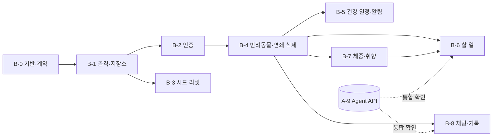

# Phase 2 개발 계획 — Backend (Node.js)

> 상위 계획: [plan.md](plan.md) Phase 2 (B-1 ~ B-8)
> 기준 문서: [ARCHITECTURE.md](ARCHITECTURE.md) 4.2·5·6·7·9장, [USER_SCENARIO.md](USER_SCENARIO.md), [schema.md](../database/schema.md), [CLAUDE.md](../CLAUDE.md) 4장
> 작성일: 2026-11-05 · 기준일(평가) `TODAY_OVERRIDE=2026-11-10`

이 문서는 plan.md의 B-1 ~ B-8을 **실제로 구현할 수 있는 단위**로 쪼갠 작업 계획이다.
- plan.md의 완료 조건은 바꾸지 않는다.
- 이 문서는 그 조건을 채우기 위한 파일, 함수, 테스트, 순서를 정한다.
- 체크박스는 이 문서에서 관리하고, task가 끝나면 plan.md의 완료 조건도 체크한다.

---

## 0. 목표와 범위

| 항목 | 내용 |
|------|------|
| 목표 | `npm run dev`(:3000)로 뜨는 Backend가 ARCHITECTURE.md 4.2의 REST API를 제공하고, Chroma 앱 데이터의 유일성·소유권·연쇄 삭제를 보장한다 |
| 범위 | `src/backend/` Node.js(JavaScript) 코드와 그 테스트. Frontend는 Phase 3 |
| 산출물 | `src/backend/` (자체 `package.json`), `npm run seed:reset` |
| 완료 판정 | 아래 13장 "Phase 2 완료 점검"을 모두 통과 |

**Phase 2에서 하지 않는 것**
- 추천 로직(카탈로그 필터 → 취향 점수)을 JS로 다시 만들지 않는다. 할 일 생성·교체는 항상 Agent `POST /tasks/generate`를 부른다 (CLAUDE.md 4.2).
- LLM을 직접 호출하지 않는다. 채팅은 Agent `POST /query`·`/query/resume` 프록시만 한다.
- 화면(Frontend)과 평가 스크립트(E-1)는 만들지 않는다. API 동작은 테스트와 `curl`로 확인한다.

**Phase 1과의 관계** (2026-11-05 기준 A-0 ~ A-5 완료, A-6 ~ A-9 진행 전)
- B-1 ~ B-5, B-7은 Agent 서버 없이 진행할 수 있다.
- B-6(할 일)·B-8(채팅)은 A-9가 필요하다. A-9 전에는 **가짜 Agent 서버**(1.4)로 개발·테스트하고, A-9가 끝나면 실제 서버로 통합 확인만 한다.

---

## 1. 개발 시작 전 정할 것 (B-0)

### 1.1 파일 배치

`src/backend/` 안만 쓴다 (제출 규약 CLAUDE.md 3장은 `src/backend/`까지만 정한다).

```
src/backend/
├── package.json            "type": "module", scripts: dev / start / test / lint / format / seed:reset
├── eslint.config.js        ESLint 기본 + Prettier (2-space)
├── .prettierrc
├── src/
│   ├── server.js           listen(:3000), 시작 작업(고아 정리·overdue 갱신), cron 등록
│   ├── app.js              createApp(deps) — Express 앱 생성 (테스트에서 가짜 의존성 주입)
│   ├── config.js           루트 .env 읽기, 필수 키 검사 (값은 로그에 남기지 않음)
│   ├── lib/
│   │   ├── dates.js        KST 오늘·연령 구간·D-day·epoch (Python src/config.py와 같은 규칙)
│   │   ├── ids.js          userId(email), newId(prefix), prefId(...), threadId 검사
│   │   ├── errors.js       HttpError(400/401/403/404/409/503) + 에러 핸들러
│   │   ├── mask.js         로그용 PII 마스킹 (Python 규칙 중 로그에 필요한 것만)
│   │   └── logger.js       요청 로그 (메서드·경로·상태·소요 시간, 본문 없음)
│   ├── store/
│   │   ├── record.js       encodeAppRecord / decodeAppRecord (ARCHITECTURE.md 5.1)
│   │   ├── chroma.js       Chroma 클라이언트, 컬렉션 핸들 (앱 데이터 8종)
│   │   ├── memory.js       테스트용 메모리 저장소 (같은 인터페이스, where 일부 연산 지원)
│   │   ├── repos.js        컬렉션별 저장소 (모든 조회가 userId 필수)
│   │   └── validate.js     schema.md 제약 검증 (enum·날짜·참조 규칙)
│   ├── catalog.js          data/catalog/*.json 읽기 (reviewed:true만, 메모리 캐시)
│   ├── checkpoints.js      data/checkpoints SQLite에서 thread 삭제 (node:sqlite)
│   ├── agentClient.js      Agent 호출 (X-Agent-Api-Key, 타임아웃, 장애 → 503 변환)
│   ├── auth/               signup·login·logout, requireAuth 미들웨어 (JWT httpOnly 쿠키)
│   ├── services/
│   │   ├── cascade.js      반려동물·회원 연쇄 삭제, 고아 정리
│   │   ├── healthSchedule.js 초기 일정표, 완료 → 다음 회차·주기, 이력 입력
│   │   ├── notifications.js D-7·D-1·D-day·overdue 목록
│   │   ├── tasks.js        오늘 할 일 생성·재생성·교체 (Agent 호출 + 저장)
│   │   └── signals.js      interactions 기록 + preferences 갱신
│   ├── jobs/overdue.js     scheduled → overdue 갱신 (cron + 시작 시)
│   ├── routes/             auth / me / pets / tasks / healthEvents / weights / preferences / threads / chat / catalog / notifications
│   └── seed/reset.js       npm run seed:reset [--variant <이름>]
└── test/                   node:test 또는 vitest, supertest
```

- [x] 위 배치를 ARCHITECTURE.md 2장(기술 스택)에 "Backend 내부 구조" 한 단락으로 적는다 (**문서 먼저**, D1)

### 1.2 라이브러리

| 용도 | 패키지 | 비고 |
|------|--------|------|
| HTTP | `express` 5 | async 핸들러 오류를 자동 전달 |
| Chroma | `chromadb` (JS) | 서버 1.5.9(`requirements.txt`)와 호환되는 버전을 B-0에서 확인해 고정 |
| 비밀번호 | `bcryptjs` | 시드 해시가 `$2b$` 형식. 네이티브 빌드 없음 |
| 토큰 | `jsonwebtoken`, `cookie-parser` | httpOnly·SameSite=Lax 쿠키 |
| 입력 검증 | `zod` | 요청 본문 스키마 |
| 스케줄러 | `node-cron` | `timezone: "Asia/Seoul"` |
| 환경변수 | `dotenv` | 루트 `.env` (`../../.env`) |
| 체크포인트 삭제 | `node:sqlite` (내장) | Node 26.13에서 사용. 네이티브 패키지 없음 |
| 테스트 | `vitest`, `supertest` | |
| 린트 | `eslint`, `prettier`, `eslint-config-prettier` | |

- [x] 버전을 `package.json`에 고정하고 `package-lock.json`을 커밋한다
- [x] `chromadb` JS 클라이언트로 서버(:8001)에 `heartbeat`·`get(where)`·`$contains`가 되는지 스모크 테스트를 먼저 쓴다 (Phase 1의 라이브러리 스모크와 같은 목적)

### 1.3 Python ↔ Node 공유 계약

두 쪽이 같은 Chroma 데이터를 읽고 쓰므로, 아래는 **한쪽만 바꾸면 안 된다**. 각 항목은 기준 사례 파일로 양쪽이 같은 결과를 내는지 확인한다.

| 계약 | Python 기준 | Node 위치 | 확인 방법 |
|------|-------------|-----------|-----------|
| 저장 형식 (5.1) | `src/retriever.py` `encode_app_record` | `store/record.js` | `src/tests/fixtures/app_records.json`(시드 전 행의 인코딩 결과, Python이 생성)과 같은지 비교 |
| 날짜·연령·D-day | `src/config.py` | `lib/dates.js` | `src/tests/fixtures/date_cases.json` 그대로 읽어 검증 |
| `due_ts` | 시드 값 (KST 자정 epoch) | `lib/dates.js` `kstMidnightEpoch` | 시드 `health_events`의 `due_ts`와 같은지 |
| `user_id` | `usr_` + sha256(소문자 이메일)[:12] | `lib/ids.js` | 시드 6명 |
| 취향 행 id | `pref_{pet_id 또는 user_id}_{sha256("kind\|target")[:10]}` (`tools.py` `remember_preference`) | `lib/ids.js` `prefId` | 같은 id로 upsert → 채팅으로 저장한 취향과 버튼 👍/👎가 한 행이 된다 |
| 👎 제외 기한 | `excluded_until = 오늘 + 6일` | `services/signals.js` | 11/08 → 11/14 |
| 취향 점수 기본값 | like 3 / dislike −3 / constraint 0 | `services/signals.js` | 단위 테스트 |
| `thread_id` | `thr_{user_id}_{pet_id}_{uuid hex}` | `lib/ids.js` | 접두사로 소유자 확인 |

- [x] `src/tests/fixtures/app_records.json`을 만드는 Python 스크립트(또는 pytest 픽스처 갱신 테스트)를 추가하고, Python 쪽 테스트가 파일이 최신인지 확인한다
- [x] 위 표를 ARCHITECTURE.md 5.1 아래 "공유 기준 사례" 목록으로 남긴다 (D2)

### 1.4 테스트 전략

| 층 | 무엇으로 | 외부 의존 | 실행 |
|----|----------|-----------|------|
| 단위 (날짜·id·인코딩·검증·일정 계산·알림 판정) | 순수 함수 + 기준 사례 파일 | 없음 | `npm test` |
| API (라우트·소유권·상태 코드·연쇄 삭제) | `createApp({ store: memoryStore, agent: fakeAgent, today })` + supertest, 시드 적재 | 없음 | `npm test` |
| Chroma 통합 | 실제 Chroma(:8001), **테스트 전용 database** `dailypet_test` | Chroma | `npm run test:chroma` |
| Agent 통합 | 실제 Agent(:8000) | Agent, Chroma (+ Bedrock는 채팅만) | `npm run test:agent` (A-9 이후) |

- 기본 `npm test`는 네트워크 없이 **20초 안에** 끝나야 한다.
- **메모리 저장소**(`store/memory.js`)는 Chroma 저장소와 같은 인터페이스다. `where`는 이 프로젝트가 쓰는 연산만 지원한다: `$and`, `$eq`, `$ne`, `$in`, `$gte`, `$lte`, `$contains`. 지원하지 않는 연산은 오류를 내서 실제 Chroma와 다르게 통과하는 일을 막는다.
- **가짜 Agent 서버**(`test/fakeAgent.js`): ARCHITECTURE.md 4.1·4.1.1·4.1.2 응답 모양을 그대로 돌려주는 작은 Express 앱. 요청을 기록해 테스트가 "어떤 인자로 불렀는지"(`keep_item_ids`, `exclude_item_ids`, `X-Agent-Api-Key`)를 확인한다. 지연·오류·타임아웃 모드를 지원한다.
- 기준일은 `TODAY_OVERRIDE=2026-11-10`. 앱 생성 시 `today` 함수를 주입해 테스트에서 날짜를 바꾼다.
- 실제 Chroma 테스트는 기본 database(앱 데이터)를 건드리지 않는다. `CHROMA_DATABASE` 키를 새로 두면 `.env.example`과 ARCHITECTURE.md 7장에도 추가한다 (D3).

### 1.5 공통 API 규칙

| 규칙 | 내용 |
|------|------|
| 인증 | `/api/auth/*`를 뺀 모든 `/api/*`는 `requireAuth`. JWT의 `sub`(= `user_id`)만 신뢰한다. 본문·쿼리의 `user_id`는 무시한다 |
| 소유권 | 리소스 조회는 `repos.*.get(userId, id)`로만 한다. 다른 사용자 것이면 **404** (ARCHITECTURE.md 4.2) |
| 상태 코드 | 401 로그인 안 됨 · 404 없음/남의 것 · 403 남의 thread resume · 409 이메일 중복·같은 날 체중 · 400 입력 오류 · 503 Agent 장애 |
| 오류 본문 | `{ "error": { "code": "...", "message": "한국어 안내" } }` |
| 날짜 | 입력·저장 모두 `YYYY-MM-DD`(KST). 시각은 `+09:00` ISO 문자열 |
| 로그 | 메서드·경로(ID 포함 가능)·상태·소요 시간만. 요청·응답 본문, 쿠키, 키는 남기지 않는다 |
| CORS | 개발 중 Frontend는 Vite 프록시(`/api` → :3000)로 붙는다. CORS는 `http://localhost:5173`만 허용 (쿠키 포함) |

---

## 2. 작업 순서



| 순서 | 묶음 | 병렬 가능 | 예상 규모 |
|------|------|-----------|-----------|
| 1 | B-0, B-1 | — | 중간 (저장소·검증이 나머지 전부의 기반) |
| 2 | B-2 ∥ B-3 | B-3은 B-1만 있으면 시작 가능 | 작음 / 작음 |
| 3 | B-4 | — | 중간 (연쇄 삭제·고아 정리) |
| 4 | B-5 ∥ B-7 | 서로 독립 | **큼** (일정 계산 규칙) / 작음 |
| 5 | B-6 | B-7의 `signals.js`를 쓴다 | 중간 |
| 6 | B-8 | B-6과 병렬 가능 | 중간 |

**가장 위험한 경로**: B-5(건강 일정 초기 생성·다음 회차 계산 — 문서에 아직 규칙이 다 적혀 있지 않음) → B-6(할 일 재생성·교체의 유지 규칙). 이 두 곳에 테스트를 가장 많이 둔다.

---

## 3. B-0 · 개발 기반과 계약

**의존성**: P0-8 ✅, A-0 ✅ (저장 형식 5.1 확정)

- [x] 1.1 배치, 1.3 공유 계약, 1.4 `CHROMA_DATABASE`를 문서(ARCHITECTURE.md 2·5.1·7장, `.env.example`)에 반영 (D1~D3)
- [x] `src/backend/package.json`, `eslint.config.js`, `.prettierrc`, `npm run lint`·`npm run format` 동작
- [x] `src/tests/fixtures/app_records.json` 생성 (Python), Node 테스트에서 읽을 수 있음
- [x] `test/fakeAgent.js`, `test/helpers.js`(`createTestApp`, 시드 적재, 로그인 쿠키 얻기)
- [x] `chromadb` JS 스모크 테스트 (`npm run test:chroma`)

**완료 조건**
- [x] `npm test`가 테스트 0개로 정상 종료하고, `npm run lint`가 통과한다
- [x] `npm run test:chroma`로 서버 heartbeat와 리스트 메타데이터 `$contains` 조회가 된다

---

## 4. B-1 · 골격·Chroma 저장소 계층

**의존성**: B-0

**인터페이스**
```js
// lib/dates.js — Python src/config.py와 같은 규칙
export function todayKst(env = process.env): string            // TODAY_OVERRIDE 우선, 형식 오류면 시작 시 실패
export function ageMonths(birth, on): number
export function ageGroup({ species, size, birthDate }, on): 'junior' | 'adult' | 'senior'
export function dDay(due, today): number                       // due - today
export function withinDays(due, today, days): boolean          // 0 <= dDay <= days
export function addDays(date, n): string
export function kstMidnightEpoch(date): number                 // due_ts
export function nowKstIso(): string                            // 2026-11-10T07:30:00+09:00

// store/record.js
export function encodeAppRecord(row): { id, document, metadata }
export function decodeAppRecord(document): object

// store/repos.js — 모든 조회·수정 함수의 첫 인자는 userId (없으면 throw)
repos.pets.list(userId) / get(userId, petId) / put(userId, row) / remove(userId, petId)
repos.tasks.listByDate(userId, petId, date) / get(userId, taskId) / put / remove / removeWhere(userId, filter)
repos.healthEvents.*, repos.weights.*, repos.interactions.*, repos.preferences.*, repos.chatLogs.*
repos.users.getById(userId) / getByEmail(email) / create(row) / remove(userId)   // users만 예외: id 자체가 userId
```

**작업**
- [x] `config.js`: `CHROMA_HOST/PORT`, `AGENT_URL`, `AGENT_API_KEY`, `JWT_SECRET`, `TODAY_OVERRIDE`, `CHECKPOINT_PATH`, `FAULT_INJECT`를 읽는다. 필수 키가 없으면 **키 이름만** 알리고 종료한다. 키 값은 어디에도 출력하지 않는다
- [x] `lib/dates.js`: `Intl.DateTimeFormat('en-CA', { timeZone: 'Asia/Seoul' })`로 KST 날짜를 얻는다. 날짜 산술은 `YYYY-MM-DD` 문자열 ↔ UTC 자정 `Date`로 해서 서버 TZ에 영향받지 않게 한다
- [x] `store/record.js`: 5.1 규칙 그대로
  - document는 키를 정렬한 JSON (`sort_keys=True`와 같은 결과, `ensure_ascii=False`)
  - metadata 제외 필드: `id`, `default_times`, `trace`, `question`, `answer`, `memo`, `password_hash`
  - null·빈 리스트·객체는 키를 뺀다. 문자열 리스트만 리스트로 남긴다
  - `created_at`·`updated_at` → `created_ts`·`updated_ts`(epoch 초)
- [x] `store/chroma.js`: 앱 컬렉션 8종을 `getOrCreateCollection`(임베딩 함수 없음)으로 잡고, 쓰기에는 더미 벡터 `[0.0]`을 넣는다. 카탈로그·지식 컬렉션은 열지 않는다
- [x] `store/repos.js`
  - 조회 `where`에 `{ user_id: userId }`를 **항상** `$and`로 붙인다 (호출자가 빼먹을 수 없게 내부에서)
  - `get(userId, id)`는 id로 읽은 뒤 `user_id`가 다르면 `null`을 돌려준다 (라우트에서 404)
  - 쓰기 전에 `validate.js`를 거친다
- [x] `store/validate.js`: `database/schema.md`의 CHECK를 JS로 옮긴다
  - enum: `species`, `sex`, `size`, `activity_level`, 건강 `type`·`status`, 할 일 `category`·`source`, `signal`, 취향 `kind`
  - 날짜 형식(`YYYY-MM-DD`이고 실제 있는 날짜), `time`(`HH:MM`), id 접두사(`usr_`·`pet_`·`task_`·`evt_`·`wt_`·`int_`·`pref_`·`log_`)
  - 참조 규칙: 할 일 영역별 참조(diet/activity → 같은 영역 카탈로그 ID, health → 같은 반려동물의 일정, custom → 참조 없음), `custom` 영역이면 `source=custom`
  - `status=done` ⇔ `completed_date` 있음, `excluded_until`은 dislike 전용, `signal != custom`이면 `catalog_item_id` 필수
  - 체중 범위: 개 0.5~100 / 고양이 0.3~15
  - 위반하면 `HttpError(400)`와 필드 이름
- [x] `catalog.js`: `data/catalog/*.json`을 읽어 `reviewed: true`만 남긴다 (Backend는 카탈로그를 수정하지 않는다). `get(itemId)`, `list({category, species})`, `healthItems(species)`
- [x] `app.js` / `server.js`: `createApp(deps)`와 `GET /health`(Chroma·Agent 연결 상태, 키 없음)

**테스트** (`test/dates.test.js`, `test/record.test.js`, `test/validate.test.js`, `test/repos.test.js`)
- [x] `date_cases.json`의 모든 사례가 Python과 같은 결과 (연령 경계, 2/29 생일, D-7 경계)
- [x] `TODAY_OVERRIDE=2026-11-10` → `todayKst()`가 `2026-11-10`. 서버 `TZ=UTC`로 바꿔도 같다
- [x] `encodeAppRecord(시드 각 행)`이 `app_records.json`과 document·metadata 모두 같다
- [x] 시드 `health_events`의 `due_ts`가 `kstMidnightEpoch(due_date)`와 같다
- [x] 검증: `species:"rabbit"` 400, diet 할 일에 `act_*` ID 400, `status:"done"`인데 `completed_date` 없음 400, 2026-02-30 400
- [x] 저장소: `userId` 없이 호출하면 예외, 다른 사용자 id로 `get` → `null`, 메모리 저장소가 지원하지 않는 `where` 연산이면 예외
- [x] (`test:chroma`) 같은 시드를 메모리 저장소와 실제 Chroma에 넣고 같은 조회 10종의 결과가 같다

---

## 5. B-2 · 인증 (F0)

**의존성**: B-1

**작업**
- [x] `POST /api/auth/signup` `{ email, password, nickname }`
  - 이메일 `trim().toLowerCase()`, 형식 검사. 비밀번호 8자 이상, 닉네임 1~20자 (규칙을 SERVICE.md F0에 적는다, D4)
  - `user_id = usr_ + sha256(email)[:12]`. 이미 있으면 **409** "이미 사용 중인 이메일이에요"
  - `bcryptjs` cost 10으로 해시. 원문은 변수 밖으로 나가지 않는다 (로그·오류 메시지·응답에 없음)
  - 가입 직후 로그인 상태로 만든다 (S01 2단계)
- [x] `POST /api/auth/login`: 실패 사유를 구분하지 않고 401 "이메일 또는 비밀번호를 확인해 주세요"
- [x] JWT: `{ sub: user_id }`, 만료 7일, `JWT_SECRET` 서명. 쿠키 `dp_session` (`httpOnly`, `SameSite=Lax`, `Secure`는 로컬 데모라 끔, `path=/`)
- [x] `POST /api/auth/logout`: 쿠키 삭제. 이후 `/api/pets`는 401 (S01)
- [x] `requireAuth`: 쿠키 검증 → `req.userId`. 토큰은 유효한데 `users`에 없으면(탈퇴 후) 401
- [x] `GET /api/me`: `{ user_id, email, nickname, created_at }` (해시 제외)
- [x] `DELETE /api/me` `{ confirm_email }`: 가입 이메일과 같아야 실행 (SERVICE.md F0). 실제 삭제는 B-4 `cascade.deleteUser`

**테스트** (`test/auth.test.js`)
- [x] `NewBie@Demo.DailyPet` 가입 → `users`에 소문자 이메일, id `usr_fce210e795d0`, `password_hash`가 `$2` 접두사
- [x] 저장된 document 전체와 응답 본문에 비밀번호 원문 문자열이 없다
- [x] `HANEUL@demo.dailypet`(시드 계정과 대소문자만 다름) → 409, 행 수 변화 없음
- [x] 시드 계정이 USER_SCENARIO.md 1.1의 데모 비밀번호로 로그인된다 (`$2b$` 해시 호환)
- [x] 로그아웃 후 `/api/pets` 401, 위조·만료 토큰 401
- [x] `/api/auth/*`를 뺀 모든 라우트가 `requireAuth`를 거친다 (라우터 목록을 순회하는 테스트)

---

## 6. B-3 · 시드 리셋 (`npm run seed:reset`)

**의존성**: B-1, P0-6 ✅

**작업**
- [x] `seed/reset.js [--variant <이름>]`
  1. 앱 데이터 컬렉션 8종을 지우고 다시 만든다 (`deleteCollection` → `getOrCreateCollection`). 카탈로그·지식 컬렉션은 이름 목록으로 **명시적으로 제외**한다
  2. `data/checkpoints/` 안의 SQLite 파일을 지운다 (`CHECKPOINT_PATH` 기준. 폴더 밖 경로면 거부)
  3. `data/seed/*.json`을 `encodeAppRecord`로 적재한다. 적재 전에 `validate.js`로 전부 검증하고, 하나라도 실패하면 아무것도 쓰지 않고 끝낸다
  4. `--variant`: `data/seed/variants/<이름>.json`의 `update` → `add` → `delete`를 적용한다. `setup_queries`가 있으면 Agent `POST /query`를 순서대로 부르고(Agent가 꺼져 있으면 실패 메시지와 종료 코드 1), 없으면 건너뛴다
  5. `overdue` 갱신(B-5 `jobs/overdue.js`)을 한 번 실행한다 (`TODAY_OVERRIDE`별 결과를 결정적으로 만들기 위해)
  6. 컬렉션별 건수를 출력한다
- [x] 실행 중인 Backend가 같은 Chroma를 쓰고 있어도 깨지지 않게, 리셋 뒤 Backend 캐시(카탈로그 외 없음)를 두지 않는다
- [x] Agent 서버가 떠 있으면 checkpoint 파일이 열려 있을 수 있다. 파일 삭제 대신 테이블 비우기(`DELETE FROM checkpoints; DELETE FROM writes;`)로 바꿀지 B-3에서 확인하고 결과를 README에 적는다

**테스트** (`test/seed.test.js`)
- [x] 리셋 후 건수: 사용자 6, 반려동물 7, 건강 일정·할 일·체중·신호·취향·대화 기록이 시드 파일 행 수와 같다
- [x] 두 번 연속 실행 → 모든 컬렉션의 id 집합과 document가 같다
- [x] `catalog_activity`에 표시 행을 넣어 두고 리셋 → 그대로 남아 있다
- [x] `--variant mocha_joint` → 모카 `conditions`에 `joint_disease`, `--variant hodu_dislikes` → 호두 dislike 신호 9건 추가
- [x] `--variant bori_pending_hitl` + 가짜 Agent → `setup_queries`가 시드 순서대로 호출된다
- [x] 잘못된 행이 섞인 임시 시드 → 실패하고 아무것도 쓰지 않는다
- [x] (`test:chroma`) 실제 Chroma에 리셋 후 Python `src/tests/seed_loader.py`와 같은 결과 (id·metadata 비교)

---

## 7. B-4 · 반려동물 API·연쇄 삭제 (F1)

**의존성**: B-2

**작업**
- [x] `GET /api/pets`: 내 반려동물을 `created_at` 순서로. 응답에 `age_group`(오늘 기준 계산)을 붙인다 (저장하지 않음)
- [x] `POST /api/pets`
  - 필수: `name`, `species`(dog/cat), `birth_date`, `weight_kg`. 빠지면 400과 **필드별** 안내 (S01 예외 4가지)
  - 선택: `breed`, `sex`, `neutered`, `size`, `activity_level`, `allergies`, `conditions`, `memo`, `default_times`, `health_history`
  - `birth_date`가 오늘보다 뒤면 400
  - `health_history`(최근 접종·검진 이력, `[{ catalog_item_id, last_done_date, dose_no? }]`)는 B-5 초기 일정표에만 쓰고 `pets`에 저장하지 않는다
  - 저장 후 B-5 `healthSchedule.createInitial(pet, history)` 호출. 일정 생성이 실패하면 방금 만든 반려동물을 지운다
  - id: `pet_` + 무작위 10자리 (시드 id와 겹치지 않게)
- [x] `GET /api/pets/:id`, `PUT /api/pets/:id`
  - `species`는 수정할 수 없다 (400). 바꾸려면 새로 등록
  - 수정해도 오늘 할 일은 바꾸지 않고, 응답에 `tasks_outdated: true`를 넣어 "할 일 다시 제안" 안내를 띄우게 한다 (SERVICE.md F1, S05 4단계)
- [x] `DELETE /api/pets/:id` `{ confirm_name }`: 이름이 같아야 실행 → `cascade.deletePet`
- [x] `services/cascade.js`
  - `deletePet(userId, petId)`: `tasks` → `health_events` → `weight_logs` → `interactions` → `preferences`(그 반려동물 것만, 사용자 공통은 남김) → `chat_logs` + 그 thread들의 checkpoint → `pets` (ARCHITECTURE.md 5장 순서)
  - `deleteUser(userId)`: 모든 반려동물에 `deletePet` → 사용자 공통 `preferences` → `users`. 끝나면 쿠키 삭제
  - 각 단계 사이에 `FAULT_INJECT=delete_after:<컬렉션>`을 확인해 오류를 던진다 (테스트 전용). 반려동물 행은 마지막에 지우므로 실패해도 프로필이 남는다 (S20)
  - 같은 반려동물을 다시 삭제하면 남은 단계부터 끝까지 진행한다 (멱등)
- [x] `checkpoints.js`: `deleteThreads(threadIds)` — `CHECKPOINT_PATH`의 SQLite를 열어 `checkpoints`·`writes` 테이블에서 `thread_id IN (...)` 삭제. 파일이 없으면 아무것도 하지 않는다. 테이블 이름은 `langgraph-checkpoint-sqlite==3.1.3`에서 확인해 상수로 둔다
- [x] 고아 정리 `cascade.cleanupOrphans()`: 시작 시 1회
  - `pets`의 `user_id`가 `users`에 없으면 그 반려동물을 `deletePet`
  - 하위 컬렉션의 `pet_id`가 `pets`에 없으면 그 행을 지운다 (사용자 공통 `preferences`는 `user_id`로 판단)
  - 정리 건수만 로그에 남긴다

**테스트** (`test/pets.test.js`, `test/cascade.test.js`)
- [x] 격리: mallory로 `GET/PUT/DELETE /api/pets/pet_bori` → 404, 보리 데이터 변화 없음 (isolation-01)
- [x] `species:"rabbit"` 400, 필수값 4개 각각 빠지면 400 (필드 이름 포함)
- [x] `PUT`으로 `activity_level` 변경 → 오늘 `tasks` 그대로, `tasks_outdated: true`
- [x] `DELETE pet_coco`(leaver) → 모든 컬렉션·checkpoint에 `pet_coco` 행 0건, 다른 사용자 행 수 변화 없음 (S20 1단계)
- [x] `DELETE /api/me` → `usr_3263e0395d81` 행 0건, 같은 이메일로 다시 가입 성공 (S20 2·3단계)
- [x] `confirm_name`·`confirm_email`이 틀리면 400, 아무것도 지우지 않는다
- [x] `FAULT_INJECT=delete_after:health_events` → 500, 프로필은 남음 → 해제 후 다시 삭제하면 끝까지 완료
- [x] 같은 상태에서 `cleanupOrphans()`를 돌리고, 반려동물 행을 지운 뒤 다시 돌리면 남은 하위 데이터가 정리된다

---

## 8. B-5 · 건강 일정·알림 (F5)

**의존성**: B-4

이 task는 계산 규칙이 가장 많고, ARCHITECTURE.md에 **초기 일정표 규칙이 아직 없다**. 아래 규칙을 먼저 ARCHITECTURE.md 6장(또는 5장 정기점검 항목 아래)에 적은 뒤 구현한다 (D5).

**초기 일정표 규칙 (안)**
| 경우 | 규칙 |
|------|------|
| 대상 항목 | 카탈로그 `health` 중 종이 맞고, 현재 연령 구간이 `age_groups`에 있거나 아직 끝나지 않은 어린 동물 기초접종(`dose_schedule`)인 항목 |
| 항목당 일정 수 | 다음에 할 회차 **1건만** 활성으로 만든다 (완료하면 그다음을 만든다) |
| `dose_schedule` 이력 없음 | 1차 `due = birth + at_age_weeks주`. 이후 회차는 `after_prev_weeks` 누적 |
| `dose_schedule` 이력 있음 (`dose_no`, `last_done_date`) | 다음 회차 `due = last_done_date + after_prev_weeks`. 마지막 회차였으면 `last_done_date + booster_interval_days` |
| `interval_days` 항목 이력 없음 | `due = max(birth + start_age_weeks주, 오늘)`. 성체 이상이고 시작 주령이 지났으면 `needs_history` |
| `interval_days` 항목 이력 있음 | `due = last_done_date + interval_days` |
| 상태 | `due < 오늘`이고 이력이 없으면 `needs_history`, 이력으로 계산했는데 지났으면 `overdue`, 그 밖에는 `scheduled` |

- 위 규칙으로 시드 `health_events`(USER_SCENARIO.md 2.3)를 다시 만들어 보고, 다르면 규칙이나 시드 중 하나를 고친다 (어느 쪽을 고칠지는 문서에 적는다).

**작업**
- [x] `healthSchedule.createInitial(pet, history, today)`: 위 규칙. id `evt_` + 무작위, `type`은 카탈로그에서, `due_ts`는 `kstMidnightEpoch`
- [x] `healthSchedule.nextAfter(event, completedDate)`: `dose_schedule` 다음 회차 → 없으면 `booster_interval_days` → `interval_days` → 없으면 다음 일정 없음. **예정일이 아니라 완료일 기준** (SERVICE.md F5)
- [x] `GET /api/pets/:id/health-events`: `{ needs_history: [...], upcoming: [...], done: [...] }`로 나눠 `d_day`를 붙인다
- [x] `PATCH /api/health-events/:id/complete` `{ completed_date }`: 미래 날짜 400. `done` + `completed_date` 저장 → `nextAfter`로 다음 일정 생성. 이미 `done`이면 409
- [x] `PATCH /api/health-events/:id`
  - `{ due_date }`: 날짜 변경 → `scheduled` (과거 날짜 400)
  - `{ last_done_date }`: 이 일정을 `done`(`completed_date = last_done_date`)으로 바꾸고 다음 일정 생성 → `needs_history` 해소 (ARCHITECTURE.md 4.2)
  - 둘 다 오거나 둘 다 없으면 400
- [x] 건강 일정을 바꾸면 그 일정의 오늘 할 일(`category=health`, `health_event_id`)도 맞춘다: 완료 → 할 일 `done: true`, 날짜 변경으로 7일 밖 → 미완료 할 일 삭제
- [x] `jobs/overdue.js` `markOverdue(today)`: `status=scheduled`이고 `due_ts < kstMidnightEpoch(today)`인 일정 → `overdue`. 모든 사용자 대상의 유일한 작업이라 `repos`의 `userId` 강제를 우회하는 **내부 전용 함수**로 두고 라우트에서 import하지 않는다
- [x] cron `5 0 * * *` (`timezone: "Asia/Seoul"`) + 서버 시작 시 1회 + 시드 리셋 끝에 1회
- [x] `GET /api/notifications`: 내 모든 반려동물의 일정 중 `dDay ∈ {7, 1, 0}`(scheduled) 또는 `overdue`. `needs_history`·`done`은 제외. 항목 `{ event_id, pet_id, pet_name, name, due_date, d_day, kind: "d7"|"d1"|"today"|"overdue" }`, 지연 → 오늘 → D-1 → D-7 순서

**테스트** (`test/healthSchedule.test.js`, `test/notifications.test.js`)
- [x] S01: 두부(개, 2026-08-01생, 이력 없음, 11/10 등록) → `hc_dog_dhpp` dose_no 1이 `needs_history`, `hc_dog_rabies` 있음
- [x] S11: 11/14에 `evt_kongi_dhpp3` 완료 → DHPP 4차 `due_date=2026-12-12`
- [x] S11: `evt_kongi_deworm`에 `last_done_date=2026-10-25` → `needs_history` 아님, 다음 구충 일정 생성
- [x] 마지막 회차 완료 → `booster_interval_days` 뒤 추가접종 1건
- [x] S03 알림: 11/10 → 광견병(D-7)만, DHPP(D-3) 없음 / 11/06 → DHPP "d7" / 11/12 → "d1" / 11/13 → "today" / 11/14(markOverdue 후) → "overdue"
- [x] `needs_history` 일정은 어떤 날짜에도 알림에 없다
- [x] mallory로 `PATCH /api/health-events/evt_kongi_dhpp3/complete` → 404
- [x] `markOverdue`를 두 번 돌려도 결과가 같다

---

## 9. B-7 · 체중·취향 API (F9, F11, F12)

**의존성**: B-4 (B-6이 `signals.js`를 쓰므로 B-6보다 먼저 한다)

**작업**
- [x] `GET /api/pets/:id/weights`: 날짜 오름차순 (추이 그래프용)
- [x] `POST /api/pets/:id/weights` `{ date, weight_kg, overwrite? }`
  - 종별 범위 밖 400 (개 0.5~100 / 고양이 0.3~15), 미래 날짜 400
  - 같은 날짜 기록이 있으면 409, `overwrite: true`면 같은 id로 덮어씀 (하루 1건)
  - 저장 후 **가장 최근 날짜** 기록으로 `pets.weight_kg` 갱신. 응답에 `tasks_outdated: true`
- [x] `DELETE /api/weights/:weightId`: 지운 뒤 남은 최신 기록으로 `pets.weight_kg` 갱신 (S05: 33.2 삭제 → 34.0). 기록이 하나도 없으면 프로필 체중은 그대로 둔다
- [x] `services/signals.js` `recordSignal(userId, petId, { itemId, signal, today })`
  - `interactions`에 원본 기록 (`int_` + 무작위, `created_at`=KST 지금)
  - `like`: `preferences` like 행 upsert (id는 1.3 `prefId`, score 3). 같은 대상의 dislike 행이 있으면 지운다
  - `dislike`: dislike 행 upsert (score −3, `excluded_until = today + 6`). 같은 대상의 like 행이 있으면 지운다
  - `complete`·`swap`·`remove`·`custom`: `interactions`만 기록 (점수 계산은 Python이 한다)
  - `itemId`는 카탈로그에 있어야 한다 (`custom`이고 자유 입력이면 null 허용)
- [x] `POST /api/pets/:id/feedback` `{ itemId, signal }` → `recordSignal`. 할 일 버튼(👍/👎)은 이 API를 쓴다. 완료·교체·삭제 신호는 B-6 할 일 API가 **내부에서** 기록하므로 Frontend가 따로 보내지 않는다 (중복 기록 방지, D6)
- [x] `GET /api/pets/:id/preferences`: `{ like: [...], dislike: [...](excluded_until, 오늘 기준 제외 중 여부), constraint: [...] }`. 사용자 공통 행(`pet_id` 없음)은 `scope: "all_pets"`로 표시하고 함께 돌려준다. 카탈로그 ID면 이름을 붙인다
- [x] `DELETE /api/pets/:id/preferences/:prefId`: 그 반려동물 또는 사용자 공통 행만. 공통 행 삭제는 응답에 `scope: "all_pets"`를 넣는다 (확인 창은 Frontend)
- [x] `DELETE /api/pets/:id/preferences`: 그 반려동물의 `preferences`와 `interactions`를 모두 지운다 (ARCHITECTURE.md 3.8: 완료 횟수도 0). 사용자 공통 행은 남긴다

**테스트** (`test/weights.test.js`, `test/preferences.test.js`)
- [x] S05: 보리 11/10 33.2kg 추가 → 프로필 33.2, 목록 35.0 → 34.0 → 33.2. 개 `0`·`150` → 400. 같은 날 다시 → 409, `overwrite` → 덮어씀
- [x] 과거 날짜(최신이 아닌) 기록을 추가하면 프로필 체중은 바뀌지 않는다
- [x] 33.2 삭제 → 프로필 34.0
- [x] S04: 모카 `act_cat_kibble_chase_01` 👍 → like 행, 그 id가 Python `remember_preference`가 만드는 id와 같다
- [x] 11/08 👎 → `excluded_until=2026-11-14`. 👍 후 👎 → like 행 없음
- [x] S21: 보리 전체 초기화 → `GET .../preferences`가 빈 목록(공통 행 제외), 보리 `interactions` 0건, 나비 데이터 그대로
- [x] 박서준 공통 제약 "19:00 이후"가 모카 취향 화면에 `scope: "all_pets"`로 나온다
- [x] 없는 카탈로그 ID로 feedback → 400

---

## 10. B-6 · 할 일 API (F2, F13)

**의존성**: B-4, B-7, A-9 (A-9 전에는 가짜 Agent)

**할 일 저장 필드 추가 (D7)**: Agent 응답의 `reason`, `rank`, `relaxed`를 화면에 보여야 한다 (👎 완화 배지는 CLAUDE.md 4.5.1 필수). 지금 `tasks` 스키마에는 없으므로 ARCHITECTURE.md 5장·ERD.md·`database/schema.md`에 선택 필드로 먼저 추가한다.

**작업**
- [ ] `agentClient.generateTasks(body)`: `POST {AGENT_URL}/tasks/generate`, 헤더 `X-Agent-Api-Key`, 타임아웃 5초(LLM 없음, p95 1초 목표). 연결 실패·타임아웃·5xx → `AgentUnavailable`
- [ ] `GET /api/pets/:id/tasks?date=YYYY-MM-DD` (기본 오늘)
  - 그 날짜 할 일이 있으면 그대로 돌려준다 (같은 날 다시 열어도 새로 만들지 않음, S03)
  - **오늘**이고 목록이 없으면 Agent를 불러 만든다. 과거·미래 날짜는 만들지 않는다
  - 같은 반려동물에 대한 동시 요청이 두 번 만들지 않게 반려동물별 진행 중 Promise를 공유한다 (프로세스 안 잠금)
  - Agent 장애: 200 `{ date, tasks: [], notice: "추천을 불러오지 못했어요", retryable: true }` (S22 3단계). 기존 목록이 있으면 Agent를 부르지 않으므로 영향 없음 (S22 1단계)
  - 정렬: `time` 오름차순, 시간 없는 항목(건강)은 맨 아래 (wireframe W05)
- [ ] 생성 결과 저장 규칙
  - diet/activity: `source=auto`, `catalog_item_id`, `title`, `time`, `reason`, `rank`, `relaxed`
  - health: `health_event_id`, `title`, 시간 없음. 같은 `health_event_id`의 할 일이 이미 있으면 새로 만들지 않는다
- [ ] `POST /api/pets/:id/tasks/generate` `{ confirm: true }` (다시 생성, 오늘만)
  - 남길 것: `done: true` 항목, `source=custom` 항목, health 항목 → 이 중 카탈로그 ID를 `keep_item_ids`로 보낸다
  - 지울 것: 미완료 `source=auto` diet/activity 항목. **Agent 응답을 받은 뒤에** 지우고 새 항목을 넣는다 (Agent 장애 시 기존 목록 유지, 503)
  - `confirm`이 없으면 400
- [ ] `POST /api/pets/:id/tasks` (직접 추가)
  - `{ title, time? }` → `category=custom`, `source=custom`
  - `{ catalog_item_id, time? }` → 카탈로그 영역(diet/activity), `source=custom`, 제목은 카탈로그 이름, `custom` 신호 기록
  - 오늘 이후 날짜만 (기본 오늘)
- [ ] `PATCH /api/tasks/:taskId` `{ done?, time?, title? }`
  - `done` false → true: 카탈로그 항목이면 `complete` 신호
  - `done` true → false: 같은 날 그 항목의 마지막 `complete` 신호를 지운다 (실수 체크 되돌리기)
  - `title`은 `custom` 영역만 수정 가능
- [ ] `DELETE /api/tasks/:taskId`: `source=auto`이면 `remove` 신호. health 할 일은 삭제할 수 없다 (일정 화면에서 처리, 400)
- [ ] `POST /api/tasks/:taskId/swap`: diet/activity 자동 항목만
  - Agent `{ category, exclude_item_ids: [현재 항목 + 오늘 같은 영역 항목 전부], limit: 1, keep_item_ids: [] }`
  - 결과가 있으면 기존 할 일을 지우고 새 항목을 같은 `time`으로 넣는다. `swap` 신호(이전 항목)
  - 결과가 없으면 200 `{ swapped: false, notice: "더 추천할 항목이 없어요" }`, 기존 항목 유지, 신호 기록 안 함
- [ ] `GET /api/catalog?category=&species=`: 직접 추가용. `recommendable: false`(유해 식품 등)는 빼고, 이름·영역·ID·요약만

**테스트** (`test/tasks.test.js`, 가짜 Agent)
- [ ] S03: 콩이 11/10 첫 조회 → Agent 1회 호출, 다시 조회 → 호출 0회·개수 같음
- [ ] 동시 요청 2개 → Agent 1회 호출
- [ ] Agent 요청 본문에 `user_id`가 JWT 사용자, 헤더에 `X-Agent-Api-Key`가 있다
- [ ] 재생성(S04 6단계): 완료 항목·직접 추가 "빗질"은 남고 `keep_item_ids`에 완료 항목 ID가 들어간다. `confirm` 없으면 400
- [ ] 재생성 중 Agent 장애 → 503, 기존 목록 그대로
- [ ] 교체(S04 2단계): 요청의 `exclude_item_ids`에 현재 항목 포함, `limit: 1`, `swap` 신호 1건. 빈 결과 → `swapped: false`, 기존 항목 유지
- [ ] 완료 → `complete` 신호 1건, 되돌리기 → 0건. 자동 항목 삭제 → `remove` 1건, 직접 추가 항목 삭제 → 신호 없음
- [ ] 👎 완화 결과(`relaxed: ["dislike"]`)가 저장되고 조회 응답에 나온다
- [ ] S22: Agent 중지 + 오늘 목록 있음 → 정상 / 목록 없음 → `tasks: []`, `notice`
- [ ] mallory로 보리 할 일 PATCH/DELETE/swap → 404
- [ ] `/api/catalog?category=diet&species=dog`에 `harmful_food` 없음
- [ ] (`test:agent`, A-9 이후) 실제 Agent로 보리 11/10 생성 → 식단 1개 이상·활동 1개 이상, 활동 상위 3개에 `act_dog_nosework_find_it_01`, 응답 1초 이내

---

## 11. B-8 · 채팅 프록시·대화 기록 (F6, F14)

**의존성**: B-4, A-9 (A-9 전에는 가짜 Agent)

**`chat_logs`를 누가 쓰는가 (D8)**: phase1_task.md A-9는 Agent가 `/query` 처리 끝에 마스킹된 `chat_logs`를 저장한다고 정했다. Backend는 **읽기·삭제만** 하고 직접 쓰지 않는다 (마스킹 규칙을 Python 한 곳에 두기 위해). plan.md B-8의 "`chat_logs`에 마스킹된 값만 저장한다"는 "Agent가 저장한 마스킹된 값만 읽어 보여준다"로 문구를 고친다.

**작업**
- [ ] `POST /api/chat` `{ question, petId, threadId? }`
  - `petId`는 내 반려동물이어야 한다 (404)
  - `threadId`가 있으면 `thr_{userId}_{petId}_` 접두사인지 확인한다 (아니면 404). 반려동물을 바꾸면 Frontend가 새 thread로 시작한다
  - 길이 1,000자 초과 400 (Agent 입력 가드레일과 같은 값, 미리 거름)
  - Agent `POST /query` `{ question, user_id, pet_id, thread_id }`, 헤더 `X-Agent-Api-Key`, 타임아웃 60초
  - 응답 `{ answer, contexts, trace, thread_id }`를 그대로 넘긴다 (`thread_id`는 trace 또는 응답에서 꺼냄 — A-9 응답 형식에 맞춘다)
  - Agent 장애·타임아웃 → **503** `{ error: { code: "agent_unavailable", message: "잠시 후 다시 시도해 주세요" } }` (S22 2단계)
- [ ] `POST /api/chat/resume` `{ threadId, decisions }`
  - `threadId` 접두사가 내 `user_id`가 아니면 **403** (isolation-04, ARCHITECTURE.md 4.2)
  - `decisions`는 `approve | edit(+edited_action) | reject(+message)`만 허용 (zod)
  - Agent `POST /query/resume`. Agent가 403·404를 돌려주면 같은 코드로 넘긴다
- [ ] `GET /api/pets/:id/threads`: `chat_logs`를 `thread_id`로 묶어 `{ thread_id, started_at, last_at, title(첫 질문 앞 30자, 마스킹된 값), count }`를 최근 순으로
- [ ] `GET /api/threads/:threadId`: 소유자 확인(접두사 + `chat_logs.user_id`) 후 시간순 `{ question, answer, trace, created_at }`
- [ ] `DELETE /api/threads/:threadId`: 그 thread의 `chat_logs` + checkpoint 삭제 (`checkpoints.deleteThreads`). 이후 같은 thread로 resume하면 Agent가 404 (S16 4단계)
- [ ] Backend 로그에는 질문·답변을 남기지 않는다 (경로·상태·소요 시간만). `lib/mask.js`는 예외 메시지에 사용자 입력이 섞일 때만 쓴다

**테스트** (`test/chat.test.js`, 가짜 Agent)
- [ ] Agent에 전달된 `user_id`가 JWT 값이다. 본문에 `user_id: "usr_69d308a849e0"`을 넣어 보내도 무시된다
- [ ] 다른 사용자 `petId` → 404, Agent 호출 0회
- [ ] 다른 사용자 thread로 resume → 403, Agent 호출 0회 (isolation-04)
- [ ] 가짜 Agent 중지 → `/api/chat` 503, `/api/pets`는 정상 (S22)
- [ ] 가짜 Agent 응답 지연 61초 → 503 (타이머를 가짜로 돌려 빠르게)
- [ ] 코코 시드 대화 1건이 `GET /api/pets/pet_coco/threads`에 나오고, 나비 목록에는 보리 대화가 없다 (S16)
- [ ] thread 삭제 → `chat_logs` 0건, checkpoint 테이블에 그 `thread_id` 행 0건 (임시 SQLite 파일로 확인)
- [ ] 로그 캡처에 질문 문자열, 쿠키, `AGENT_API_KEY` 값이 없다
- [ ] (`test:agent`, A-9 이후) 실제 Agent로 S06 대화 → 같은 thread로 이어서 질문 → 대화 목록에 1개 thread

---

## 12. 문서 먼저 고칠 것 (구현 중 확인 목록)

CLAUDE.md 2장 규칙에 따라, 아래 항목은 **코드보다 문서를 먼저** 고친다.

| # | 내용 | 고칠 문서 | 시점 |
|---|------|-----------|------|
| D1 ✅ | Backend 내부 구조(1.1)와 라이브러리(1.2) | ARCHITECTURE.md 2장 | B-0 |
| D2 ✅ | Python ↔ Node 공유 기준 사례 목록 (1.3, `app_records.json`·`prefId` 규칙 포함) | ARCHITECTURE.md 5.1 | B-0 |
| D3 ✅ | 테스트 전용 `CHROMA_DATABASE` 키 | ARCHITECTURE.md 7장, `.env.example` | B-0 |
| D4 ✅ | 가입 입력 규칙 (비밀번호 8자 이상, 닉네임 1~20자) | SERVICE.md F0 | B-2 |
| D5 ✅ | 건강 초기 일정표 규칙 (8장 표), 시드와 맞는지 확인 결과 | ARCHITECTURE.md 6장, 필요하면 USER_SCENARIO.md 2.3 | B-5 |
| D6 ✅ | 완료·교체·삭제 신호는 할 일 API가 기록, `/feedback`은 👍/👎(+직접 신호)용 | ARCHITECTURE.md 4.2 | B-7 |
| D7 | `tasks`에 선택 필드 `reason`, `rank`, `relaxed` 추가 | ARCHITECTURE.md 5장, ERD.md, `database/schema.md` | B-6 |
| D8 | `chat_logs`는 Agent만 쓰고 Backend는 읽기·삭제만 | ARCHITECTURE.md 5장, plan.md B-8 문구 | B-8 |
| D9 | 응답 필드 `tasks_outdated`, 할 일 `notice`·`retryable`, 교체 `swapped`, 오류 본문 형식 | ARCHITECTURE.md 4.2 | B-4·B-6 |
| D10 | `/api/chat` 응답에 `thread_id`를 어디서 꺼내는지 (A-9 확정 후) | ARCHITECTURE.md 4.1, 4.2 | B-8 |

---

## 13. 위험과 대응

| 위험 | 영향 | 대응 |
|------|------|------|
| `chromadb` JS 클라이언트와 서버 1.5.9의 API 차이 | B-1 지연 | B-0에서 스모크 테스트를 먼저 쓰고, 맞는 버전을 고정 |
| 메모리 저장소와 실제 Chroma의 `where` 결과 차이 | 테스트는 통과하는데 실제로 실패 | 지원 연산을 최소로 제한하고, `test:chroma`에서 같은 조회 10종을 양쪽에 비교 |
| Python과 Node의 인코딩·날짜 규칙이 어긋남 | Agent가 Backend가 쓴 데이터를 못 읽음 | 1.3 기준 사례 파일을 양쪽 테스트가 같이 읽는다 |
| 건강 초기 일정 규칙이 시드와 맞지 않음 | S01·S11 실패, 재작업 | D5에서 규칙을 문서로 먼저 정하고, 시드 일정 재현 테스트를 먼저 쓴다 |
| Agent가 checkpoint SQLite를 열어 둔 채 Backend가 삭제 | 잠금 오류 | `busy_timeout`을 두고, 실패하면 오류를 돌려주고 고아 정리 때 다시 시도 |
| Chroma에 트랜잭션이 없어 연쇄 삭제 도중 실패 | 데이터 일부만 남음 | 반려동물 행을 마지막에 지우고, 멱등 재실행 + 시작 시 고아 정리 (S20) |
| A-9가 늦어짐 | B-6·B-8 통합 확인 지연 | 가짜 Agent로 기능을 먼저 끝내고, A-9 후 `test:agent`만 돌린다 |
| 오늘 할 일 동시 생성 | 같은 날 할 일 중복 | 반려동물별 진행 중 Promise 공유 (단일 프로세스 로컬 데모 전제) |

---

## 14. Phase 2 완료 점검

- [ ] `npm test` 전체 통과 (네트워크 없이 20초 이내), `npm run lint` 통과
- [ ] `npm run test:chroma` 통과 (Chroma 서버 실행 상태)
- [ ] `npm run seed:reset`이 기본 시드와 변형 3종을 적재하고, 두 번 실행해도 결과가 같다
- [ ] `npm run dev`(:3000)로 뜨고, 시작 시 고아 정리·overdue 갱신이 돈다
- [ ] S01·S03·S04·S05·S11·S19(isolation-01·04)·S20·S21·S22 체크리스트 중 Backend 담당(🔌) 항목을 API 테스트로 통과
- [ ] 일반 API 20회 호출 p95 ≤ 500ms (S22 4단계, 로컬 Chroma)
- [ ] (A-9 이후) `npm run test:agent` 통과: 할 일 생성·교체, 채팅·resume·대화 기록
- [ ] 12장 문서 수정 D1~D10이 반영되어 있다
- [ ] plan.md B-1 ~ B-8 완료 조건이 모두 체크되어 있다
- [ ] 로그·응답에 비밀번호 원문, 키 값, 마스킹되지 않은 PII가 없다 (로그 캡처 검색으로 확인)
- [ ] 산출물을 커밋했다 (`feat:` / `test:`), `.env`·`node_modules/`·`data/chroma/`·`data/checkpoints/` 제외

## 15. 진행 현황

| Task | 상태 | 비고 |
|------|------|------|
| B-0 기반·계약 | ✅ | 2026-11-05 · chromadb JS 3.5.0 ↔ 서버 1.5.9 확인. `app_records.json` Python 생성·최신성 테스트 |
| B-1 골격·저장소 | ✅ | 2026-11-05 · 시드 52행 인코딩이 Python과 같음, 같은 조회 10종이 메모리·실제 Chroma에서 같은 결과. 단위 51개 + Chroma 12개 |
| B-2 인증 | ✅ | 2026-11-05 · bcryptjs cost 10, JWT 7일 httpOnly 쿠키. 모든 /api 라우트가 구조적으로 requireAuth (라우터 순회 테스트) |
| B-3 시드 리셋 | ✅ | 2026-11-05 · checkpoint는 테이블 비우기. 실제 `data/chroma`에 기본 시드 적재 확인. **발견: Chroma upsert가 metadata를 합침 → Python·Node 모두 delete→add로 수정** |
| B-4 반려동물·연쇄 삭제 | ✅ | 2026-11-05 · 연쇄 삭제는 반려동물 행을 마지막에, 멱등 재실행·고아 정리. checkpoint thread 삭제 확인 |
| B-5 건강 일정·알림 | ✅ | 2026-11-05 · 규칙은 ARCHITECTURE.md 6.1. 회차 모르는 이력은 완료 주령으로 추정(콩이 구충 → 6차 11/22). 시드는 규칙 재현분·사용자 조정분을 문서에 구분 |
| B-6 할 일 | ⬜ | 가짜 Agent로 먼저, A-9 후 통합 |
| B-7 체중·취향 | ✅ | 2026-11-05 · prefId가 Python과 같아 채팅 취향·버튼 👍/👎가 한 행 |
| B-8 채팅·기록 | ⬜ | 가짜 Agent로 먼저, A-9 후 통합 |
