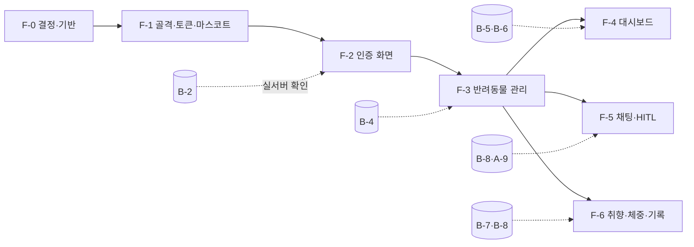

# Phase 3 개발 계획 — Frontend (React + TypeScript)

> 상위 계획: [plan.md](plan.md) Phase 3 (F-1 ~ F-6)
> 기준 문서: [wireframe.md](wireframe.md) (배치·동작), [Style-guide.md](Style-guide.md) (토큰·컴포넌트 값), [ARCHITECTURE.md](ARCHITECTURE.md) 4.2·7.6장, [SERVICE.md](../SERVICE.md) 4·8장, [USER_SCENARIO.md](USER_SCENARIO.md), [phase2_task.md](phase2_task.md) (Backend 응답 형식), [CLAUDE.md](../CLAUDE.md) 4.2·4.5.2
> 작성일: 2026-11-05 · 화면 예시 기준일 `TODAY_OVERRIDE=2026-11-10` (화요일)

이 문서는 plan.md의 F-1 ~ F-6을 **실제로 구현할 수 있는 단위**로 쪼갠 작업 계획이다.
- plan.md의 완료 조건은 바꾸지 않는다.
- 이 문서는 그 조건을 채우기 위한 파일, 컴포넌트, 테스트, 순서를 정한다.
- 체크박스는 이 문서에서 관리하고, task가 끝나면 plan.md의 완료 조건도 체크한다.
- 문서끼리 다르면 SERVICE.md → ARCHITECTURE.md → Style-guide.md → wireframe.md 순으로 따르고, 다른 부분은 문서를 먼저 고친다 (Style-guide.md 머리말).

---

## 0. 목표와 범위

| 항목 | 내용 |
|------|------|
| 목표 | `npm run dev`(:5173)로 뜨는 웹앱이 wireframe W00 ~ W12를 Backend `/api/*`만으로 동작시킨다 |
| 범위 | `src/frontend/` React + TypeScript 코드와 그 테스트, 자체 제작 마스코트, `doc/assets.md` 기록 |
| 산출물 | `src/frontend/` (자체 `package.json`), `src/frontend/src/styles/tokens.css`, `doc/assets.md` 갱신 |
| 완료 판정 | 아래 13장 "Phase 3 완료 점검"을 모두 통과 |

**Phase 3에서 하지 않는 것**
- Agent 서버나 LLM을 직접 부르지 않는다. 모든 요청은 `/api/*`(Backend)로만 보낸다 (CLAUDE.md 4.2).
- 추천·D-day 판정·취향 점수를 화면에서 다시 계산하지 않는다. 서버가 준 `d_day`, `kind`, `rank`, `relaxed`를 그대로 보여 준다. 화면이 계산하는 것은 날짜 **표시 형식**과 연령 구간 **미리보기**(W03)뿐이다.
- 푸시 알림, SSE 스트리밍, 프로필 사진 업로드 저장은 하지 않는다 (ARCHITECTURE.md 10장. 사진 칸은 선택 UI만 두고 저장하지 않는다 → D7).
- 평가 실행(E-1 ~ E-3)은 하지 않는다. 화면 시나리오는 이 Phase에서 자동 테스트로 확인하고, 전체 수동 점검은 E-2에서 한다.

**Phase 1·2와의 관계** (2026-11-05 기준 Agent A-0 ~ A-5 완료, Backend 계획만 있음)
- F-1(골격·토큰·마스코트)은 Backend 없이 바로 시작할 수 있다 (plan.md 1장).
- F-2 ~ F-6은 **MSW 목 서버**(1.4)로 먼저 만들고, 해당 Backend task가 끝나면 실제 서버로 바꿔 확인한다. 목 응답은 ARCHITECTURE.md 4.2와 phase2_task.md에 정한 형식을 그대로 따른다.

---

## 1. 개발 시작 전 정할 것 (F-0)

### 1.1 정해야 할 것 👤

| # | 항목 | 추천안 | 근거 |
|---|------|--------|------|
| Q1 | 마스코트 제작 방식 (SERVICE.md 10장 오픈 이슈) | **코드로 그린 자체 제작 SVG**. 개·고양이 각각 표정 5가지를 React 컴포넌트로 만든다. 외부 에셋과 라이선스 문제가 없다 | CLAUDE.md 4.5.2, Style-guide.md 8장 |
| Q2 | 아이콘 세트 (assets.md 미정) | **Lucide** (ISC 라이선스, 선 2px, 둥근 끝이 기본값) | Style-guide.md 8장 "선 2px, 둥근 끝, 한 세트만" |
| Q3 | 글꼴 제공 방식 | `@fontsource/jua`, `@fontsource/nanum-gothic`으로 **직접 포함** (Google Fonts CDN을 쓰지 않아 로컬 데모가 오프라인에서도 동작) | ARCHITECTURE.md 7.6 "후보" 확정 |
| Q4 | Tailwind 버전 | **v3** (Style-guide.md 13.1이 `tailwind.config.ts`를 전제로 한다. v4를 쓰면 13.1을 먼저 고친다) | Style-guide.md 13.1 |

- [ ] Q1 ~ Q4를 정하고 `doc/assets.md` 2장(채택 표시, 확인일)과 SERVICE.md 10장(마스코트 `[x]`)에 기록한다

### 1.2 파일 배치

```
src/frontend/
├── package.json            scripts: dev / build / preview / test / test:e2e / lint / format / typecheck
├── vite.config.ts          dev 서버 :5173, 프록시 /api → http://localhost:3000
├── tailwind.config.ts      의미 토큰을 theme.extend에 연결 (값을 다시 쓰지 않음)
├── eslint.config.js, .prettierrc, tsconfig.json
├── index.html              <head>에서 React보다 먼저 data-theme·data-motion 설정 (Style-guide.md 10장)
├── e2e/                    Playwright (실제 Backend + 시드 리셋)
└── src/
    ├── main.tsx, App.tsx   라우터·QueryClient·전역 Provider
    ├── styles/tokens.css   **유일한 디자인 값 정의 위치** (Style-guide.md 13.2)
    ├── styles/global.css   기본 스타일, 폰트 로드
    ├── api/
    │   ├── client.ts       fetch 래퍼 (credentials: "include", 오류 본문 → ApiError, 401 처리)
    │   ├── types.ts        API 요청·응답 타입 (ARCHITECTURE.md 4.2 + phase2_task.md)
    │   └── *.ts            auth / pets / tasks / health / weights / preferences / chat / catalog / notifications
    ├── hooks/              TanStack Query 훅 (usePets, useTodayTasks, useNotifications …)
    ├── state/
    │   ├── currentPet.tsx  선택된 반려동물 (URL ?pet= + localStorage)
    │   └── settings.tsx    테마·움직임 줄이기 (localStorage, 실패하면 기본값)
    ├── lib/
    │   ├── dates.ts        KST 표시 형식 "11/13 (금)", D-day 문구, 연령 구간 미리보기
    │   ├── traceLabels.ts  trace → 사용자용 문구 표 (ARCHITECTURE.md 7.6, 유일한 위치)
    │   ├── chatView.ts     응답(answer·contexts·trace) → 말풍선 표시 모델 (HITL·출처·특수 응답 판정)
    │   └── messages.ts     오류 코드 → 한국어 문구
    ├── components/
    │   ├── base/           Button, Input, Badge, Toast, Modal, Sheet, Tabs, EmptyState, ErrorState, Skeleton, ProgressBar
    │   ├── mascot/         DogMascot, CatMascot, Mascot(species, mood, size)
    │   ├── layout/         AppShell(W00), PetTabs, BottomNav, Sidebar, RequireAuth
    │   └── domain/         TaskCard, HealthEventCard, ChatBubble, ApprovalCard, SourcesBox, EvidencePanel, WeightChart
    ├── pages/              W01Login … W12Me (화면 ID와 이름을 맞춤, wireframe.md "읽는 법")
    ├── mocks/              MSW 핸들러·시드 기반 목 데이터 (개발·테스트 공용)
    └── test/               Vitest 설정, 렌더 헬퍼
```

- [ ] 위 배치를 ARCHITECTURE.md 2장에 "Frontend 내부 구조" 한 단락으로 적는다 (**문서 먼저**, D1)

### 1.3 라이브러리

| 용도 | 패키지 | 비고 |
|------|--------|------|
| 빌드 | `vite`, `@vitejs/plugin-react`, `typescript` | |
| 라우팅 | `react-router-dom` | wireframe 0장 라우트 |
| 서버 상태 | `@tanstack/react-query` | 반려동물 전환·변경 후 무효화, 재시도 정책을 한곳에서 |
| 스타일 | `tailwindcss` (Q4), `postcss`, `autoprefixer` | 값은 tokens.css의 CSS 변수만 참조 |
| 모션 | `framer-motion` | 스프링 바운스 (Style-guide.md 9장) |
| 아이콘 | `lucide-react` (Q2) | |
| 글꼴 | `@fontsource/jua`, `@fontsource/nanum-gothic` (Q3) | |
| 체중 그래프 | 직접 그린 SVG (`WeightChart`) | 점 몇 개뿐이라 차트 라이브러리를 쓰지 않는다 |
| 단위·컴포넌트 테스트 | `vitest`, `@testing-library/react`, `@testing-library/user-event`, `jsdom`, `msw` | |
| 접근성 검사 | `vitest-axe` (컴포넌트), `@axe-core/playwright` (화면) | Style-guide.md 12장 |
| E2E | `@playwright/test` | 실제 Backend + `seed:reset` |
| 린트 | `eslint`, `typescript-eslint`, `eslint-plugin-react-hooks`, `prettier` | |

- [ ] 버전을 `package.json`에 고정하고 `package-lock.json`을 커밋한다

### 1.4 테스트 전략

| 층 | 무엇으로 | 외부 의존 | 실행 |
|----|----------|-----------|------|
| 단위 (날짜 표시·traceLabels·chatView·오류 문구) | 순수 함수 + 고정 입력 | 없음 | `npm test` |
| 컴포넌트 (TaskCard·ApprovalCard·Modal …) | RTL + `vitest-axe` | 없음 | `npm test` |
| 화면 (W01 ~ W12) | RTL + **MSW** (시드 기반 목 응답) | 없음 | `npm test` |
| E2E (시나리오) | Playwright + 실제 Backend(:3000) + 가짜 또는 실제 Agent, 테스트마다 `seed:reset` | Backend, Chroma (+ Agent) | `npm run test:e2e` |

- 기본 `npm test`는 네트워크 없이 **30초 안에** 끝나야 한다.
- **MSW 목 데이터는 `data/seed/*.json`을 읽어 만든다**(빌드 시 import). 그래서 화면 테스트의 예시 값(보리 33.2kg, 콩이 DHPP 3차 11/13)이 시나리오와 같다.
- 목 응답의 모양은 `api/types.ts` 타입을 거쳐 만든다. Backend 응답이 문서와 다르면 타입 → 목 → 화면 순으로 고친다.
- 기준일은 `2026-11-10`. 화면 테스트는 `vi.setSystemTime`으로 고정하고, 표시용 "오늘"은 서버 응답의 `date`를 우선한다 (Backend `TODAY_OVERRIDE`와 어긋나지 않게).
- E2E 브라우저 폭은 375px(모바일)과 1280px(데스크톱) 두 가지다 (Style-guide.md 14장).

### 1.5 공통 화면 규칙

| 규칙 | 내용 |
|------|------|
| API 호출 | `api/client.ts` 하나로만 한다. `fetch`를 컴포넌트에서 직접 쓰지 않는다. 주소는 상대 경로 `/api/...` (Vite 프록시) |
| 인증 | httpOnly 쿠키라 토큰을 JS에서 다루지 않는다. 앱 시작 시 `GET /api/me`로 로그인 여부를 판단한다 |
| 401 | 어디서든 401이면 캐시를 비우고 `/login`으로 보낸다. "다시 로그인해 주세요" 토스트 (W00) |
| 404 | 다른 사용자 리소스·삭제된 리소스. "찾을 수 없어요" 빈 상태로 보여 주고 내부 사유를 쓰지 않는다 |
| 503 | 해당 영역에만 오류 상태를 보여 주고 나머지 화면은 정상 (S22, wireframe 13장) |
| 반려동물 전환 | 선택값은 URL `?pet=<id>`가 기준이고, 마지막 선택을 `localStorage`에 둔다. 목록에 없는 id면 첫 반려동물로 바꾼다 |
| 날짜 | 표시는 `M/D (요일)`, API에는 `YYYY-MM-DD` (wireframe 13장). 요일·날짜 계산은 `Asia/Seoul` 기준 |
| 문구 | 사용자 노출 문구는 한국어, Style-guide.md 11장 말투. 서버 오류 메시지는 `error.code`로 `lib/messages.ts`에서 고른다 |
| 디자인 값 | 컴포넌트·화면 코드에 hex 색, px 반경·간격, 글꼴 이름을 쓰지 않는다 (린트 규칙으로 검사, F-1) |
| 내부 정보 | 카탈로그 ID, Agent·도구 이름, trace `args`를 화면에 보여 주지 않는다 (wireframe W05·W09-a). 예외: 근거 보기의 카탈로그 ID는 `--font-mono`로 작게 보여 줄 수 있다 (Style-guide.md 4.1) → 보여 줄지 D6에서 정한다 |

---

## 2. 작업 순서



| 순서 | 묶음 | 병렬 가능 | 예상 규모 |
|------|------|-----------|-----------|
| 1 | F-0, F-1 | Backend와 완전히 병렬 | **큼** (토큰 3계층, 기본 컴포넌트 10여 개, 마스코트 10종) |
| 2 | F-2 | — | 작음 |
| 3 | F-3 | — | 중간 (등록 폼이 가장 길다) |
| 4 | F-4 ∥ F-5 ∥ F-6 | 서로 독립 (공통은 F-1 컴포넌트) | **큼** / **큼** / 중간 |

**가장 위험한 경로**: F-5(HITL 승인 카드와 자동 거절 — Agent 응답에서 승인 대기를 어떻게 알아내는지 아직 정해지지 않음, D3) → F-4(할 일 카드의 낙관적 갱신·되돌리기·교체). 이 두 곳에 테스트를 가장 많이 둔다.

---

## 3. F-0 · 결정과 기반

**의존성**: P0-2 ✅ (`doc/assets.md`)

- [ ] 1.1 Q1 ~ Q4 결정 기록 (👤)
- [ ] 1.2 파일 배치를 ARCHITECTURE.md 2장에 반영 (D1)
- [ ] Vite + React + TS 프로젝트 생성, `npm run lint`·`npm run typecheck`·`npm test` 동작
- [ ] `vite.config.ts` 프록시 `/api` → `http://localhost:3000` (쿠키가 같은 출처로 붙도록)
- [ ] `src/mocks/`: MSW 브라우저·노드 핸들러 골격, `data/seed/*.json`으로 목 데이터 생성
- [ ] `npm run dev:mock`: MSW를 켠 채로 개발 서버 실행 (Backend 없이 화면 개발)

**완료 조건**
- [ ] `npm run dev`로 빈 화면이 :5173에 뜨고, `npm test`가 테스트 0개로 정상 종료한다
- [ ] `npm run dev:mock`에서 목 `GET /api/me`가 응답한다

---

## 4. F-1 · 골격·디자인 토큰

**의존성**: F-0, P0-2 ✅

**작업**
- [ ] `styles/tokens.css`: Style-guide.md 13.2 골격을 그대로 옮긴다
  - 원시 → 의미 → 컴포넌트 3계층 (Style-guide.md 2장)
  - 테마 `[data-theme="dark"]`와 자동(`prefers-color-scheme`), 종 `[data-species="dog|cat"]` 강조색 (3.5장), 모션 `[data-motion="reduced"]`
  - 값은 이 파일에만 둔다. Style-guide.md와 다르면 Style-guide.md에 맞춘다
- [ ] `tailwind.config.ts`: 의미 토큰을 `var(--…)`로 연결한다. 기본 팔레트·반경은 끄고 토큰만 쓰게 한다 (`theme` 덮어쓰기)
- [ ] 린트: 컴포넌트·페이지 파일에서 hex 색(`#[0-9a-f]{3,8}`), `px` 리터럴, 글꼴 이름을 찾는 규칙 (`no-restricted-syntax` 또는 간단한 스크립트 `npm run lint:tokens`). 예외는 `tokens.css`와 마스코트 SVG
- [ ] `index.html`: `localStorage`의 테마·움직임 설정을 읽어 `<html data-theme data-motion>`을 React보다 먼저 설정한다. 읽기 실패 시 자동 (Style-guide.md 10장)
- [ ] 기본 컴포넌트 (Style-guide.md 7장 상태 전부: 기본·hover·눌림·포커스·비활성·로딩)
  - `Button`(primary/secondary/ghost/danger, 알약), `Input`·`TextArea`·`Select`·`DateInput`·`TimeInput`, `Badge`(D-day·지연됨·이력 확인 필요·싫어요 표시한 항목·직접 추가 — 색 + 아이콘 + 글자), `Toast`(3초, 되돌리기 있으면 5초, `role="status"`), `Modal`(포커스 가둠·복귀)·`ConfirmModal`(이름/이메일 입력 확인 변형)·`Sheet`, `Tabs`, `EmptyState`·`ErrorState`(마스코트 + 한 줄 + 다음 행동), `Skeleton`, `ProgressBar`
- [ ] 마스코트 (Q1): `DogMascot`·`CatMascot` × 기본·기쁨·미안·걱정·축하, 크기 24/32/96/160만 허용, 색은 팔레트 토큰만. 다른 회사 캐릭터를 떠올리게 하는 실루엣을 피한다 (assets.md 1장)
  - [ ] 완성 후 사람이 "다른 IP와 닮지 않았는지" 확인하고 assets.md에 확인일을 적는다 👤
- [ ] `layout/`: `AppShell`(W00) — 모바일 하단 내비 5칸 / 데스크톱(≥1024px) 사이드바 240px·본문 최대 960px, 헤더(🔔 개수·프로필), `PetTabs`(등록 순, 종별 마스코트·강조색, `[＋]`·`[⚙]`), 반려동물 0마리 안내
- [ ] `state/settings.tsx`: 테마(자동/밝게/밤하늘)·움직임 줄이기, `localStorage` 실패 시 기본값. 움직임 줄이기 = 기기 설정 OR 사용자 설정
- [ ] `api/client.ts`: `credentials: "include"`, JSON 본문, 오류 본문 `{ error: { code, message } }` → `ApiError(status, code)`, 401 전역 처리, 네트워크 오류 → `ApiError(0, "network")`
- [ ] `lib/dates.ts`: `formatMD("2026-11-13") → "11/13 (금)"`, `dDayLabel(d) → "D-3" | "오늘" | "내일" | "지연됨"`, 연령 구간 미리보기(어린 12개월 미만 / 시니어 7세, 대형견 6세 — `src/tests/fixtures/date_cases.json`으로 검증)
- [ ] `doc/assets.md`: 글꼴·아이콘·마스코트 행을 채택 상태로 바꾸고 확인일을 적는다 (**커밋 전에 먼저**, assets.md 머리말)
- [ ] 개발용 `/_styleguide` 라우트(개발 모드에서만): 토큰·컴포넌트·마스코트를 5개 조합(밝게/밤하늘 × 개/고양이 + 움직임 줄이기)으로 한눈에 확인

**테스트** (`src/components/**/*.test.tsx`, `src/lib/*.test.ts`)
- [ ] `date_cases.json`의 연령 구간 사례가 Python·Node와 같은 결과
- [ ] `formatMD`·`dDayLabel`: D-7, D-1(내일), D-0(오늘), 지연
- [ ] 기본 컴포넌트 각각 `vitest-axe` 위반 0건, 키보드로 조작 가능, 이모지 버튼에 `aria-label`
- [ ] `Modal`: 열면 포커스가 안으로, Esc로 닫으면 연 버튼으로 포커스 복귀
- [ ] `ConfirmModal`(이름 입력 변형): 입력이 정확히 같을 때만 확인 버튼 활성
- [ ] `data-motion="reduced"`에서 `Toast`·`Modal`이 페이드만 쓴다 (Framer Motion `useReducedMotion` 경로)
- [ ] `lint:tokens`가 hex 색을 넣은 임시 파일을 잡아낸다
- [ ] `api/client.ts`: 401이면 로그인 이동 콜백 호출, 503이면 `ApiError(503)`

**완료 조건 매핑** (plan.md F-1)
- `package.json`·Vite·ESLint+Prettier·`npm run dev`(:5173) → F-0, 이 task
- 색·반경·폰트를 CSS 변수 한 곳에서 관리 → `tokens.css` + `lint:tokens`
- 자체 제작 마스코트·일러스트만 쓰고 `doc/assets.md`에 출처 기록 → 마스코트 작업 + assets.md
- API 클라이언트가 Backend만 호출 → `api/client.ts` 상대 경로 + 13장 검색 점검

---

## 5. F-2 · 인증 화면 (W01, W02, W12 일부)

**의존성**: F-1, B-2 (B-2 전에는 MSW)

**작업**
- [ ] `RequireAuth`: 앱 시작 시 `GET /api/me`. 로딩 중에는 마스코트 스켈레톤, 401이면 `/login?next=<원래 경로>`
- [ ] W01 로그인: 이메일·비밀번호(👁 보기), 오류 "이메일 또는 비밀번호가 맞지 않아요"(계정 존재 여부를 알리지 않음), 성공 시 반려동물이 있으면 `next` 또는 W05, 없으면 W03
- [ ] W02 가입: 이메일·비밀번호(8자 이상, D4는 phase2_task.md)·닉네임, 데모 안내 체크, 409 → 이메일 칸 아래 "이미 사용 중인 이메일이에요", 400 → 필드별 안내. 성공 → W03 첫 등록
- [ ] 이메일은 입력 그대로 보여 주고 서버가 소문자로 저장한다 (화면에서 바꾸지 않음, wireframe W02)
- [ ] 로그아웃(W12 버튼): `POST /api/auth/logout` → 캐시 비우기 → W01
- [ ] 입력 오류는 칸 아래 `aria-describedby`로 연결, 제출 실패 시 첫 오류 칸으로 포커스

**테스트** (`src/pages/W01Login.test.tsx`, `W02Signup.test.tsx`, MSW)
- [ ] 로그인 실패 문구가 "없는 이메일"과 "틀린 비밀번호"에서 같다
- [ ] 가입 409 → 이메일 칸 오류, 다른 칸 값 유지
- [ ] 비로그인으로 `/health` 진입 → `/login?next=/health` → 로그인 후 `/health`
- [ ] 로그아웃 후 뒤로 가기로 보호 화면에 들어가도 로그인으로 보낸다 (캐시 비움)
- [ ] (E2E) S01 1·2·5단계: `NewBie@Demo.DailyPet` 가입 → W03, 로그아웃 → `/api/pets` 401 → 다시 로그인

---

## 6. F-3 · 반려동물 관리 화면 (W00 탭, W03, W04)

**의존성**: F-2, B-4 (B-4 전에는 MSW)

**작업**
- [ ] `state/currentPet.tsx`: 1.5 반려동물 전환 규칙. 전환 시 `queryClient`의 반려동물별 쿼리는 키에 `petId`가 들어 있어 따로 캐시된다. 전환 이벤트를 구독할 수 있게 한다 (F-5 자동 거절용)
- [ ] W03 등록·수정 (`/pets/new`, `/pets/:id/edit`)
  - 필수: 이름·종·생년월일·체중. 빈 칸이면 칸 아래 안내, 제출 막음 (서버 400 필드 오류도 같은 자리에 표시)
  - 종은 🐶 강아지 / 🐱 고양이 라디오 2개 + "다른 동물은 지원 예정이에요" 안내. 수정 화면에서는 종을 바꿀 수 없다 (phase2_task.md B-4)
  - 생년월일 입력 시 연령 구간 미리보기 ("어린 동물 (3개월)"), 미래 날짜 막음
  - 체중 범위 안내: 개 0.5~100kg / 고양이 0.3~15kg (종에 따라 바뀜)
  - 크기는 강아지만 표시
  - 알레르기·질환: 카탈로그 태그 값 중에서 고르는 칩 (`GET /api/catalog`에서 모은 `allergens`·`contraindications` 값 + 한국어 이름 표). 자유 입력은 메모로
  - 기본 시간대: 급여 시각 여러 개, 산책·놀이 시각 여러 개 → `default_times`
  - 접종·검진 이력(등록 때만): `GET /api/catalog?category=health&species=`에서 종에 맞는 항목, 회차 날짜 입력 또는 "모름" → `health_history`
  - 수정 저장 후 응답 `tasks_outdated: true`면 W05에 "프로필이 바뀌었어요 [할 일 다시 제안]" 배너를 띄울 표시를 남긴다 (반려동물별, 다시 제안하면 지움)
  - 저장 성공 → 새로 등록했으면 그 반려동물로 전환 후 W05
- [ ] W04 관리 (`/pets`): 카드(마스코트·품종·나이·체중·알레르기), [수정] → W03, [삭제] → 이름 입력 확인 모달 → `DELETE /api/pets/:id` `{ confirm_name }`
  - 실패(500) 시 "삭제하지 못했어요. 잠시 후 다시 시도해 주세요", 목록 유지 (S20 예외 흐름)
  - 선택 중이던 반려동물을 지우면 첫 반려동물로 전환, 0마리면 등록 안내
- [ ] `PetTabs`: 등록 순서, 선택 상태를 `aria-selected`로, 좌우 화살표 키로 이동

**테스트** (MSW)
- [ ] 필수값 4개를 하나씩 비우고 저장 → 그 칸에 안내, 요청 0회 (S01 예외)
- [ ] 종 선택지가 정확히 2개
- [ ] 생년월일 2026-08-01, 기준일 11/10 → "어린 동물 (3개월)"
- [ ] 수정 저장 → W05에 배너, [할 일 다시 제안] 후 배너 사라짐 (S05 4단계)
- [ ] 삭제 모달: 이름이 다르면 버튼 비활성, 같으면 `confirm_name`과 함께 요청 (S20 1단계)
- [ ] 보리 → 나비 전환 시 URL `?pet=pet_nabi`, 새로고침해도 나비 유지 (S02)
- [ ] 목록에 없는 `?pet=pet_mocha`(다른 사용자) → 첫 반려동물로 바뀌고 요청에 `pet_mocha`가 쓰이지 않는다
- [ ] (E2E) S01 3단계: 두부 등록 → W05 진입, 건강 일정 화면에 "이력 확인 필요" 항목이 있다

**완료 조건 매핑** (plan.md F-3): 등록·수정·삭제(확인 대화상자)·전환 (S01, S02, S20), 알레르기·질환·기본 시간대 입력

---

## 7. F-4 · 대시보드 (W05, W05-b, W06, W07)

**의존성**: F-3, B-5, B-6 (전에는 MSW)

**작업 — W05 오늘의 할 일**
- [ ] `useTodayTasks(petId)`: `GET /api/pets/:id/tasks` (오늘). 응답 `notice`·`retryable`(phase2_task.md B-6)이 있으면 할 일 영역만 "(😿) 추천을 불러오지 못했어요 [다시 시도]" (S22 3단계). 알림·체중 카드는 따로 불러와 영향을 받지 않는다
- [ ] 첫 생성 중: 마스코트 쓰기 애니메이션 + 스켈레톤 카드 3개 (움직임 줄이기면 정지 스켈레톤)
- [ ] 인사·진행률: 마스코트 1인칭 인사, "11월 10일 화요일 · 오늘의 할 일 2/6", `ProgressBar`(색 + 숫자)
- [ ] 정렬: 시간순, 시간이 없는 항목은 맨 아래 (wireframe W05)
- [ ] `TaskCard` (Style-guide.md 7.4, 카테고리 색 3.4장)
  - 완료 체크: 낙관적 갱신 → `PATCH /api/tasks/:id {done}`. 실패하면 되돌리고 토스트. 반짝임 파티클(12개 이하) + 스프링 바운스 + 마스코트 기쁨, 움직임 줄이기면 체크 표시만
  - 👍/👎 (`aria-label` "좋아요"/"싫어요", `aria-pressed`): `POST /api/pets/:id/feedback`. 👎 토스트 "M/D까지 추천하지 않아요" (날짜 = 오늘 + 6일, 서버 응답 값이 있으면 그것을 쓴다)
  - 🔄 바꾸기: `POST /api/tasks/:id/swap`. `swapped: false`면 "더 추천할 항목이 없어요", 카드 유지
  - ⋯ 메뉴: 시간 변경(시간 선택기 → 재정렬), 삭제
  - 삭제: 카드를 바로 숨기고 [되돌리기] 토스트 5초. 5초가 지나면 그때 `DELETE` 호출, 되돌리면 호출하지 않는다 (ARCHITECTURE.md 4.2). 그 사이 화면을 떠나면 바로 호출한다
  - `relaxed`에 `dislike`가 있으면 ⟨싫어요 표시한 항목⟩ 배지 + "후보가 부족해 다시 넣었어요", `constraint`면 "저녁 외 시간 항목" 안내 (CLAUDE.md 4.5.1, S04 예외)
  - 건강 할 일(`category=health`)에는 👍/👎/바꾸기가 **없다**. `[일정 ›]` → W07에서 그 일정 강조
  - 직접 추가 항목에는 ✍️ 직접 추가 배지
  - 메타 줄: 영역·강도·태그 (카탈로그 ID는 보여 주지 않음)
- [ ] [＋ 직접 추가] → W06, [↻ 할 일 다시 제안] → 확인 모달 → `POST .../tasks/generate {confirm:true}`. 503이면 "지금은 다시 제안할 수 없어요" + 기존 목록 유지
- [ ] 모두 완료하면 "(🎉) 오늘 할 일을 모두 마쳤어요!" + 축하 반짝임 1회
- [ ] 체중 카드: 프로필 체중 + [기록하기 ›] → W08
- [ ] 프로필 변경 배너 (F-3에서 남긴 표시, W08 저장도 같은 표시)

**작업 — 알림 (W00 🔔, W05 배너, W05-b 시트)**
- [ ] `useNotifications()`: `GET /api/notifications` (반려동물 무관, 사용자 전체). 대시보드 진입·포커스 복귀 때 새로 불러온다
- [ ] 배너: 가장 급한 1건(지연 → 오늘 → D-1 → D-7, 서버 순서 그대로) + [보기 ›]. 지연은 붉은 강조 "지연됨"(색 + ⚠ + 글자)
- [ ] 🔔 숫자 = 알림 개수, 시트에 전체 목록. 항목을 누르면 그 반려동물로 전환 후 W07
- [ ] 시트 하단 안내 "D-7 · D-1 · 당일 · 지연된 일정만 알려 드려요"

**작업 — W06 직접 추가 모달**
- [ ] 직접 입력(제목 + 시간 선택) / 추천 목록에서 고르기(영역 탭 식단·활동, 검색, `GET /api/catalog?category=&species=`) → `POST /api/pets/:id/tasks`
- [ ] 목록은 서버가 준 것만 보여 준다. 화면에서 알레르기·질환을 다시 거르지 않는다 → 서버가 **반려동물 기준 안전 필터**를 적용해 주는지 확인 (D5)

**작업 — W07 건강 일정**
- [ ] `GET /api/pets/:id/health-events` → 이력 확인 필요(맨 위, 노란 배지) / 다가오는 일정 / 지난 기록(접힘)
- [ ] 상태 배지: `D-n` · `D-1`·`오늘`(강조) · `지연됨` · `이력 확인 필요` · `완료` (Style-guide.md 7.5)
- [ ] [완료] → 모달(실제 완료일, 미래 날짜 막음) → `PATCH .../complete`. 다음 일정 **미리보기**는 서버 응답의 다음 일정을 보여 준다 (화면에서 회차·간격을 계산하지 않음 → 미리보기를 저장 전에 보여 주려면 D2)
- [ ] 이력 확인 필요 항목: [마지막 날짜 입력] → `PATCH {last_done_date}`, [날짜 정하기] → `PATCH {due_date}`
- [ ] ⋯ → 날짜 변경 (`PATCH {due_date}`, 승인 없음)
- [ ] 캘린더 뷰: 월간 달력에 일정 점, 날짜를 누르면 그날 목록. 키보드로 날짜 이동 (`role="grid"`)
- [ ] 하단 안내 "일정은 일반 권장 시기예요. 정확한 시기는 동물병원과 상의해 주세요"
- [ ] 완료·변경 후 `notifications`, `health-events`, 오늘 `tasks` 쿼리를 무효화한다

**테스트** (MSW 화면 테스트 + E2E)
- [ ] S03: 콩이 11/10 → 배너에 광견병 D-7만, 할 일에 DHPP D-3·광견병 D-7 둘 다 (MSW 목은 Backend 규칙대로 만든 값)
- [ ] 같은 날 대시보드를 두 번 열어도 `GET .../tasks`만 호출되고 생성 API는 0회
- [ ] 완료 체크 → 새로고침 후에도 ☑ (S03)
- [ ] `prefers-reduced-motion: reduce` 에뮬레이션 → 반짝임 요소가 렌더되지 않는다 (S03)
- [ ] 건강 할 일 카드에 👍/👎/바꾸기 버튼이 없다
- [ ] 바꾸기 `swapped:false` → 안내 토스트, 카드 유지 (S04 예외)
- [ ] 삭제 → 5초 안에 되돌리기 → `DELETE` 0회 / 5초 후 → `DELETE` 1회 (가짜 타이머)
- [ ] `relaxed:["dislike"]` 항목에 ⟨싫어요 표시한 항목⟩ 배지
- [ ] 다시 제안 확인 모달 [취소] → 요청 0회 (S04 예외)
- [ ] 할 일 응답 `notice` → 할 일 영역만 오류, 알림 배너·체중 카드는 정상 (S22 3단계)
- [ ] W07 완료 모달 11/14 → 다음 일정 "4차 · 12/12 (토)"가 표시된다 (S11, 서버 응답 기준)
- [ ] (E2E) S04 1 ~ 6단계 (모카): 낚싯대 놀이 없음, 활동 시간 19:00 이후, 바꾸기·👍·삭제·"21:00 빗질" 직접 추가·다시 제안 후 완료·직접 추가 유지
- [ ] (E2E) S11: `TODAY_OVERRIDE=2026-11-14`로 DHPP 3차 완료, 구충 이력 입력 → "이력 확인 필요" 사라짐

**완료 조건 매핑** (plan.md F-4): 할 일·완료·교체·시간 설정·직접 추가·👍/👎, 건강 알림 배너·일정 완료, 👎 완화 표시, S03·S04·S11 체크리스트

---

## 8. F-5 · 채팅·HITL·근거 보기 (W09, W09-a ~ d)

**의존성**: F-3, B-8 (+ A-9). 전에는 MSW로 `answer`·`contexts`·`trace` 목 응답

이 task는 Agent 응답(3키 + `thread_id`)을 **화면용 모델로 바꾸는 규칙**이 핵심이다. 규칙은 `lib/chatView.ts` 한 곳에 두고 단위 테스트로 고정한다. 아래 판정 근거 중 일부는 아직 A-9에서 확정되지 않았으므로 **구현 전에 ARCHITECTURE.md 4.1에 먼저 적는다** (D3).

**화면 판정 규칙 (안)**
| 표시 | 판정 근거 | 상태 |
|------|-----------|------|
| 답한 도우미 ("🍽 식단 도우미가 답했어요") | trace의 마지막 `handoff` 대상 → `traceLabels` | 확정 (trace 형식 4.1) |
| 승인 카드 (HITL) | trace의 `{type:"interrupt"}` 이벤트와 그 안의 작업 요약(도구 이름, 일정 이름·날짜) | 확정 (D3): interrupt `summary` {action, item_name, due_date, dose_no, event_id} — ARCHITECTURE.md 4.1 |
| 웹 검색 출처 박스 | `web_search` tool_call이 있고, 답변 끝 출처 목록 또는 trace `tool_result`의 URL | 확정 (D3): `web_search` tool_result의 `sources` (http/https만) |
| 응급 강조 박스 | trace `guardrail` 이벤트의 응급 표시 또는 답변의 병원 권고 문구 | 확정 (D3): `final.emergency: true` |
| 가드레일 차단 안내 | trace `{type:"guardrail", stage:"input"}`이고 차단됨 → 일반 안내만 (사유 표시 안 함) | 확정 (S17) |
| 취향 저장 칩 | trace에 `remember_preference` tool_call → 칩 "💝 취향에 저장했어요 [보기 ›]" (내용은 `GET .../preferences`를 다시 불러 보여 줌) | 확정 |
| "나비를 선택한 뒤 요청해 주세요 [나비로 전환]" | 답변·trace에서 대상 반려동물 id를 알아야 함 | 확정 (D3): 답변 문구 "«이름»를(을) 선택한 뒤 요청해 주세요" + 내 반려동물 이름 일치 |

**작업**
- [ ] W09 레이아웃: 모바일 1열 / 데스크톱 왼쪽 대화 목록(W10 컴포넌트 재사용) + 오른쪽 대화창. 상단 [🗂 대화 기록] [✎ 새 대화]
- [ ] `/chat/:threadId`: `GET /api/threads/:id`로 지난 메시지를 불러온다. 다른 반려동물의 thread면 그 반려동물로 전환하지 않고 W10으로 보낸다 (접두사 `thr_{user}_{pet}_`로 판정, 서버 404도 같은 처리)
- [ ] 보내기: `POST /api/chat {question, petId, threadId?}`
  - 응답 대기 중 마스코트 말풍선 "생각 중…" 점 애니메이션 (움직임 줄이기면 정지 텍스트), 같은 thread에서 중복 전송 막음
  - 응답의 `thread_id`를 URL에 반영 (`/chat/:threadId`, replace)
  - 새 답변 영역 `aria-live="polite"`
  - 503 → 입력창 위 배너 "(😿) 잠시 후 다시 시도해 주세요", 보낸 메시지에 [다시 보내기] (S22 2단계)
- [ ] 입력: 1,000자 제한, 카운터 "0 / 1,000", 넘으면 전송 비활성. 아래 도움말 "전화번호·주소 같은 개인정보는 입력하지 않아도 돼요". 추천 질문 칩 3개 (종에 맞게)
- [ ] `ChatBubble`: 사용자/도우미 말풍선 (Style-guide.md 7.6), 마스코트 표정(답변 종류별 기본·미안·걱정)
  - 답변 텍스트는 **일반 텍스트로** 렌더한다 (HTML 해석 금지). 줄바꿈·목록 기호만 처리
  - 서버가 마스킹한 값(`010-****-5678`)을 그대로 보여 준다
- [ ] `EvidencePanel` (W09-a): "🔎 근거 보기 ▾" 펼침 → contexts 목록(발췌, 출처 기관) + trace를 `traceLabels`로 바꾼 단계 목록. 표에 없는 항목은 "처리 중 단계"로 묶고, `args`는 절대 보여 주지 않는다
- [ ] `lib/traceLabels.ts`: Agent 이름(supervisor·diet_agent·exercise_agent·health_agent·general_agent) → "상담 도우미"·"식단 도우미"·"운동 도우미"·"건강 도우미"·"상식 도우미", 도구 이름 → 사용자 문구 (ARCHITECTURE.md 3.4 도구 목록 전부)
- [ ] `SourcesBox` (W09-b): 출처 제목·도메인, `target="_blank" rel="noopener noreferrer"`, `http(s)` 링크만 허용, 안내 "일반 정보예요. 정확한 판단은 수의사와 상담하세요", "🌐 상식 도우미가 웹에서 찾아봤어요". 저장 버튼 없음
- [ ] `ApprovalCard` (W09-c, Style-guide.md 7.7)
  - [승인] → `POST /api/chat/resume {threadId, decisions:[{type:"approve"}]}` → "✔ 등록했어요", 건강 일정·알림·할 일 쿼리 무효화
  - [날짜 수정] → 카드 안 날짜 선택 → [수정해서 승인] (`edit` + `edited_action`)
  - [거절] → `reject` → "등록하지 않았어요"
  - 승인 대기 중 입력창 안내 "새로 질문하면 위 요청은 취소돼요"
  - **자동 거절 표시**: 대기 중 새 메시지를 보내거나 반려동물을 바꾸면 카드를 "⊘ 취소된 요청"으로 바꾸고 "이전 일정 요청은 취소했어요" 안내. 실제 거절은 Agent가 다음 `/query` 때 한다 (phase1_task.md A-8). 반려동물을 바꾸면 다음 질문이 새 thread이므로 화면 표시만 바꾸고, 이전 thread를 다시 열면 서버 상태대로 보여 준다
  - resume 403·404 → "이미 처리되었거나 찾을 수 없는 요청이에요"
- [ ] 특수 응답 (W09-d): 위 판정 규칙대로 응급 박스(붉은 강조, 반짝임·농담 금지), 범위 밖 거절(미안 표정), 차단 안내, 취향 저장 칩, 다른 반려동물 쓰기 안내

**테스트** (`src/lib/chatView.test.ts`, `src/pages/W09Chat.test.tsx`, MSW)
- [ ] `chatView`: 평가셋 대표 문항별 가짜 응답 6종(diet·health HITL·general 웹 검색·safety 응급·injection 차단·personalization 취향 저장) → 표시 모델 스냅샷
- [ ] `traceLabels`: ARCHITECTURE.md 3.4의 모든 도구 이름에 문구가 있다 (도구 목록을 상수로 두고 비교). 모르는 이름 → "처리 중 단계"
- [ ] 근거 보기에 `args` 값, `user_id`, `pet_` id, 영어 도구 이름이 없다 (렌더 결과 텍스트 검색)
- [ ] 답변에 ``가 있어도 태그로 렌더되지 않는다
- [ ] S06: 보리 간식 질문 → 답변 + "식단 도우미가 답했어요" + 근거 보기에 contexts 2개
- [ ] S10: interrupt 응답 → 승인 카드, [승인] → resume 요청 본문 `approve`, 카드 "✔ 등록했어요", 일정 쿼리 무효화
- [ ] S10: 대기 중 새 메시지 → 카드 "⊘ 취소된 요청" / 반려동물 전환 → 같은 표시 + 토스트
- [ ] S12: 웹 검색 답변 → 출처 링크 `target=_blank`, 안내 문구, "할 일에 추가" 버튼 없음
- [ ] S08 (P1 호두 식단+운동): 두 도우미 handoff가 근거 보기 단계에 모두 보인다
- [ ] 1,001자 → 전송 버튼 비활성
- [ ] 503 → 배너 + [다시 보내기] → 같은 질문 재전송
- [ ] (E2E, A-9 이후) S06·S10 실제 Agent: 답변·근거 보기·승인 → W07에 새 일정

**완료 조건 매핑** (plan.md F-5): 질문·답변·근거(`contexts`)·처리 과정(`trace`), HITL 승인/거절·자동 거절 안내, 웹 검색 출처·안내, S06·S08·S10·S12

---

## 9. F-6 · 취향·체중·대화 기록 화면 (W08, W10, W11, W12)

**의존성**: F-3, B-7, B-8 (전에는 MSW)

**작업 — W11 내 취향**
- [ ] `GET /api/pets/:id/preferences` → 👍 좋아해요 / 👎 싫어해요("M/D까지 추천하지 않아요", 기한이 지난 항목은 "지금은 다시 추천돼요") / ⏰ 지켜야 할 조건 / ⭐ 자주 한 활동
- [ ] 조건 문구: `activity_time_after:19:00` → "놀이·산책은 19:00 이후"처럼 사람이 읽는 문구로 바꾼다 (ARCHITECTURE.md 3.8 constraint 형식 4종 + 자유 텍스트는 그대로)
- [ ] `scope: "all_pets"` 행에 "👤 모든 아이 공통" 배지. ✕ 누르면 "모든 반려동물에서 지워져요" 확인 후 삭제 (SERVICE.md F9)
- [ ] 그 밖의 ✕는 즉시 삭제 + "다음 추천부터 다시 후보에 들어가요" 토스트 (S04 8단계)
- [ ] [전체 초기화] → 확인 모달 "모카의 취향과 활동 기록 점수가 초기화돼요" → `DELETE .../preferences` → 빈 상태 (S21)
- [ ] ⭐ 자주 한 활동(3회 이상 완료): Backend 응답에 단골 목록이 필요하다 → **결정(D4): Backend가 응답 `frequent`로 준다** (ARCHITECTURE.md 4.2, phase2_task.md B-7)

**작업 — W08 체중 기록**
- [ ] 입력(날짜·체중), 종별 범위 안내, 미래 날짜 막음. 409 → "이 날짜에 기록이 있어요. 덮어쓸까요?" 확인 → `overwrite: true`
- [ ] `WeightChart`: 자체 SVG 꺾은선, 점마다 값 텍스트(색만으로 구분하지 않음), `<title>`·표 대체(스크린리더용 숨은 표)
- [ ] 마스코트 한마디: 첫 기록 대비 변화 ("1.8kg 줄었어요!"). 증가·감소를 판단·평가하는 말(진단처럼 들리는 말)은 쓰지 않는다 (Style-guide.md 11장)
- [ ] 기록 목록(최근 순) + 🗑 삭제(확인) → 프로필 체중이 이전 값으로 돌아간 것을 반영
- [ ] 저장·삭제 후 W05 "프로필이 바뀌었어요" 표시

**작업 — W10 대화 기록**
- [ ] `GET /api/pets/:id/threads` → 제목·마지막 날짜·첫 질문 요약(마스킹된 값), 최근 순. 선택한 반려동물의 대화만
- [ ] 항목 → `/chat/:threadId`로 이어서 대화
- [ ] ⋯ → 삭제 확인 → `DELETE /api/threads/:id` → 목록에서 제거, 열려 있던 대화면 새 대화로
- [ ] 빈 상태: "아직 나눈 대화가 없어요 [대화 시작하기]"

**작업 — W12 내 정보·설정**
- [ ] 닉네임·이메일 (`GET /api/me`)
- [ ] 테마 자동/밝게/밤하늘, 움직임 줄이기 → `state/settings.tsx` (즉시 적용, 서버 저장 없음)
- [ ] 로그아웃(F-2), 회원 탈퇴: 이메일 입력 확인 모달 → `DELETE /api/me {confirm_email}` → W01 "그동안 함께해 줘서 고마워요" (S20 2단계)
- [ ] "오픈소스·에셋 정보" 링크: `doc/assets.md`의 표시 문구를 옮긴 정적 화면 (CC BY 에셋이 없으면 글꼴·아이콘 라이선스만)

**테스트** (MSW)
- [ ] S21: 보리 전체 초기화 → 빈 상태, 요청 1회
- [ ] S04 7단계: 모카 취향에 좋아요 "사료 던져 쫓기", 싫어요 "낚싯대…(11/14까지)", 조건 "19:00 이후 · 모든 아이 공통"
- [ ] 공통 조건 ✕ → 확인 모달이 먼저 뜬다 / 일반 항목 ✕ → 바로 삭제
- [ ] S05: 보리 33.2kg 기록 → 그래프 점 3개(35.0 → 34.0 → 33.2), 개 `150` → 범위 안내·요청 0회, 같은 날짜 → 덮어쓰기 확인
- [ ] 33.2 삭제 → 체중 카드 34.0kg
- [ ] S16: 보리 대화 목록에 나비 대화가 없다, 항목 → 같은 `threadId`로 W09, 삭제 → 목록에서 사라짐
- [ ] 회원 탈퇴 모달: 이메일이 다르면 버튼 비활성
- [ ] 테마 밤하늘 선택 → `<html data-theme="dark">`, 새로고침 후 유지, `localStorage` 예외를 던지게 해도 화면이 뜬다
- [ ] (E2E) S20 2·3단계: 탈퇴 → W01 → 같은 이메일로 다시 가입 → 반려동물 0마리 안내

**완료 조건 매핑** (plan.md F-6): [내 취향] 좋아요·싫어요(제외 기한)·제약·개별 삭제·전체 초기화(S21), 체중 입력·추이(S05), 반려동물별 대화 기록·이어서 대화(S16)

---

## 10. 공통 점검 (모든 task에 적용)

Style-guide.md 12장(접근성)·14장(리뷰 체크리스트)을 화면마다 확인한다. 자동화할 수 있는 것은 테스트로 둔다.

- [ ] (E2E) 모든 화면에서 `@axe-core/playwright` 위반 0건 (밝게·밤하늘 각각)
- [ ] (E2E) 375px·1280px에서 `document.documentElement.scrollWidth <= clientWidth` (가로 스크롤 없음), 200% 확대 시에도
- [ ] (E2E) 키보드만으로 S03 흐름(로그인 → 할 일 완료 → 알림 시트)을 끝낼 수 있다
- [ ] 터치 영역 44×44px 이상 (토큰 `--size-touch` 최소값으로 강제)
- [ ] 5개 조합(밝게/밤하늘 × 개/고양이 + 움직임 줄이기)을 `/_styleguide`와 주요 화면에서 스크린샷으로 남긴다 (Playwright `toHaveScreenshot`, 기준 이미지는 커밋)
- [ ] 화면·코드·에셋 이름에 다른 회사 이름("Disney", "Prism", "Mickey" 등)이 없다 (검색)

---

## 11. 문서 먼저 고칠 것 (구현 중 확인 목록)

CLAUDE.md 2장 규칙에 따라, 아래 항목은 **코드보다 문서를 먼저** 고친다.

| # | 내용 | 고칠 문서 | 시점 |
|---|------|-----------|------|
| D1 | Frontend 내부 구조(1.2)와 라이브러리(1.3), Q1 ~ Q4 결정 | ARCHITECTURE.md 2·7.6장, `doc/assets.md`, SERVICE.md 10장 | F-0 |
| D2 | 건강 일정 완료 모달의 "다음 일정 미리보기"를 저장 전에 보여 주려면 Backend 미리보기 API(예: `GET /api/health-events/:id/next?completed_date=`)가 필요. 없으면 저장 후 결과만 보여 주는 것으로 wireframe W07을 고친다 | ARCHITECTURE.md 4.2 또는 wireframe.md W07 | F-4 |
| D3 | 채팅 화면 판정 근거: interrupt 이벤트의 화면용 요약(작업 종류·일정 이름·날짜), 웹 검색 출처 URL 위치, 응급 표시, 다른 반려동물 쓰기 요청 표시. 3키 계약은 바꾸지 않고 `trace` 이벤트 필드로 추가한다 | ARCHITECTURE.md 4.1·3.6, phase1_task.md A-8 | F-5 (A-8 구현 전) |
| D4 | 취향 응답에 "자주 한 활동"(3회 이상 완료) 목록 추가 여부 | ARCHITECTURE.md 4.2, phase2_task.md B-7, wireframe.md W11 | F-6 |
| D5 | `GET /api/catalog`에 `petId`를 주면 그 반려동물 기준 안전 필터(종·연령·알레르기·질환·유해 식품)를 서버가 적용 (W06 "콩이에게 맞는 항목만"). 필터 로직은 Python에만 둔다는 규칙(CLAUDE.md 4.2)과 충돌하지 않게 Agent에 조회 API를 둘지 함께 정한다 | ARCHITECTURE.md 4.2, phase2_task.md B-6 | F-4 |
| D6 | 근거 보기에서 카탈로그 ID를 보여 줄지 (Style-guide.md 4.1은 허용, wireframe W05는 "노출하지 않음") | wireframe.md W09-a 또는 Style-guide.md 4.1 | F-5 |
| D7 | 프로필 사진: 선택 UI만 두고 저장하지 않음 (업로드 저장은 Version 2) | SERVICE.md F1, wireframe.md W03 | F-3 |
| D8 | wireframe W05 예시의 건강 할 일 "09:00"은 ARCHITECTURE.md 4.1.2("건강 일정 할 일은 시간이 없다")와 다르다 → 예시에서 시간을 뺀다 | wireframe.md W05 | F-4 |
| D9 | 알레르기·질환 태그의 한국어 이름 표 (예: `chicken` → 닭고기, `joint_disease` → 관절 질환). 화면 한 곳(`lib/labels.ts`)에 두고 근거를 적는다 | ARCHITECTURE.md 5장 | F-3 |

---

## 12. 위험과 대응

| 위험 | 영향 | 대응 |
|------|------|------|
| Backend(B-2 ~ B-8)·Agent(A-9)가 늦어짐 | 실제 연결 확인 지연 | MSW 목으로 화면을 먼저 끝내고, 목 응답은 `api/types.ts`를 거쳐 만들어 형식 차이를 타입 오류로 잡는다 |
| 목과 실제 응답의 형식 차이 | E2E에서만 발견 | Backend task가 끝날 때마다 해당 화면 E2E 1개를 바로 돌린다. Backend 응답 예시를 JSON 파일로 받아 목과 비교 |
| HITL 판정 근거(D3)가 늦게 정해짐 | F-5 재작업 | `chatView.ts`에 판정을 모아 두고, D3를 A-8 구현 전에 정하도록 Phase 1과 맞춘다 |
| 마스코트 제작이 오래 걸림 / 다른 IP와 닮음 | F-1 지연, 규칙 위반 | 단순한 도형 기반 SVG로 먼저 만들고 표정은 눈·입만 바꾼다. 사람 확인을 체크리스트에 둔다 |
| 파스텔 배경 위 명암비 부족 | 접근성 실패 | 토큰 단계에서 명암비를 확인하는 테스트(의미 토큰 쌍 → 대비 계산)를 둔다 |
| 낙관적 갱신·되돌리기 타이머가 꼬임 | 할 일 상태 불일치 | 할 일 변경은 TanStack Query mutation 한 곳에서, 실패 시 서버 값으로 다시 불러온다 |
| 서버 시각과 브라우저 시각 차이 (`TODAY_OVERRIDE`) | 날짜 표시가 시나리오와 다름 | "오늘"은 서버 응답의 `date`를 우선하고, 브라우저 시계는 표시 보조로만 쓴다 |

---

## 13. Phase 3 완료 점검

- [ ] `npm test` 전체 통과 (네트워크 없이 30초 이내), `npm run lint`·`npm run typecheck`·`npm run lint:tokens` 통과
- [ ] `npm run build` 성공
- [ ] `npm run test:e2e` 통과 (Backend + 시드 리셋, Agent 필요한 채팅 시나리오는 A-9 이후)
- [ ] wireframe W00 ~ W12가 모두 있고, 14장 화면 ↔ API 대응표의 모든 API를 화면에서 쓴다
- [ ] S01·S02·S03·S04·S05·S06·S08·S10·S11·S12·S16·S20·S21·S22의 화면(🖥️) 항목을 테스트로 확인했다
- [ ] 10장 공통 점검(접근성·가로 스크롤·5개 조합·다른 회사 이름 없음)을 통과했다
- [ ] `src/frontend/`에서 Agent 주소(`:8000`, `/query`, `/tasks/generate`), LLM SDK, 비밀키가 검색되지 않는다
- [ ] `doc/assets.md`에 쓰는 모든 에셋의 출처·라이선스·확인일이 있다
- [ ] 11장 문서 수정 D1 ~ D9가 반영되어 있다
- [ ] plan.md F-1 ~ F-6 완료 조건이 모두 체크되어 있다
- [ ] 산출물을 커밋했다 (`feat:` / `test:`), `node_modules/`·`dist/`·Playwright 결과물 제외

## 14. 진행 현황

| Task | 상태 | 비고 |
|------|------|------|
| F-0 결정·기반 | ⬜ | Q1 ~ Q4 👤 |
| F-1 골격·토큰·마스코트 | ⬜ | Backend와 병렬 |
| F-2 인증 화면 | ⬜ | MSW로 먼저, B-2 후 확인 |
| F-3 반려동물 관리 | ⬜ | MSW로 먼저, B-4 후 확인 |
| F-4 대시보드 | ⬜ | MSW로 먼저, B-5·B-6 후 확인 |
| F-5 채팅·HITL | ⬜ | D3 선행, B-8·A-9 후 확인 |
| F-6 취향·체중·기록 | ⬜ | MSW로 먼저, B-7·B-8 후 확인 |
