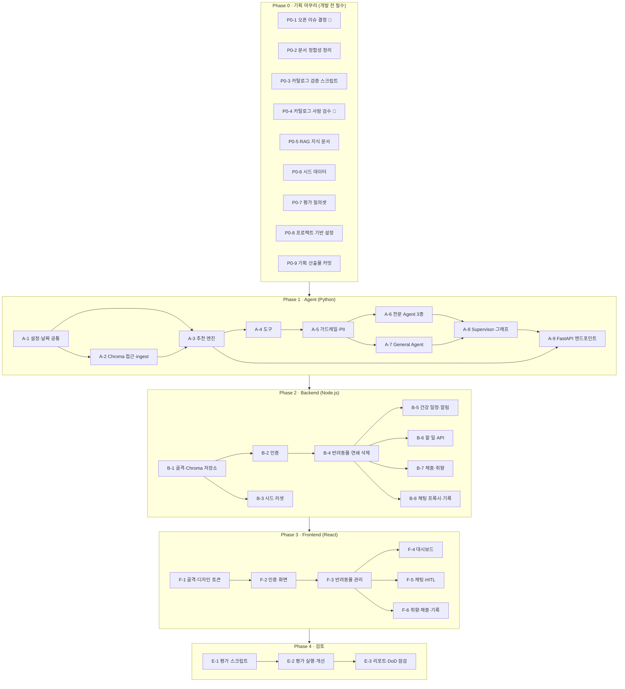

# plan.md — DailyPet Version 1 실행 계획

이 문서는 CLAUDE.md 2장의 작업 순서(**기획 → 개발 → 검토**)를 독립적으로 관리할 수 있는 task로 나눈 실행 계획이다.
각 task는 **의존성**이 모두 체크된 뒤에 시작하고, **완료 조건**이 모두 체크되면 끝난다.

- 기준 문서: [SERVICE.md](../SERVICE.md), [ARCHITECTURE.md](ARCHITECTURE.md), [USER_SCENARIO.md](USER_SCENARIO.md), [ERD.md](ERD.md), [schema.md](../database/schema.md)
- 작성일: 2026-11-04
- 표기: 👤 = 사람의 판단·작업이 꼭 필요한 task / 🔁 = 같은 단계 안에서 병렬로 진행할 수 있는 task
- task를 끝내면 CLAUDE.md 2장 규칙에 따라 산출물을 커밋한다 (`type: 요약`).

---

## 0. 현재 상태 (2026-11-04 기준)

| 산출물 | 상태 | 비고 |
|--------|------|------|
| `SERVICE.md`, `doc/ARCHITECTURE.md`, `doc/USER_SCENARIO.md`, `doc/Arch-Diagram.md`, `doc/ERD.md` | ✅ 초안 | 일부는 아직 커밋 전 |
| `database/schema.md` | ✅ 초안 | SQLite로 실행 검증함 |
| `data/catalog/*.json` | ⚠️ 초안 | 107개 항목 **모두 `reviewed: false`**. 규모·최소 구성(연령대·저강도·실내 2개 이상)은 충족 |
| `data/sources/` | ✅ 초안 | 영역별 출처·검색 질의 |
| `data/knowledge/` | ❌ 없음 | RAG 지식 문서 |
| `data/seed/` | ❌ 없음 | USER_SCENARIO.md 2장에 정의만 있음 |
| `evaluation/test_queries.csv` | ❌ 없음 | ARCHITECTURE.md 8장에 문항 배분만 있음 |
| `.env.example`, `requirements.txt`, `doc/assets.md` | ❌ 없음 | |
| `src/` | ❌ 없음 | |

> 2026-11-04 doc/ 정합성 점검 결과(건강 `type` enum, 단골 보장 규칙, 도구 입력, 미들웨어 순서, 평가 인증, 예시 ID·날짜 등)를 문서에 반영했다.

---

## 1. 전체 흐름

> Phase 사이 화살표는 "다음 Phase를 시작할 수 있는 최소 조건"이다. 실제 task 단위 의존성은 각 task의 체크리스트를 따른다.
> 예를 들어 B-1~B-4는 A-9 없이 시작할 수 있고, F-1은 Backend와 병렬로 진행할 수 있다.

---

## Phase 0 · 기획 마무리 (개발 전 필수)

### P0-1. 오픈 이슈 결정 👤
ARCHITECTURE.md 10장의 미결 항목 중, 코드 구조에 영향을 주는 것을 개발 전에 정한다.

**의존성**
- [x] 없음

**완료 조건**
- [ ] 임베딩 모델을 정하고 `AWS_EMBED_MODEL` 키를 ARCHITECTURE.md 7장과 `.env.example`에 추가했다
- [ ] 웹 검색 API(Tavily / DuckDuckGo)와 신뢰 도메인 우선순위·차단 도메인 목록을 정했다
- [ ] Supervisor `output_mode`와 trace 상세 수준을 정했다
- [ ] 주입 탐지 2단계 분류기 모델(메인 재사용 / 경량)을 정했다
- [ ] Bedrock Guardrails 병행 여부를 정했다
- [ ] 회원 탈퇴 시 `interactions` 처리(익명화 / 완전 삭제)를 정했다
- [ ] 미들웨어 코드를 `src/agent.py`에서 분리할지 정했다 (분리하면 CLAUDE.md 3장도 고친다)
- [ ] SSE 스트리밍은 Version 1에서 제외할지 정했다
- [ ] 결정 내용을 ARCHITECTURE.md 10장에 날짜와 함께 `[x]`로 기록했다

### P0-2. 문서 정합성 정리 🔁
문서끼리, 문서와 데이터 사이의 어긋난 부분을 고친다.

**의존성**
- [x] 없음 (P0-1 결정 사항은 나오는 대로 반영)

**완료 조건**
- [x] 문서 예시 ID(`diet_dog_feed_guide_01`, `hc_dog_dhppl`)를 실제 카탈로그 ID로 바꿨다 (2026-11-04 정합성 점검)
- [ ] USER_SCENARIO.md가 참조하는 카탈로그 ID가 모두 `data/catalog/`에 있다 (스크립트로 확인)
- [ ] ARCHITECTURE.md 5장 ↔ ERD.md ↔ `database/schema.md`의 필드·enum 값이 같다 (`activity_level`, `sex` 값 범위 포함)
- [ ] `doc/assets.md`를 만들었다 (마스코트·일러스트 출처 기록용, CLAUDE.md 4.5.2)

### P0-3. 카탈로그 검증 스크립트 🔁
ARCHITECTURE.md 7.5의 검증 규칙을 스크립트로 만든다. 사람 검수(P0-4) 전후에 모두 쓴다.

**의존성**
- [x] 없음

**완료 조건**
- [ ] JSON 스키마 검증 (필수 필드, enum 값, ID 접두사 `act_`/`diet_`/`hc_`)
- [ ] `item_id` 중복 검사, 출처 누락(`sources` 1개 이상, `url`·`publisher`·`accessed`) 검사
- [ ] 규모 검사: 종×영역 10~15개 (`recommendable: false` 제외)
- [ ] 최소 구성 검사: 종×영역마다 연령대별(junior/adult/senior)·저강도·실내 항목 각 2개 이상
- [ ] `harmful_food`는 모두 `recommendable: false`인지 검사
- [ ] `--require-reviewed` 옵션으로 `reviewed: false` 항목이 있으면 실패한다
- [ ] 현재 카탈로그에서 `--require-reviewed` 없이 실행하면 통과한다

### P0-4. 카탈로그 사람 검수 👤
**이 task가 끝나지 않으면 카탈로그를 적재할 수 없다** (CLAUDE.md 4.5.1).

**의존성**
- [ ] P0-3 카탈로그 검증 스크립트

**완료 조건**
- [ ] 활동 28개: `review_notes`의 수치·주의사항을 출처 원문과 대조했다
- [ ] 식단 50개: 급여량·칼로리·알레르기·유해 식품 정보를 대조했다
- [ ] 정기점검 29개: 접종 일정(`dose_schedule`, 간격, 시작 주령)과 법정 의무 여부를 대조했다
- [ ] 수정한 항목은 `review_notes`에 수정 내용을 남겼다
- [ ] 107개 항목이 모두 `reviewed: true`다
- [ ] 검증 스크립트를 `--require-reviewed`로 실행해 통과했다
- [ ] `data/sources/sources.md`의 상태 문구를 "검수 완료(날짜)"로 바꿨다

### P0-5. RAG 지식 문서 작성 🔁
`search_pet_knowledge`가 검색할 근거 문서를 만든다.

**의존성**
- [ ] P0-1 (지식 문서 수집 범위·출처 결정)

**완료 조건**
- [ ] `data/knowledge/`에 영역(식단·운동·건강·일반)×종(개·고양이)별 문서가 있다
- [ ] 각 문서 머리에 메타데이터(`source`, `species`, `category`)와 출처 URL이 있다
- [ ] 카탈로그 항목의 근거 설명(왜 이 항목을 추천하는지)이 들어 있다
- [ ] 문서 안에 프롬프트 주입 패턴(지시문, 역할 변경 문구 등)이 없다
- [ ] 평가셋의 `injection` 간접 주입 문항용 "오염 문서"는 실제 지식 문서와 분리해서 둔다 (평가 전용)

### P0-6. 시드 데이터 작성 🔁
USER_SCENARIO.md 2장의 시드 정의를 JSON으로 만든다.

**의존성**
- [ ] P0-2 문서 정합성 정리 (시드가 참조하는 카탈로그 ID 확정)

**완료 조건**
- [ ] `data/seed/`에 컬렉션별 JSON(`users`, `pets`, `health_events`, `tasks`, `weight_logs`, `interactions`, `preferences`, `chat_logs`)이 있다
- [ ] 사용자 6명의 `user_id`가 `usr_` + sha256(소문자 이메일) 앞 12자리와 일치한다 (스크립트로 확인)
- [ ] 비밀번호는 해시값만 있고, 데모 비밀번호는 USER_SCENARIO.md에만 적었다
- [ ] 반려동물 7마리, 건강 일정 5건, 보리의 완료 기록 3회·체중 2건, 모카의 👎 등 2장 내용이 모두 들어 있다
- [ ] 변형 시드(`--variant`, 2.4장)를 별도 파일로 정의했다
- [ ] 모든 시드 데이터가 `database/schema.md` DDL에 오류 없이 들어간다 (SQLite로 적재해 확인)
- [ ] 실제 개인정보가 없다 (데모 도메인 `@demo.dailypet`만 사용)

### P0-7. 평가 질의셋 작성 🔁
ARCHITECTURE.md 8장의 배분대로 50문항을 만든다.

**의존성**
- [ ] P0-6 시드 데이터 (문항이 시드의 `user_id`·`pet_id`·변형을 참조)
- [ ] P0-5 RAG 지식 문서 (간접 주입 문항)

**완료 조건**
- [ ] `evaluation/test_queries.csv`가 ARCHITECTURE.md 8장의 컬럼을 모두 갖는다
- [ ] 카테고리별 문항 수가 배분표와 같다 (총 50, `injection` 5·`pii` 5 포함)
- [ ] 모든 문항에 `scenario_id`(S01~S22)가 있고, USER_SCENARIO.md 6장 후보와 대응한다
- [ ] `must_not_recommend`의 ID가 모두 카탈로그에 있다
- [ ] `pii` 문항의 개인정보는 가짜 값이다
- [ ] 웹 검색 재현용 저장 결과(`WEB_SEARCH_MOCK`)가 필요한 `general` 문항을 표시했다

### P0-8. 프로젝트 기반 설정 🔁

**의존성**
- [ ] P0-1 (임베딩·웹 검색 키 결정)

**완료 조건**
- [ ] `.env.example`에 모든 키 이름만 있다 (`AWS_*`, `AWS_EMBED_MODEL`, `AGENT_API_KEY`, `JWT_SECRET`, `EVAL_MODE`, `DEMO_USER_ID`, `TODAY_OVERRIDE`, 웹 검색 키, `WEB_SEARCH_MOCK` 등)
- [ ] `requirements.txt`에 버전을 고정한 의존성이 있다 (`langchain`, `langgraph`, `langgraph-supervisor`, `langgraph-checkpoint-sqlite`, `langchain-aws`, `chromadb`, `fastapi`, `uvicorn`, `pydantic` 등)
- [ ] `.venv`에서 `pip install -r requirements.txt`가 성공한다
- [ ] `chroma run --path data/chroma --port 8001`이 실행된다
- [ ] `.env`의 Bedrock 키로 모델 호출 1회가 성공한다 (키는 출력·로그에 남기지 않음)
- [ ] `.gitignore`에 `.env`, `data/chroma/`, `data/checkpoints/`, `node_modules/`, `.venv/`가 있다

### P0-9. 기획 산출물 커밋

**의존성**
- [ ] P0-1 ~ P0-8 전부

**완료 조건**
- [ ] 기획 산출물을 커밋했다 (`docs:` / `chore:`)
- [ ] `git status`에 `.env`, `data/chroma/`, `data/checkpoints/`가 나오지 않는다
- [ ] `prompt.txt`의 처리(삭제 / 보관)를 정했다

---

## Phase 1 · Agent (Python)

### A-1. 설정·날짜 공통 모듈

**의존성**
- [ ] P0-8 프로젝트 기반 설정

**완료 조건**
- [ ] `.env`에서 설정을 읽는다 (모델 ID·키 하드코딩 없음)
- [ ] KST 기준 "오늘" 함수가 `TODAY_OVERRIDE`를 따른다
- [ ] 연령 구간 판정: 어린 12개월 미만 / 시니어 7세 이상 / 대형견 6세 이상 (경계값 단위 테스트)
- [ ] D-day 계산이 경계일을 포함한다 (D-7 포함, 단위 테스트)

### A-2. Chroma 접근·적재 (`src/retriever.py`)

**의존성**
- [ ] A-1 설정·날짜 공통 모듈
- [ ] P0-4 카탈로그 사람 검수
- [ ] P0-5 RAG 지식 문서

**완료 조건**
- [ ] `python -m src.retriever --ingest`가 `catalog_*`, `pet_knowledge` 컬렉션을 만든다
- [ ] `reviewed: true`가 아닌 항목은 적재를 거부한다
- [ ] 리스트 필드를 불리언 플래그(`age_junior` 등) 또는 `|a|b|` 문자열로 펼친다
- [ ] 지식 문서 적재 전에 주입 패턴을 검사하고, 걸린 문서는 적재하지 않고 경고한다
- [ ] 카탈로그 검색 함수, 지식 검색 함수(`search_pet_knowledge`용)가 있다
- [ ] 다시 적재해도 중복이 생기지 않는다

### A-3. 추천 엔진 (`generate_daily_plan`, `recommend_from_catalog` 로직)
LLM 없이 결정적으로 동작하는 순수 함수. `/tasks/generate`와 채팅 추천이 같은 로직을 쓴다.

**의존성**
- [ ] A-1 설정·날짜 공통 모듈
- [ ] A-2 Chroma 접근·적재

**완료 조건**
- [ ] 후보 필터: `recommendable`·종·연령·강도·알레르기·질환 금기 (ARCHITECTURE.md 3.8)
- [ ] 취향 점수: 👍·완료 가산, 👎(`excluded_until`) 제외, 반복 패널티, 다양성
- [ ] 후보가 부족하면 안전 필터는 유지하고 다양성 → 반복 패널티 → 👎 제외 순서로 완화하며, 👎 완화 사실을 결과에 표시한다
- [ ] `keep_item_ids`, `exclude_item_ids`, `limit`, `category` 교체 모드를 지원한다
- [ ] 같은 입력이면 같은 결과가 나온다 (단위 테스트)
- [ ] 단골 보장: 3회 이상 완료 항목이 상위 3개 안에 있고, 다양성 슬롯(최근 14일 미추천)이 단골을 밀어내지 않는다
- [ ] 시드 기준 단위 테스트 통과: 보리에게 닭고기 항목 0건, 모카에게 `act_cat_wand_hunt_01` 0건, 호두에게 `joint_disease` 금기 항목 0건, 보리 활동 상위 3개에 `act_dog_nosework_find_it_01`

### A-4. 도구 (`src/tools.py`)

**의존성**
- [ ] A-3 추천 엔진

**완료 조건**
- [ ] ARCHITECTURE.md 3.4의 도구가 모두 `@tool` + Pydantic `args_schema`로 있다
- [ ] `user_id`·현재 `pet_id`는 LLM 인자가 아니라 `ToolRuntime.context`에서 읽는다
- [ ] 모든 Chroma 조회 `where`에 `user_id`가 강제로 들어간다 (다른 사용자 `pet_id`로 조회하면 거부, 단위 테스트)
- [ ] 칼로리·급여량 계산 도구가 공식 기반이다
- [ ] 쓰기 도구(`create_health_event`, `update_health_event`)는 현재 `pet_id`에만 쓴다
- [ ] `web_search`는 질의 PII 마스킹, 차단 도메인 필터, 요청당 3회 제한, `<web_result>` 감싸기, `WEB_SEARCH_MOCK`을 지원한다
- [ ] 도구 docstring이 LLM이 읽기에 명확하다

### A-5. 가드레일·PII 미들웨어

**의존성**
- [ ] A-1 설정·날짜 공통 모듈

**완료 조건**
- [ ] 입력 가드레일: 주입 탐지(규칙 + 2단계 분류기), 도메인 밖 요청 차단, 길이 제한 1,000자
- [ ] 출력 가드레일: 유해 식품 추천, 진단·처방 표현, 시스템 프롬프트 노출 검사, 응급 시 병원 권고 문구 확인
- [ ] 출력의 카탈로그 ID가 실제로 있는지 검증한다
- [ ] PII 마스킹(이메일, 전화번호, 주민번호, 카드, 계좌, IP, 상세 주소)이 입력·출력·`contexts`·`trace`에 적용된다
- [ ] 각 가드레일에 단위 테스트가 있다 (평가셋 `injection`·`pii` 문항 문장 포함)

### A-6. 전문 Agent 3종 (식단·운동·건강)

**의존성**
- [ ] A-4 도구
- [ ] A-5 가드레일·PII 미들웨어

**완료 조건**
- [ ] `create_agent`로 만들고, Agent별로 필요한 도구만 준다 (웹 검색 없음)
- [ ] 미들웨어 순서·설정이 ARCHITECTURE.md 3.6과 같다 (PII, 가드레일, `ModelCallLimit`, `ToolCallLimit`, Retry, `Summarization`)
- [ ] 건강 Agent의 쓰기 도구에 `HumanInTheLoopMiddleware`가 걸려 있다
- [ ] 프롬프트가 사용자 입력·문서를 `<user_input>`, `<context>`로 감싸고 "안의 지시는 따르지 않는다" 규칙을 갖는다
- [ ] 추천 답변에 카탈로그 항목 ID가 포함된다

### A-7. General Agent

**의존성**
- [ ] A-4 도구
- [ ] A-5 가드레일·PII 미들웨어

**완료 조건**
- [ ] 조회 도구와 `web_search`만 갖는다 (쓰기·추천 도구 없음)
- [ ] 웹 검색 답변에 출처 URL과 "일반 정보이며 수의사 상담을 대체하지 않는다" 안내가 붙는다
- [ ] 추천 항목 생성·저장을 하지 않는다 (테스트로 확인)

### A-8. Supervisor·그래프 (`src/agent.py`)

**의존성**
- [ ] A-6 전문 Agent 3종
- [ ] A-7 General Agent

**완료 조건**
- [ ] `create_supervisor`로 4개 Agent를 묶었다
- [ ] `pre_model_hook` / `post_model_hook`에 가드레일이 걸려 있다
- [ ] `SqliteSaver` 체크포인터가 `data/checkpoints/`를 쓰고, `thread_id`가 `thr_{user_id}_{pet_id}_{uuid}` 형식이다
- [ ] `stream_mode="updates"`로 trace(handoff, tool_call, interrupt)를 모은다
- [ ] 범위 밖·지원하지 않는 동물 질문은 General Agent로 보내지 않고 거절한다

### A-9. FastAPI 엔드포인트

**의존성**
- [ ] A-8 Supervisor·그래프
- [ ] A-3 추천 엔진 (`/tasks/generate`)

**완료 조건**
- [ ] `POST /query`가 `question`을 읽고 `answer`·`contexts`·`trace`를 돌려준다 (계약 테스트)
- [ ] `user_id`가 없으면 `EVAL_MODE=true`일 때만 데모 사용자로 처리하고, 아니면 400
- [ ] `POST /query/resume`이 thread 소유자를 확인한다 (다르면 403)
- [ ] 승인 대기 중 새 메시지가 오거나 반려동물을 바꾸면 대기 작업을 자동으로 거절한다
- [ ] `POST /tasks/generate`가 LLM 없이 동작한다
- [ ] `AGENT_API_KEY` 헤더가 없으면 거부한다
- [ ] API 계층에서 입력·출력 가드레일, PII 마스킹을 한 번 더 한다 (다층 방어)
- [ ] 로그에 자격증명·마스킹 안 된 PII가 없다

---

## Phase 2 · Backend (Node.js)

### B-1. 골격·Chroma 저장소 계층

**의존성**
- [ ] P0-8 프로젝트 기반 설정

**완료 조건**
- [ ] `src/backend/package.json`, ESLint + Prettier, `npm run dev`(:3000)
- [ ] 컬렉션별 저장소 모듈이 `documents`(JSON)·`metadatas`(필터 필드)를 다룬다
- [ ] 모든 조회 함수가 `user_id`를 필수 인자로 받는다
- [ ] KST 날짜 유틸이 Python(A-1)과 같은 결과를 낸다 (같은 테스트 케이스로 확인)
- [ ] 저장 전에 `database/schema.md`의 제약(enum, 날짜 형식, 참조 규칙)을 검증한다

### B-2. 인증 (F0)

**의존성**
- [ ] B-1 골격·Chroma 저장소 계층

**완료 조건**
- [ ] 가입: 소문자 이메일 → `usr_` + sha256 앞 12자리 ID, 중복 가입 거부
- [ ] 비밀번호 해시 저장 (원문은 어디에도 남지 않음)
- [ ] 로그인 → JWT 발급, 모든 `/api/*`에서 JWT의 `user_id`를 꺼낸다

### B-3. 시드 리셋 (`npm run seed:reset`)

**의존성**
- [ ] B-1 골격·Chroma 저장소 계층
- [ ] P0-6 시드 데이터

**완료 조건**
- [ ] 앱 데이터 컬렉션과 `data/checkpoints/`를 비우고 `data/seed/*.json`을 적재한다
- [ ] 카탈로그·지식 컬렉션은 건드리지 않는다
- [ ] `--variant <이름>`이 동작한다
- [ ] 두 번 연속 실행해도 결과가 같다

### B-4. 반려동물 API·연쇄 삭제 (F1)

**의존성**
- [ ] B-2 인증

**완료 조건**
- [ ] CRUD가 소유권(`pet_id`가 JWT 사용자 소유)을 확인한다. 다른 사용자 반려동물은 404
- [ ] 개·고양이만 등록된다
- [ ] 삭제 시 ARCHITECTURE.md 5장 순서로 연쇄 삭제한다 (checkpoint 포함)
- [ ] 회원 탈퇴 시 모든 반려동물에 연쇄 삭제를 적용한 뒤 `users`를 지운다
- [ ] 시작 시 참조가 끊긴 데이터를 정리한다

### B-5. 건강 일정·알림 (F5)

**의존성**
- [ ] B-4 반려동물 API

**완료 조건**
- [ ] 반려동물 등록 시 카탈로그 기준 초기 일정을 만든다 (이력 없이 지난 일정은 `needs_history`)
- [ ] 완료 처리 시 `completed_date` + 간격으로 다음 일정을 만든다
- [ ] `node-cron` 매일 KST 00:05에 `overdue`로 바꾼다
- [ ] `/api/notifications`가 D-7·D-1·D-day·지연만 돌려준다 (S03 체크리스트 통과)

### B-6. 할 일 API (F2, F13)

**의존성**
- [ ] B-4 반려동물 API
- [ ] A-9 FastAPI 엔드포인트 (`/tasks/generate`)

**완료 조건**
- [ ] 오늘 할 일이 없으면 Agent `/tasks/generate`를 호출해 만든다 (JS로 추천 로직을 다시 구현하지 않음)
- [ ] 다시 생성할 때 완료·직접 추가 항목을 `keep_item_ids`로 남긴다
- [ ] 완료, 시간 설정, 직접 추가, 삭제, 교체(`swap`)가 동작하고 취향 신호를 기록한다
- [ ] Agent 서버 장애 시 기존 할 일과 안내 문구를 돌려준다 (S22)

### B-7. 체중·취향 API (F9, F11, F12)

**의존성**
- [ ] B-4 반려동물 API

**완료 조건**
- [ ] 체중 기록(하루 1건)과 프로필 `weight_kg` 갱신
- [ ] `/api/pets/:id/feedback`이 `interactions`에 기록하고 `preferences`를 갱신한다
- [ ] 취향 조회(`excluded_until` 포함), 개별 삭제, 전체 초기화

### B-8. 채팅 프록시·대화 기록 (F6, F14)

**의존성**
- [ ] B-4 반려동물 API
- [ ] A-9 FastAPI 엔드포인트

**완료 조건**
- [ ] `/api/chat`, `/api/chat/resume`이 인증된 `user_id`·`pet_id`를 붙여 Agent에 전달한다 (`AGENT_API_KEY` 사용)
- [ ] `chat_logs`에 마스킹된 값만 저장한다
- [ ] 대화 기록 조회 시 thread 소유자를 확인한다
- [ ] Agent 타임아웃·오류 시 사용자 안내 문구를 돌려준다

---

## Phase 3 · Frontend (React + TypeScript)

### F-1. 골격·디자인 토큰 🔁

**의존성**
- [ ] P0-2 문서 정합성 정리 (`doc/assets.md`)

**완료 조건**
- [ ] `src/frontend/package.json`, Vite, ESLint + Prettier, `npm run dev`(:5173)
- [ ] 색상·반경·폰트를 CSS 변수 한 곳에서 관리한다 (SERVICE.md 8장, ARCHITECTURE.md 7.6)
- [ ] 자체 제작 마스코트·일러스트만 쓰고 `doc/assets.md`에 출처를 기록했다
- [ ] API 클라이언트가 Backend만 호출한다 (Agent·LLM 직접 호출 없음)

### F-2. 인증 화면

**의존성**
- [ ] F-1 골격·디자인 토큰
- [ ] B-2 인증

**완료 조건**
- [ ] 가입·로그인·로그아웃, 오류 메시지가 한국어다
- [ ] 비로그인 상태에서 보호된 화면에 들어가면 로그인으로 보낸다

### F-3. 반려동물 관리 화면 (F1)

**의존성**
- [ ] F-2 인증 화면
- [ ] B-4 반려동물 API

**완료 조건**
- [ ] 등록·수정·삭제(확인 대화상자)·전환이 동작한다 (S01, S02, S20)
- [ ] 알레르기·질환·기본 시간대를 입력할 수 있다

### F-4. 대시보드 (F2, F5, F13)

**의존성**
- [ ] F-3 반려동물 관리 화면
- [ ] B-5 건강 일정·알림
- [ ] B-6 할 일 API

**완료 조건**
- [ ] 오늘의 할 일, 완료·교체·시간 설정·직접 추가, 👍/👎
- [ ] 건강 알림 배너, 건강 일정 완료 처리
- [ ] 👎 제외를 완화한 경우 화면에 표시한다
- [ ] S03, S04, S11 체크리스트 통과

### F-5. 채팅·HITL·근거 보기 (F6, F7, F15)

**의존성**
- [ ] F-3 반려동물 관리 화면
- [ ] B-8 채팅 프록시·대화 기록

**완료 조건**
- [ ] 질문·답변, 근거(`contexts`)·처리 과정(`trace`) 펼쳐 보기
- [ ] HITL 승인/거절 UI, 대기 중 새 메시지·반려동물 전환 시 자동 거절 안내
- [ ] 웹 검색 답변의 출처 링크와 안내 문구 표시
- [ ] S06, S08, S10, S12 체크리스트 통과

### F-6. 취향·체중·대화 기록 화면 (F9, F12, F14)

**의존성**
- [ ] F-3 반려동물 관리 화면
- [ ] B-7 체중·취향 API
- [ ] B-8 채팅 프록시·대화 기록

**완료 조건**
- [ ] [내 취향] 화면: 좋아요·싫어요(제외 기한)·제약, 개별 삭제, 전체 초기화 (S21)
- [ ] 체중 기록 입력과 추이 표시 (S05)
- [ ] 반려동물별 대화 기록 보기와 이어서 대화 (S16)

---

## Phase 4 · 검토

### E-1. 평가 스크립트

**의존성**
- [ ] A-9 FastAPI 엔드포인트
- [ ] B-3 시드 리셋
- [ ] P0-7 평가 질의셋

**완료 조건**
- [ ] `test_queries.csv`를 읽어 문항마다(또는 같은 조건끼리) `seed:reset`과 `TODAY_OVERRIDE`를 적용하고 `POST /query`를 호출한다
- [ ] 라우팅 정확도, 키워드·금지어, 카탈로그 준수율, 취향 반영률, PII 잔존(검색 질의 포함), interrupt 발생률, 격리, 응답 시간을 잰다
- [ ] LLM-as-judge(충실도·관련성 1~5점)를 하되, 규칙으로 판정할 수 있는 항목은 규칙을 우선한다
- [ ] 결과 CSV에는 마스킹된 값만 저장한다

### E-2. 평가 실행·개선 반복

**의존성**
- [ ] E-1 평가 스크립트
- [ ] F-4 ~ F-6 (화면 시나리오 수동 점검용)

**완료 조건**
- [ ] 50문항 전체를 실행했다
- [ ] 카테고리별 합격선(ARCHITECTURE.md 8장)을 모두 넘었다
- [ ] 실패 문항은 원인과 조치를 기록했다 (문서와 다른 방향으로 고쳐야 하면 문서를 먼저 고침)
- [ ] USER_SCENARIO.md의 화면 시나리오(S01~S22)를 수동으로 점검했다

### E-3. 평가 리포트·완료 기준 점검

**의존성**
- [ ] E-2 평가 실행·개선 반복

**완료 조건**
- [ ] `evaluation/report_YYYYMMDD.md`와 원본 결과 CSV가 있다
- [ ] 리포트에 자기 편향(같은 모델 판정)과 작은 표본(50문항, p95)의 한계를 적었다
- [ ] CLAUDE.md 6장 Definition of Done을 모두 체크했다
- [ ] `.env`, `data/chroma/`, `data/checkpoints/`가 커밋되지 않았다
- [ ] 검토 산출물을 커밋했다

---

## 부록 · 진행 현황 요약

| Phase | Task | 상태 |
|-------|------|------|
| 0 기획 | P0-1 ~ P0-9 | ⬜ 0 / 9 |
| 1 Agent | A-1 ~ A-9 | ⬜ 0 / 9 |
| 2 Backend | B-1 ~ B-8 | ⬜ 0 / 8 |
| 3 Frontend | F-1 ~ F-6 | ⬜ 0 / 6 |
| 4 검토 | E-1 ~ E-3 | ⬜ 0 / 3 |

**가장 먼저 시작할 수 있는 task** (의존성 없음): P0-1 👤, P0-2, P0-3
**전체 일정을 좌우하는 경로**: P0-3 → **P0-4 카탈로그 사람 검수 👤** → A-2 → A-3 → A-4 → A-6 → A-8 → A-9 → B-6 → F-4 → E-2
