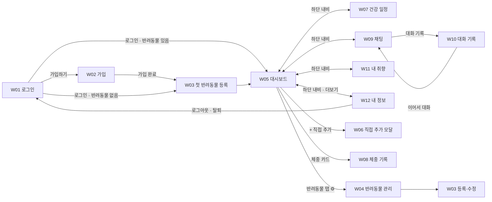

# wireframe.md — DailyPet Version 1 화면 와이어프레임

> 상태: 초안 (기획 단계) · 작성일: 2026-11-04
> 근거 문서: [SERVICE.md](../SERVICE.md) 4·6·8장, [USER_SCENARIO.md](USER_SCENARIO.md), [ARCHITECTURE.md](ARCHITECTURE.md) 4.2·6·7.6장
> 이 문서에서 정한 UI 규칙(건강 할 일 카드, trace 표시, 체중 덮어쓰기, 확인 창·되돌리기, 테마·모션 설정, 승인 대기 안내)은 SERVICE.md와 ARCHITECTURE.md에도 반영되어 있다 (2026-11-04).
> 화면 예시 데이터는 USER_SCENARIO.md 2장 시드(기준일 `2026-11-10` 화요일 KST)를 쓴다.

이 문서는 **배치와 동작**을 정한다. 색·반경·폰트는 디자인 토큰(ARCHITECTURE.md 7.6)을 따르고, 여기서는 정하지 않는다.

**읽는 법**
- 와이어프레임은 **모바일 기준(폭 약 390px)**으로 그린다. 데스크톱 배치가 다른 화면만 따로 그린다.
- 한글은 고정폭 글꼴에서 폭이 달라 오른쪽 테두리를 생략한다. `┌ └`가 영역의 시작과 끝이다.
- 표기: `[버튼]` · `( 입력칸 )` · `▾` 선택 · `◉ ○` 라디오 · `☐ ☑` 체크 · `(🐶)` 마스코트 자리 · `«…»` 동적 값
- 화면 ID `W01`~`W12`는 구현 시 라우트·컴포넌트 이름과 맞춘다.

---

## 0. 화면 목록과 흐름

| ID | 화면 | 라우트 (안) | 관련 기능 | 시나리오 |
|----|------|-------------|-----------|----------|
| W00 | 공통 레이아웃 (헤더·반려동물 탭·내비게이션) | — | F1 | S02 |
| W01 | 첫 화면 · 로그인 | `/login` | F0 | S01 |
| W02 | 가입 | `/signup` | F0 | S01 |
| W03 | 반려동물 등록·수정 | `/pets/new`, `/pets/:id/edit` | F1, F13 | S01, S05 |
| W04 | 반려동물 관리 (목록·삭제) | `/pets` | F1 | S02, S20 |
| W05 | 대시보드 (오늘의 할 일 + 알림) | `/` | F2, F5, F9, F13 | S03, S04, S22 |
| W06 | 할 일 직접 추가 (모달) | — | F2, F13 | S04 |
| W07 | 건강 일정 | `/health` | F5 | S03, S11 |
| W08 | 체중 기록 | `/weights` | F12 | S05 |
| W09 | 채팅 (근거 보기·HITL 포함) | `/chat`, `/chat/:threadId` | F6, F7, F14, F15 | S06~S18 |
| W10 | 대화 기록 목록 | `/chat/history` (모바일) | F14 | S16 |
| W11 | 내 취향 | `/preferences` | F9, F11 | S04, S21 |
| W12 | 내 정보 · 설정 | `/me` | F0 | S20 |



---

## W00. 공통 레이아웃

로그인 뒤 모든 화면이 쓰는 틀이다. **상단에서 반려동물을 바꾸면 모든 화면이 그 반려동물 기준으로 바뀐다** (F1).

**모바일**
```text
┌───────────────────────────────────────────────
│ ✨ DailyPet                         🔔² (🙂)
│ ┌────────┐┌────────┐
│ │🐶 보리 ││🐱 나비 │  [＋]  [⚙]
│ └────────┘└────────┘
│  ▲ 선택된 반려동물 (종에 따라 마스코트·강조색 변경)
├───────────────────────────────────────────────
│
│               « 화면 본문 »
│
├───────────────────────────────────────────────
│  🏠 오늘    💉 일정    💬 채팅    💝 취향    ☰ 더보기
└───────────────────────────────────────────────
```

**데스크톱 (≥ 1024px)**: 하단 내비가 왼쪽 사이드바로 바뀌고, 본문은 최대 폭 960px 가운데 정렬.
```text
┌──────────────┬─────────────────────────────────────────────
│ ✨ DailyPet  │ [🐶 보리] [🐱 나비] [＋] [⚙]           🔔² (🙂)
│              ├─────────────────────────────────────────────
│ 🏠 오늘      │
│ 💉 건강 일정 │
│ ⚖️ 체중 기록 │               « 화면 본문 »
│ 💬 채팅      │
│ 💝 내 취향   │
│ 👤 내 정보   │
└──────────────┴─────────────────────────────────────────────
```

| 요소 | 동작 |
|------|------|
| 반려동물 탭 | 등록 순서로 표시. 선택값은 URL 쿼리 또는 로컬 상태로 유지. 탭 전환 시 **채팅의 승인 대기 작업은 자동 거절**되고 토스트로 알린다 (S10) |
| `[＋]` | W03 등록 화면 |
| `[⚙]` | W04 반려동물 관리 |
| 🔔 알림 | 숫자 = `/api/notifications` 개수. 누르면 알림 목록 시트 (W05-b) |
| `(🙂)` 프로필 | W12 내 정보 |
| 반려동물 0마리 | 탭 대신 "첫 반려동물을 등록해 주세요 [등록하기]" |
| 로그인 만료(401) | 로그인 화면으로 이동, "다시 로그인해 주세요" 토스트 |

---

## W01. 첫 화면 · 로그인

```text
┌───────────────────────────────────────────────
│
│            ✨        (🐶)  (🐱)        ✨
│                 마스코트가 손 흔들기
│
│               D a i l y P e t
│        오늘도 우리 아이와 반짝이는 하루를!
│
│   이메일
│   ( you@example.com                         )
│   비밀번호
│   ( ••••••••                            👁 )
│
│   ⚠ 이메일 또는 비밀번호가 맞지 않아요      ← 오류 시
│
│   [            로그인            ]
│
│   처음이신가요?  [시작하기 · 가입]
└───────────────────────────────────────────────
```

- 로그인 성공 → 반려동물이 있으면 W05, 없으면 W03 (첫 등록).
- 오류 문구는 "이메일 또는 비밀번호"로 묶어 계정 존재 여부를 알리지 않는다.
- API: `POST /api/auth/login` (JWT httpOnly 쿠키)

## W02. 가입

```text
┌───────────────────────────────────────────────
│ ←                 가입하기
│
│        (🐱) "만나서 반가워요! 몇 가지만 알려주세요"
│
│   이메일 *
│   ( NewBie@Demo.DailyPet                    )
│   ⚠ 이미 사용 중인 이메일이에요            ← 409
│   비밀번호 *  (8자 이상)
│   ( ••••••••                            👁 )
│   닉네임 *
│   ( 새봄                                    )
│
│   ☐ 데모 서비스 이용 안내를 확인했어요
│
│   [            가입하기            ]
└───────────────────────────────────────────────
```

- 이메일은 대소문자를 구분하지 않는다. 화면은 입력 그대로 보여주고 저장은 소문자로 한다 (S01).
- 이메일 인증, 소셜 로그인 없음.
- 가입 완료 → 로그인 상태로 W03 첫 반려동물 등록.
- API: `POST /api/auth/signup` (중복 409, 입력 오류 400)

---

## W03. 반려동물 등록 · 수정

```text
┌───────────────────────────────────────────────
│ ←            반려동물 등록하기
│
│   (📷 사진 선택 · 선택사항)
│
│   이름 *          ( 두부                     )
│   종 *            ◉ 🐶 강아지   ○ 🐱 고양이
│                   ⓘ 다른 동물은 지원 예정이에요
│   품종            ( 말티즈                ▾ )
│   성별            ◉ 수컷  ○ 암컷    ☐ 중성화했어요
│   생년월일 *      ( 2026-08-01            📅 )
│                   → 어린 동물 (3개월)        ← 자동 판정 표시
│   체중(kg) *      ( 2.0                      )
│   크기            ◉ 소형  ○ 중형  ○ 대형      ← 강아지만
│   활동량          ○ 낮음  ◉ 보통  ○ 높음
│
│ ┌ 건강 정보 ───────────────────────────────
│ │ 알레르기   [닭고기 ✕] [소고기 ✕] [+ 추가]
│ │ 질환       [관절 질환 ✕] [+ 추가]   ← 태그 선택
│ │ 메모       ( 신장 수치 관찰 중              )
│ └──────────────────────────────────────────
│
│ ┌ 기본 시간대 (할 일에 자동으로 붙어요) ───
│ │ 🍚 급여    ( 08:00 ) ( 20:00 ) [+]
│ │ 🐾 산책·놀이 ( 19:30 ) [+]
│ └──────────────────────────────────────────
│
│ ┌ 접종·검진 이력 (선택) ──────────────────
│ │ 종합백신(DHPP)   ( 1차 날짜 ) [+ 회차 추가]   ☐ 모름
│ │ 광견병           ( 날짜 입력 )   ☐ 모름
│ │ ⓘ 모르면 비워 두세요. 권장 시기가 지난 항목은
│ │   "이력 확인 필요"로 표시돼요
│ └──────────────────────────────────────────
│
│   [            저장하기            ]
└───────────────────────────────────────────────
```

| 규칙 | 근거 |
|------|------|
| 필수값(이름·종·생년월일·체중)이 비면 해당 칸 아래 안내, 저장 안 됨 (400) | F1, S01 |
| 종은 개·고양이 두 가지뿐 | F1, S01 |
| 체중 범위: 개 0.5~100kg, 고양이 0.3~15kg | F12, schema.md |
| 질환·알레르기는 카탈로그 금기·알레르겐 태그와 같은 값으로 선택 (자유 입력은 메모로) | ARCHITECTURE 5장 |
| 접종 이력 항목은 종·연령에 맞는 정기점검 카탈로그에서 불러온다 | F5 |
| **수정 시**: 저장 후 오늘 목록은 자동으로 바꾸지 않고, W05에 "프로필이 바뀌었어요 [할 일 다시 제안]" 배너 | F1, S05 |

- API: `POST /api/pets` · `PUT /api/pets/:id` · `GET /api/catalog?category=health&species=`

---

## W04. 반려동물 관리

```text
┌───────────────────────────────────────────────
│ ←            우리 아이들
│
│ ┌──────────────────────────────────────────
│ │ (🐶) 보리   골든리트리버 · 5세 · 33.2kg
│ │      알레르기: 닭고기
│ │                              [수정] [삭제]
│ └──────────────────────────────────────────
│ ┌──────────────────────────────────────────
│ │ (🐱) 나비   러시안블루 · 2세 · 4.0kg
│ │                              [수정] [삭제]
│ └──────────────────────────────────────────
│
│   [ ＋ 새 반려동물 등록 ]
└───────────────────────────────────────────────
```

**삭제 확인 모달** (S20)
```text
┌───────────────────────────────────────────────
│              (😢) 정말 보내시겠어요?
│
│  코코의 할 일, 건강 일정, 체중 기록, 취향,
│  대화 기록이 모두 지워지고 되돌릴 수 없어요.
│
│  확인을 위해 이름을 입력해 주세요
│  ( 코코                                     )
│
│       [취소]            [삭제하기]  ← 이름이 맞을 때만 활성
└───────────────────────────────────────────────
```
- 삭제 실패(연쇄 삭제 중단) 시 "삭제하지 못했어요. 잠시 후 다시 시도해 주세요" 안내, 프로필은 목록에 남는다.
- API: `GET /api/pets` · `DELETE /api/pets/:id`

---

## W05. 대시보드 (오늘의 할 일)

예시: P1 김하늘 · 콩이, 2026-11-10 07:30 (S03)

```text
┌───────────────────────────────────────────────
│ « W00 헤더 · [🐶 콩이] »
├───────────────────────────────────────────────
│ ┌ 🔔 알림 배너 ────────────────────────────
│ │ 💉 광견병 접종 D-7 (11/17)           [보기 ›]
│ └──────────────────────────────────────────
│ ┌ ⓘ 프로필이 바뀌었어요 ──────────────────  ← 프로필·체중 변경 후에만
│ │ 바뀐 정보로 다시 제안받을까요? [할 일 다시 제안]
│ └──────────────────────────────────────────
│
│  (🐶) "오늘 콩이랑 산책 가는 날이에요! 🐾"
│  11월 10일 화요일 · 오늘의 할 일 2/6 ✨
│  ▓▓▓▓▓▓░░░░░░░░
│
│ ┌──────────────────────────────────────────
│ │ ☑ 07:30  🍚 아침 사료 나눠 주기 (하루 3~4회)
│ │          식단 · 퍼피 급여 가이드
│ └──────────────────────────────────────────
│ ┌──────────────────────────────────────────
│ │ ☐ 09:00  💉 종합백신 3차 D-3 — 병원 예약하기
│ │          건강 일정 · 11/13             [일정 ›]
│ └──────────────────────────────────────────
│ ┌──────────────────────────────────────────
│ │ ☐ 10:00  🙈 숨바꼭질 놀이 10분
│ │          활동 · 저강도 · 실내
│ │          👍  👎  🔄 바꾸기  ⋯
│ └──────────────────────────────────────────
│ ┌──────────────────────────────────────────
│ │ ☐ 19:30  🐾 퍼피 탐색 산책 15분  ⟨싫어요 표시한 항목⟩  ← relaxed: dislike
│ │          활동 · 후보가 부족해 다시 넣었어요
│ │          👍  👎  🔄 바꾸기  ⋯
│ └──────────────────────────────────────────
│ ┌──────────────────────────────────────────
│ │ ☐ 21:00  🪮 빗질                    ✍️ 직접 추가
│ │                                         ⋯
│ └──────────────────────────────────────────
│
│   [ ＋ 직접 추가 ]      [ ↻ 할 일 다시 제안 ]
│
│ ┌ ⚖️ 체중 ─────────────────────────────────
│ │ 3.1kg                      [기록하기 ›]  → W08
│ └──────────────────────────────────────────
└───────────────────────────────────────────────
```

**할 일 카드 동작**

| 동작 | 화면 반응 | API · 신호 |
|------|-----------|------------|
| ☐ → ☑ 완료 | 반짝임 파티클 + 스프링 바운스, 마스코트 반응 (`prefers-reduced-motion`이면 생략) | `PATCH /api/tasks/:id` · `complete` |
| 👍 / 👎 | 아이콘 채워짐, "기억해 둘게요" 토스트. 👎는 "11/16까지 추천하지 않아요" 안내 | `POST /api/pets/:id/feedback` · `like` / `dislike` |
| 🔄 바꾸기 | 같은 영역 다른 항목 1개로 교체. 후보 없으면 "더 추천할 항목이 없어요" | `POST /api/tasks/:id/swap` · `swap` |
| ⋯ → 시간 변경 | 시간 선택기 → 시간순 재정렬 | `PATCH /api/tasks/:id` |
| ⋯ → 삭제 | 카드 사라짐 + [되돌리기] 토스트 5초 | `DELETE /api/tasks/:id` · `remove` |
| 건강 할 일 `[일정 ›]` | W07로 이동, 해당 일정 강조 | — |

- 정렬: 시간순, 시간이 없는 항목은 맨 아래.
- 카드 하단 작은 글씨로 카탈로그 영역·강도·태그를 보여 준다. 카탈로그 ID는 화면에 노출하지 않는다.
- 건강 할 일 카드에는 👍/👎/바꾸기가 없다 (취향 대상 아님).
- **알림 배너**: D-7·D-1·당일·지연 일정만 (S03). 지연은 붉은 강조 "지연됨".

**할 일 다시 제안 확인 모달** (S04-6)
```text
┌───────────────────────────────────────────────
│        (🐶) 오늘 할 일을 다시 만들까요?
│
│  ✔ 완료한 항목과 직접 추가한 항목은 그대로 둬요
│  ↻ 아직 안 한 제안 항목만 바뀌어요
│
│       [취소]            [다시 만들기]
└───────────────────────────────────────────────
```

**상태별 화면**

| 상태 | 표시 |
|------|------|
| 생성 중 (첫 진입, 목록 없음) | 마스코트가 할 일 목록을 쓰는 애니메이션 + 스켈레톤 카드 3개 |
| Agent 서버 장애, 오늘 목록 **있음** | 정상 표시 (S22-1) |
| Agent 서버 장애, 오늘 목록 **없음** | 할 일 영역에만 "(😿) 추천을 불러오지 못했어요 [다시 시도]", 알림·체중 카드는 정상 (S22-3) |
| 모두 완료 | "(🎉) 오늘 할 일을 모두 마쳤어요!" + 축하 반짝임 |

### W05-b. 알림 목록 (🔔 시트)
```text
┌───────────────────────────────────────────────
│ 알림                                      ✕
│ ──────────────────────────────────────────
│ 💉 D-7     광견병 접종 (콩이)      11/17  ›
│ ──────────────────────────────────────────
│ ⓘ D-7 · D-1 · 당일 · 지연된 일정만 알려 드려요
│   ("이력 확인 필요" 일정은 W07에서 따로 보여요)
└───────────────────────────────────────────────
```
- 사용자의 모든 반려동물 일정을 모아 보여 준다. 항목을 누르면 해당 반려동물로 전환 후 W07.
- API: `GET /api/notifications`

---

## W06. 할 일 직접 추가 (모달)

```text
┌───────────────────────────────────────────────
│ 할 일 직접 추가                           ✕
│
│  ◉ 직접 입력        ○ 추천 목록에서 고르기
│
│  ( 빗질                                     )
│  시간 (선택)  ( 21:00 )
│
│  ── 추천 목록에서 고르기를 선택하면 ──
│  [식단] [활동]                  ← 영역 탭
│  ( 🔍 검색                                  )
│  ○ 🧩 스너플 매트·퍼즐 급여   저강도 · 실내
│  ○ 🐾 냄새 맡기 산책          저강도
│  ⓘ 콩이에게 맞는 항목만 보여요 (종·연령·알레르기)
│
│       [취소]            [추가하기]
└───────────────────────────────────────────────
```
- 직접 입력 → `category=custom`, `source=custom`. 목록 선택 → 해당 영역, `source=custom`, 카탈로그 ID 연결.
- 목록은 안전 필터(종·연령·알레르기·질환·유해 식품 제외)를 통과한 항목만.
- API: `POST /api/pets/:id/tasks` · `GET /api/catalog?category=&species=` · 신호 `custom`

---

## W07. 건강 일정

```text
┌───────────────────────────────────────────────
│ « W00 헤더 · [🐶 콩이] »
├───────────────────────────────────────────────
│  💉 콩이의 건강 일정          [리스트 | 캘린더]
│
│ ┌ ⚠ 이력 확인 필요 ───────────────────────
│ │ 🪱 어린 강아지 내부구충     권장 10/20
│ │ 마지막으로 한 날을 알려주시면 다음 일정을 잡아 드려요
│ │          [마지막 날짜 입력]  [날짜 정하기]
│ └──────────────────────────────────────────
│
│  다가오는 일정
│ ┌──────────────────────────────────────────
│ │ 💉 종합백신(DHPP) 3차         D-3
│ │    11/13 (금)                     [완료] ⋯
│ └──────────────────────────────────────────
│ ┌──────────────────────────────────────────
│ │ 💉 광견병 1차                  D-7
│ │    11/17 (화) · 법정 의무         [완료] ⋯
│ └──────────────────────────────────────────
│
│  지난 기록 ▾
│    ✔ 종합백신 2차   10/23 완료
│    ✔ 종합백신 1차   10/02 완료
│
│  ⓘ 일정은 일반 권장 시기예요. 정확한 시기는
│    동물병원과 상의해 주세요.
└───────────────────────────────────────────────
```

**상태 배지**: `D-n`(기본) · `D-1`·`오늘`(강조) · `지연됨`(붉은색, `overdue`) · `이력 확인 필요`(노란색, `needs_history`) · `완료`(회색)

**완료 처리 모달** (S11)
```text
┌───────────────────────────────────────────────
│ 종합백신(DHPP) 3차 완료                    ✕
│
│  실제로 맞은 날     ( 2026-11-14       📅 )
│
│  ✨ 다음 일정: 4차 · 2026-12-12
│     (실제 완료일 + 4주로 계산해요)    ← 날짜 입력 시 미리보기
│
│       [취소]            [완료하기]
└───────────────────────────────────────────────
```
- `⋯` → 날짜 변경(화면에서 직접, 승인 없음). 채팅으로 요청한 변경만 HITL을 거친다.
- 캘린더 뷰: 월간 달력에 일정 점 표시, 날짜를 누르면 그날 일정 리스트.
- API: `GET /api/pets/:id/health-events` · `PATCH /api/health-events/:id/complete` · `PATCH /api/health-events/:id`

---

## W08. 체중 기록

```text
┌───────────────────────────────────────────────
│ ←            ⚖️ 보리의 체중
│
│   날짜  ( 2026-11-10 📅 )   체중 ( 33.2 ) kg
│   ⚠ 0.5~100kg 사이로 입력해 주세요   ← 범위 밖
│                              [기록하기]
│
│   35 ┤●
│   34 ┤        ●
│   33 ┤              ●
│      └──────────────────────
│       10/10   11/01   11/10
│   (🐶) "1.8kg 줄었어요! 잘하고 있어요 ✨"
│
│   기록
│   11/10   33.2kg                        🗑
│   11/01   34.0kg                        🗑
│   10/10   35.0kg                        🗑
└───────────────────────────────────────────────
```
- 가장 최근 기록이 프로필 체중이 된다. 최근 기록을 지우면 바로 이전 값으로 돌아간다 (S05).
- 저장 후 W05에 "프로필이 바뀌었어요" 배너.
- 같은 날짜에 다시 기록하면 덮어쓸지 확인 (하루 1건).
- API: `GET/POST /api/pets/:id/weights` · `DELETE /api/weights/:id`

---

## W09. 채팅

예시: P3 이지우 · 보리 (S06)

**모바일**
```text
┌───────────────────────────────────────────────
│ « W00 헤더 · [🐶 보리] »
├───────────────────────────────────────────────
│ 💬 보리와 상담        [🗂 대화 기록] [✎ 새 대화]
│ ──────────────────────────────────────────
│                    ┌──────────────────────
│                    │ 보리 간식으로 뭐가 좋아?
│                    │ 토핑도 추천해줘
│                    └──────────────────── 나
│ (🐶)┌──────────────────────────────────
│     │ 보리는 감량 중이라 하루 칼로리의 10% 안에서
│     │ 저칼로리 간식이 좋아요.
│     │  🥕 당근 간식
│     │  🫛 그린빈 간식
│     │  🎃 익힌 호박 토핑 (무가당)
│     │ 보리는 닭고기 알레르기가 있어 닭가슴살
│     │ 토핑은 뺐어요.
│     │ ─────────────────────────────
│     │ 🔎 근거 보기 ▾        🍽 식단 도우미가 답했어요
│     └──────────────────────────────────
│
│ [오늘 운동 추천] [하루 사료량] [다음 접종 언제?]  ← 추천 질문 칩
│ ( 보리에 대해 물어보세요…             ) [➤]
│   0 / 1,000
└───────────────────────────────────────────────
```

**데스크톱**: 왼쪽에 대화 기록 목록(W10)을 고정하고 오른쪽에 대화창.
```text
┌──────────────────────┬────────────────────────────────────
│ 보리의 대화  [✎ 새]  │ 💬 보리 간식 추천
│ ──────────────────── │
│ ● 보리 간식 추천     │   « 대화 내용 »
│   11/10 · 오늘       │
│ ○ 보리 다이어트      │
│   11/08              │ [칩] [칩] [칩]
│                      │ ( 입력…                       ) [➤]
└──────────────────────┴────────────────────────────────────
```

### W09-a. 근거 보기 (F7, P1)
```text
│     │ 🔎 근거 보기 ▴
│     │ ┌ 참고한 내용 (contexts) ──────────
│     │ │ 📄 당근 간식 — 저칼로리 간식, 하루 칼로리의
│     │ │    10% 이내 … (출처: «기관명»)
│     │ │ 📄 익힌 호박 토핑 — 무가당·무양념 …
│     │ └──────────────────────────────────
│     │ ┌ 처리 과정 (trace) ────────────────
│     │ │ ① 상담 도우미 → 식단 도우미에게 전달
│     │ │ ② 프로필 확인 · 취향 확인
│     │ │ ③ 카탈로그에서 추천 (알레르기 제외)
│     │ │ ④ 지식 문서 검색
│     │ └──────────────────────────────────
```
- trace는 사용자용 문구로 바꿔 보여 준다 (Agent 이름 → "식단 도우미" 등). 도구 인자·내부 이름·시스템 정보는 보여 주지 않는다.
- 모든 내용은 PII 마스킹된 값이다.

### W09-b. 웹 검색 답변 (General Agent, S12)
```text
│ (🐱)┌──────────────────────────────────
│     │ 이사 전부터 이동장에 익숙해지게 하고, 당일에는
│     │ 조용한 방 하나에 모카의 물건을 먼저 두세요. …
│     │ ┌ 📎 출처 ───────────────────────
│     │ │ «검색 결과 제목» · «도메인» ↗
│     │ │ «검색 결과 제목» · «도메인» ↗
│     │ └────────────────────────────────
│     │ ⓘ 일반 정보예요. 정확한 판단은 수의사와
│     │   상담하세요.
│     │ 🌐 상식 도우미가 웹에서 찾아봤어요
│     └──────────────────────────────────
```
- 출처 링크는 새 탭으로 연다. 웹 검색 답변 카드에는 "할 일에 추가" 같은 저장 버튼이 없다.

### W09-c. 승인 카드 (HITL, S10)
```text
│ (🐱)┌──────────────────────────────────
│     │ 아래 일정을 등록할까요?
│     │ ┌ ✋ 승인이 필요해요 ────────────
│     │ │ 🦷 치과 검진·스케일링
│     │ │ 호두 · 2026-12-15 (화)
│     │ │
│     │ │ [승인]   [날짜 수정]   [거절]
│     │ └──────────────────────────────
│     └──────────────────────────────────
```
| 동작 | 반응 |
|------|------|
| [승인] | 카드가 "✔ 등록했어요"로 바뀌고 W07에 반영 |
| [날짜 수정] | 카드 안 날짜 선택기 → [수정해서 승인] (`edit`) |
| [거절] | "등록하지 않았어요" (DB 변경 없음) |
| 대기 중 새 메시지 전송 / 반려동물 전환 | 카드가 "⊘ 취소된 요청"으로 바뀌고 "이전 일정 요청은 취소했어요" 안내 후 새 질문 처리 |
| 승인 대기 중 입력창 | 입력은 가능, 안내 문구 "새로 질문하면 위 요청은 취소돼요" |

- API: `POST /api/chat` · `POST /api/chat/resume`

### W09-d. 특수 응답 표시

| 상황 | 표시 | 시나리오 |
|------|------|----------|
| 응급·유해 식품 | 말풍선 상단에 붉은 강조 박스 "🚨 지금 바로 동물병원에 연락하세요" | S14 |
| 범위 밖·지원하지 않는 동물 | 마스코트가 미안한 표정 + 정중한 거절 문구 | S15 |
| 가드레일 차단(주입 등) | "그 요청은 도와드릴 수 없어요" 일반 안내 (차단 사유·내부 정보는 표시하지 않음) | S17 |
| 취향 저장 (`remember_preference`) | 말풍선 아래 칩 "💝 취향에 저장했어요: 연어 좋아함 · 수영 싫어함 [보기 ›]" → W11 | S21 |
| 다른 반려동물 쓰기 요청 | "나비를 선택한 뒤 요청해 주세요 [나비로 전환]" | S09 |
| Agent 서버 장애 (503) | 입력창 위 배너 "(😿) 잠시 후 다시 시도해 주세요", 보낸 메시지에 [다시 보내기] | S22 |
| 응답 대기 | 마스코트 말풍선에 "생각 중…" 점 애니메이션 (최대 15초 목표) | NFR |

- 입력 길이 1,000자 제한, 넘으면 전송 버튼 비활성.
- 입력한 개인정보는 응답·기록에서 마스킹되어 보인다 (예: `010-****-5678`). 입력창 아래 "전화번호·주소 같은 개인정보는 입력하지 않아도 돼요" 도움말.

---

## W10. 대화 기록 목록

```text
┌───────────────────────────────────────────────
│ ←            🗂 보리의 대화 기록
│
│ ┌──────────────────────────────────────────
│ │ 보리 간식 추천                     11/10
│ │ "그럼 호박은 얼마나 줘?"            ⋯
│ └──────────────────────────────────────────
│ ┌──────────────────────────────────────────
│ │ 보리 다이어트 식단이랑 운동         11/08
│ │ "보리 살 빼야 하는데…"              ⋯
│ └──────────────────────────────────────────
│
│  ⓘ 선택한 반려동물의 대화만 보여요
└───────────────────────────────────────────────
```
- 항목 → 같은 `thread_id`로 W09에서 이어서 대화 (서버 재시작 후에도 맥락 유지).
- `⋯` → 삭제 확인 → 목록·checkpoint에서 삭제.
- 표시되는 내용은 마스킹된 값이다.
- API: `GET /api/pets/:id/threads` · `GET/DELETE /api/threads/:threadId`

---

## W11. 내 취향 (F9, F11 · P1)

예시: P2 박서준 · 모카 (S04-7)

```text
┌───────────────────────────────────────────────
│ « W00 헤더 · [🐱 모카] »
├───────────────────────────────────────────────
│  💝 모카의 취향
│  (🐱) "제가 기억하고 있는 것들이에요"
│
│ ┌ 👍 좋아해요 ─────────────────────────────
│ │ 🐟 사료 던져 쫓기 놀이                  ✕
│ └──────────────────────────────────────────
│ ┌ 👎 싫어해요 ─────────────────────────────
│ │ 🪶 낚싯대 장난감 사냥 놀이              ✕
│ │    11/14까지 추천하지 않아요
│ └──────────────────────────────────────────
│ ┌ ⏰ 지켜야 할 조건 ───────────────────────
│ │ 놀이·산책은 19:00 이후     👤 모든 아이 공통 ✕
│ └──────────────────────────────────────────
│ ┌ ⭐ 자주 한 활동 ─────────────────────────  ← 3회 이상 완료 (단골)
│ │ (아직 없어요)
│ └──────────────────────────────────────────
│
│   [ 🗑 모카의 취향 전체 초기화 ]
└───────────────────────────────────────────────
```
- `✕` → 즉시 삭제, "다음 추천부터 다시 후보에 들어가요" 토스트 (S04-8).
- "모든 아이 공통" 조건(`pet_id` 없음)은 어느 반려동물 화면에서 지워도 공통으로 지워진다는 확인을 거친다.
- 전체 초기화 → 확인 모달 "모카의 취향과 활동 기록 점수가 초기화돼요" → 빈 목록 (S21).
- API: `GET/DELETE /api/pets/:id/preferences` · `DELETE /api/pets/:id/preferences/:prefId`

---

## W12. 내 정보 · 설정

```text
┌───────────────────────────────────────────────
│ ←                👤 내 정보
│
│   닉네임   새봄
│   이메일   newbie@demo.dailypet
│
│   화면 테마   ◉ 자동  ○ 밝게  ○ 밤하늘 🌙
│   움직임 줄이기  ☐ (기기 설정을 따름)
│
│   [ 로그아웃 ]
│
│ ──────────────────────────────────────────
│   [ 회원 탈퇴 ]                    ← 작은 글씨, 붉은색
└───────────────────────────────────────────────
```
**회원 탈퇴 모달**: "모든 반려동물과 기록이 지워지고 되돌릴 수 없어요" + 이메일 입력 확인 → `DELETE /api/me` → W01, "그동안 함께해 줘서 고마워요" (S20).

- API: `GET /api/me` · `POST /api/auth/logout` · `DELETE /api/me`

---

## 13. 공통 컴포넌트·상태

| 컴포넌트 | 쓰는 곳 | 비고 |
|----------|---------|------|
| 마스코트 아바타 `(🐶)(🐱)` | 헤더 탭, 대시보드 인사, 채팅 말풍선, 빈 상태·오류 | 종에 따라 바뀜. 표정: 기본·기쁨·미안·걱정·축하. **자체 제작**, 출처는 `doc/assets.md` |
| 말랑 카드 | 할 일, 일정, 반려동물, 취향 | 큰 반경·부드러운 그림자 (토큰 `--radius-card`) |
| 알약 버튼 | 모든 버튼 | 주요 = primary, 위험 = 붉은 테두리 |
| 상태 배지 | D-day, 지연됨, 이력 확인 필요, 싫어요 표시한 항목, 직접 추가 | 색 + 아이콘 + 글자 (색만으로 구분하지 않음) |
| 토스트 | 저장·삭제·취향 기억·자동 거절 안내 | 하단 3초, 되돌리기 있으면 5초 |
| 확인 모달 | 다시 제안, 삭제, 초기화, 탈퇴 | 파괴적 작업은 이름·이메일 입력 확인 |
| 빈 상태 | 할 일·일정·대화·취향 없음 | 마스코트 + 한 줄 안내 + 다음 행동 버튼 |
| 오류 상태 | 503, 네트워크 오류 | 해당 영역만 오류 표시, 나머지는 정상 (S22) |

**공통 규칙**
- 모든 문구는 한국어, 다정한 말투. 마스코트 1인칭 허용 (SERVICE 8장).
- 다른 회사 캐릭터·로고·이름·음악·이미지를 쓰지 않는다 (CLAUDE.md 4.5.2).
- 명암비 4.5:1 이상, 이모지·아이콘에 대체 텍스트, 키보드로 모든 버튼 조작 가능.
- `prefers-reduced-motion` 또는 W12 "움직임 줄이기"면 반짝임·바운스 애니메이션을 끈다.
- 날짜는 KST 기준 `M/D (요일)` 형식으로 보여 주고, API에는 `YYYY-MM-DD`로 보낸다.
- 프론트엔드는 Backend `/api/*`만 호출한다 (Agent·LLM 직접 호출 없음).

## 14. 화면 ↔ API 대응표

| API | 화면 |
|-----|------|
| `POST /api/auth/signup` · `login` · `logout` | W01, W02, W12 |
| `GET / DELETE /api/me` | W12 |
| `GET / POST /api/pets` · `GET / PUT / DELETE /api/pets/:id` | W00, W03, W04 |
| `GET /api/pets/:id/tasks` · `POST .../tasks` · `POST .../tasks/generate` | W05, W06 |
| `PATCH / DELETE /api/tasks/:taskId` · `POST .../swap` | W05 |
| `POST /api/pets/:id/feedback` | W05 |
| `GET /api/pets/:id/health-events` · `PATCH /api/health-events/:id(/complete)` | W07 |
| `GET /api/notifications` | W00, W05, W05-b |
| `GET / POST /api/pets/:id/weights` · `DELETE /api/weights/:id` | W08 |
| `GET / DELETE /api/pets/:id/preferences` · `DELETE .../preferences/:prefId` | W11 |
| `GET /api/catalog` | W03, W06 |
| `POST /api/chat` · `POST /api/chat/resume` | W09 |
| `GET /api/pets/:id/threads` · `GET / DELETE /api/threads/:threadId` | W09, W10 |

> 모든 `/api/*` 엔드포인트가 최소 한 화면에서 쓰인다 (ARCHITECTURE.md 4.2 기준).
